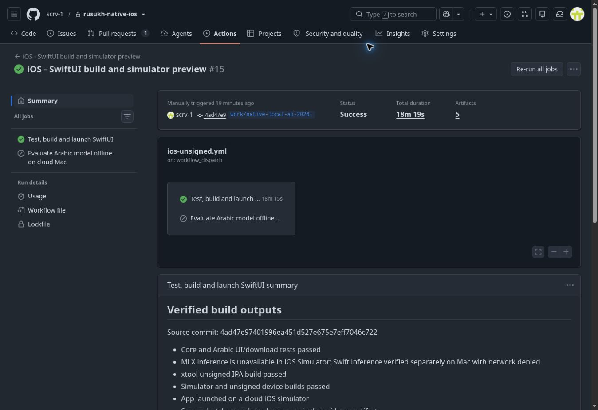
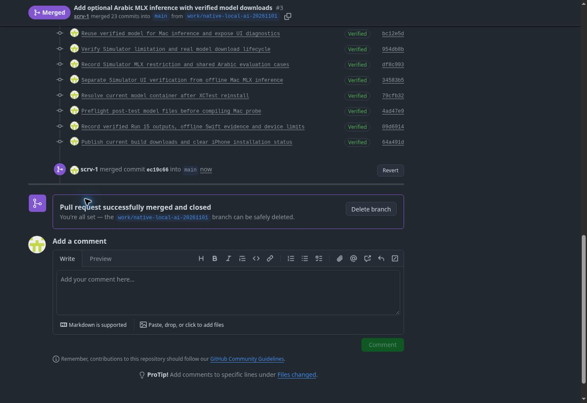

# تقرير تنفيذ رُسوخ — 1 نوفمبر 2026 (الرياض)

**آخر تحقق مكتمل: [Run 15](https://github.com/scrv-1/rusukh-native-ios/actions/runs/41260299774) نجح خلال 18m19s على `4ad47e97401996ea451d527e675e7eff7046c722`: 40 وحدة + 4 رحلات UI، بناء المحاكي والجهاز وxtool، و8 إجابات Swift على Mac مع حظر الشبكة.**

هذا سجل مرحلي؛ معيار النجاح النهائي — تطبيق مستقل على آيفون المستخدم مع ذكاء عربي محلي مختبر — لم يتحقق بعد. لا يوجد ادعاء بتثبيت التطبيق على هاتف.

## خط الأساس والأدلة

المستودع الخاص: https://github.com/scrv-1/rusukh-native-ios . كان main عند `f1891990ceae8ac0f81395da28cfb437a66e5ab7`، وجرى العمل في `work/native-foundation-20261101` دون حذف المشروع أو تغيير خصوصيته.

تم تنزيل حزمة أدلة العملية السابقة رقم 2 وقراءتها فعليًا: https://github.com/scrv-1/rusukh-native-ios/actions/runs/41236553179 . التزام البناء `d617221376c8ea05b5814d6593292288a01f8710`. أثبتت السجلات نجاح 22 اختبار XCTest، وبناء الجهاز غير الموقع، وإطلاق التطبيق على المحاكي. عُرضت صورة المحاكي الأصلية. اختبار Swift Testing الإضافي الذي يقول صفر اختبارات لا يلغي اختبارات XCTest الـ22.

بصمة حزمة الأدلة المنزّلة SHA-256: `76d69c618895317dffa36beaf1e9afa206206e8e0306188e4d297ca0a7f7e293`.

بصمات الملفات الداخلية المسجلة في تلك الحزمة: نسخة المحاكي `56092f461e0b4323aec09d472cdfc616d8f7e95c0461be878cf5e48ef39d5e69`؛ IPA الجهاز `0cd321199ad7fdf2083adcf115533e766c114255dc516b8ca682b55e979b89f6`؛ الصورة `3c1b561c316fc5e09a9d777c334546bedc339ef607c0b0a3250077c5dde971e3`. لم يُعد حساب بصمتي التطبيقين من تنزيل جديد؛ الصورة والحزمة تحققتا محليًا.

## بيئة Work المثبتة وحدودها

- Mac البناء الفعلي في Run 15: macOS 27.0.1 (26A434)، arm64، Xcode 27.1 (27A9275)، Apple Swift 6.4 (swiftlang-6.4.0.34.1)، iOS/Simulator SDK 27.1، Python 3.15.1، Git 2.56.0. راجع [مقتطف البيئة](run-15-environment-excerpt.txt).
- نظام Linux Ubuntu 24.04.3، x86_64، النواة 6.18.57. Terminal وعمليات Python/Node/Git تعمل فعليًا.
- حد الذاكرة عبر cgroup: 8589934592 بايت (8 GiB)، وحصة CPU: `800000 100000` أي 8 أنوية مكافئة. مساحة متاحة عند إعادة الفحص: نحو 58 GiB.
- تنزيل مصادر عامة ممكن؛ لا يعني ذلك اتصالًا مفتوحًا بكل الخدمات. جلسة GitHub في المتصفح مسجلة، بينما Git الخاص عبر Terminal بلا اعتماد، وموصل GitHub أرجع Unknown tool رغم ظهوره في الفهرس.
- uid=0 لم يمنح صلاحية تثبيت apt المطلوبة: فشلت عمليات setgroups/seteuid. استُخدمت أدوات محمولة من مصادرها الرسمية، ولم تُحاول إزالة القيود.
- لا سطح مكتب أصلي متاح عبر الأدوات؛ واجهة رسومية متاحة عبر المتصفح السحابي فقط. لا Xcode ولا iOS Simulator داخل Linux، ولا USB أو usbmuxd يصل إلى آيفون المستخدم.
- التخزين المحلي مؤقت: بعد استئناف الجلسة لم تبقَ حزم الأدوات وتعديلات سابقة؛ أعيد بناء التعديلات من نسخة محفوظة، ثم رُفعت إلى فرع GitHub. لا ضمان لمدة الجلسة أو الاحتفاظ بالمخرجات المحلية.
- اختُبر تنزيل ورفع GitHub. نجح رفع الملفات الفعلية، وقُرئ ملف اختبار الواجهة كاملًا من GitHub (90 سطرًا، 4.48 KB). تعثّر تنزيل ZIP للفرع وبعض Artifacts في جلسة المتصفح الحالية؛ لا يُدّعى تحقق محلي لملف لم يُنزّل.
- الفوترة المعاد فحصها بعد اكتمال Run 15: GitHub Free، Actions استهلكت $4.15 من $12 المضمّنة، خصم $4.15، المستحق $0، التخزين المعروض 0 من 0.5 GB. قد يتأخر تحديث الفوترة؛ الفحص السابق في أكتوبر أظهر $1.67 ضمن الرصيد. حد الإنفاق الإضافي Actions يساوي $0 وUsage blocked. لم يُعدّل أي إعداد فوترة؛ التشغيل يدوي بحد 30 دقيقة واحتفاظ Artifacts 7 أيام.

## جرد الأدوات

الرموز: «مثبت» يعني دليل مباشر من تشغيل أو ملفات/واجهة؛ «مستنتج» يعني متوقع من منصة أو SDK ولم يُجرّب؛ «غير مؤكد» لم يُثبت؛ «غير متاح» فشل أو غياب في البيئة المحددة. الإصدار «غير مقاس» مقصود. إطار العمل ليس برنامجًا مستقلًا، وGitHub Actions خدمة سحابية.

| الأداة/الإصدار والنوع | وظيفتها | Work نفسه | Mac/خدمة سحابية | شُغّلت فعليًا؟ | حساب/صلاحيات | التكلفة والحصة | قرار الاستخدام |
|---|---|---|---|---|---|---|---|
| Bash، إصدار غير مقاس، CLI | سكربتات البناء | مثبت | مثبت ضمن CI | نعم؛ فحص bash -n | لا | مجاني | نعم |
| Xcode 27.1 (27A9275)، IDE/SDK | تجميع iOS | غير متاح | مثبت Run 2 | نعم عبر xcodebuild | Actions؛ Apple لتنزيل Xcode محليًا | ضمن رصيد Actions | نعم، أداة البناء الأساسية |
| Xcode Command Line Tools، حزمة | أدوات Apple | غير متاح | مثبت داخل Xcode؛ الحزمة المستقلة غير مفحوصة | أوامر Xcode تعمل | لا اعتماد Apple للبناء غير الموقع | ضمن CI | نعم |
| xcodebuild، تابع Xcode 27.1، CLI | بناء المحاكي والجهاز والاختبار | غير متاح | مثبت | نعم، Run 2 | GitHub | ضمن CI | نعم |
| xcrun/simctl، تابع Xcode، CLI | اختيار SDK وتشغيل المحاكي | غير متاح | مثبت | نعم، boot/install/launch/screenshot | GitHub | ضمن CI | نعم |
| iOS Simulator، إصدار runtime في artifact، تطبيق | تشغيل SwiftUI | غير متاح | مثبت | نعم، صورة حقيقية Run 2 | لا جهاز فعلي | ضمن CI | نعم؛ لا يعمل على الآيفون |
| XCTest / XCUITest، إطار اختبار | المنطق ورحلة الواجهة | XCTest Linux تعطل | XCTest وXCUITest مثبتان | 40 اختبار محرك و4 رحلات واجهة ناجحة في Run 15 | لا | ضمن CI | نعم |
| Swift Compiler/SPM: Apple 6.4 في CI؛ Linux 6.2.1 جُرّب، CLI | تجميع Swift والحزم | شُغّل --version وdump-package؛ لم تبقَ الحزمة بعد الاستئناف | مثبت Apple 6.4 | Linux swift test تعطل Signal 4، ليس نجاحًا | لا | مجاني + CI | Mac للاختبارات؛ لا إعادة تنزيل Linux الكبيرة |
| Instruments / xctrace، برنامج وCLI | الذاكرة والطاقة والأداء | غير متاح | مستنتج مع Xcode؛ لم يُشغّل | لا | جهاز حقيقي للبطارية والحرارة | الأداة مجانية؛ تشغيل CI محدود | لاحقًا بعد اتصال جهاز |
| LLDB 2103.0.34.103، CLI debugger | تشخيص الانهيار | غير متاح | مثبت في Run 15 | --version فقط؛ لا جلسة debugging | لا | ضمن CI | عند وجود انهيار |
| Accessibility Inspector، تطبيق | تدقيق الوصول | غير متاح | مستنتج مع Xcode؛ GUI غير موصول | لا | Mac تفاعلي | مجاني مع Xcode | لا ادعاء تدقيق VoiceOver كامل |
| SF Symbols، تطبيق/رموز نظام | أيقونات Apple | التطبيق غير متاح | التطبيق غير مؤكد؛ systemImage مستخدم | الرموز تظهر في التطبيق؛ المحرر لا | لا | مجاني وفق رخصة Apple | رموز النظام، بلا تثبيت إضافي |
| Git 2.51.1، CLI | الرجوع والالتزامات | مثبت | مثبت من checkout | نعم | الخاصة تحتاج اعتمادًا؛ المتصفح مسجل | مجاني | نعم |
| GitHub CLI gh، CLI | إدارة PR وActions | غير متاح | غير مؤكد | لا | GitHub | مجاني | لا؛ المتصفح متاح |
| GitHub Actions، خدمة | Mac سحابي وبناء | عبر المتصفح | مثبت runner xcode-27، macOS 27.0.1 arm64 في Run 2 | نعم | حساب GitHub موجود | الرصيد أعلاه، إنفاق إضافي صفر | نعم، تشغيل محدود يدوي |
| GitHub Codespaces، خدمة Linux | تحرير إضافي | الخدمة متاحة بالحساب، لم تنشأ جلسة | ليس Xcode Mac | لا | GitHub | لم يُستهلك؛ حصة الحساب لم تُقَس | لا حاجة |
| Visual Studio Code، محرر | تحرير | wrapper موجود؛ تنفيذ code فشل لأن binary مفقود | غير مؤكد | محاولة فعلية فشلت | لا | مجاني | لا، أدوات الملفات تكفي |
| Cursor، محرر | تحرير | غير متاح | غير مؤكد | لا | حسب الخطة | لم تُفعّل خطة | لا حاجة |
| Codex CLI، أداة | تنفيذ مساعد | CLI غير متاح؛ عامل Work الحالي فعال | غير مؤكد | لا CLI | جلسة ChatGPT الحالية | لا API أو رسوم إضافية فُعّلت | Work فقط |
| XcodeGen، CLI | توليد xcodeproj من YAML | غير متاح | مثبت عبر brew في Run 2 | نعم | لا | مجاني + CI | نعم، البنية الموجودة |
| xtool 1.24.0، CLI/AppImage | بناء نفس مصادر SwiftUI وتغليف IPA | --help/--version نجحا بعد استخراج AppImage؛ SDK غير متاح | بناء Mac مثبت في Run 4 | CLI وبناء نفس التطبيق إلى IPA غير موقع نجحا | توقيع فقط يحتاج Apple/جهاز | مفتوح المصدر؛ لا شراء | نعم، مسار إضافي دون نسخ الكود |
| Tuist، CLI | توليد المشروع | غير متاح | غير مؤكد | لا | حسب الخدمة | لم تُستخدم خدمة | لا، يكرر XcodeGen |
| Fastlane، CLI | نشر وتوقيع آلي | غير متاح | غير مؤكد | لا | Apple للنشر | الأداة مفتوحة؛ نشر Apple منفصل | مؤجل |
| CocoaPods، CLI | اعتماديات | غير متاح | غير مؤكد | لا | لا | مفتوح المصدر | لا حاجة لاعتماديات إضافية |
| Homebrew، مدير حزم | تثبيت XcodeGen | غير متاح | مثبت Run 2 | brew install فعلي | لا | مجاني | في Mac CI فقط |
| SwiftLint / SwiftFormat، CLI | تحليل/تنسيق | غير متاح | غير مؤكد | لا | لا | مفتوح المصدر | لا تثبيت لمجرد القائمة |
| xcbeautify، CLI | تلخيص السجلات | غير متاح | غير مؤكد | لا | لا | مفتوح المصدر | السجلات الخام تكفي الآن |
| Python 3.12.14، runtime | ZIP/بصمات/تحليل ملفات | مثبت | موجود، إصدار CI يسجل | نعم | لا | مجاني | نعم |
| Node.js 24.22.1، runtime | أدوات Work | مثبت | runner يستخدم Node 24 للأفعال | نعم --version | لا | مجاني | عند الحاجة |
| Ruby، runtime | Fastlane/CocoaPods | غير متاح | غير مؤكد | لا | لا | مجاني | لا حاجة |
| jq 1.7، CLI | JSON وسجلات | مثبت | غير مؤكد | نعم --version | لا | مجاني | عند الحاجة |
| ffmpeg 6.1.1، CLI | فيديو المحاكي | موجود؛ أول --version غير صالح | غير مؤكد | لم يُستخدم لإنشاء فيديو | لا | مجاني | صورة واختبارات الآن؛ لا فيديو مصنوع |
| rg / bash / zip / SHA-256، CLI | بحث/تحقق/تغليف | مثبت | shasum وditto وzip مثبتة | نعم | لا | مجاني | نعم |
| SwiftUI، إطار | واجهة عربية أصلية | غير متاح للتنفيذ | مثبت من بناء التطبيق | نعم على المحاكي | لا | ضمن SDK | نعم |
| Foundation Models، إطار | نص توليدي على الجهاز | غير متاح | compiled في التطبيق؛ الاستدلال غير مثبت | بناء فقط؛ شاشة التوفر ليست اختبار ذكاء | جهاز مؤهل وApple Intelligence ونموذج منزل | لا API سحابي | موجود؛ دعم العربية يفحص وقت التشغيل |
| Core ML، إطار | نموذج محلي CPU/GPU/ANE | غير متاح | compiled كنقطة تكامل | لا نموذج مرفق أو استدلال | نموذج مرخّص وجهاز | لا شراء | نقطة تكامل فقط |
| coremltools، Python package | تحويل النماذج | غير مثبت | قابل للتثبيت، غير مختبر | لا | نموذج/ترخيص | مفتوح المصدر | بعد اختيار نموذج مناسب |
| MLX Swift 0.32.3 / mlx-swift-lm 3.32.3 / swift-transformers 1.3.0، مكتبات | نموذج عربي اختياري | غير متاح iOS/Metal | مثبت Mac Swift وبناء iOS في Run 15 | 8 إجابات Swift مع منع الشبكة و4 رحلات UI ناجحة في Run 15؛ بلا استدلال Simulator | تنزيل صريح لأوزان مرخصة، بلا حساب HF | مفتوح المصدر + CI | تجريبي؛ لا اعتماد إنتاجي |
| Metal / Accelerate، أطر | GPU ورياضيات CPU | غير متاح | Metal مثبت في Runs 6–9؛ Accelerate غير مقاس منفردًا | استدلال Python MLX حقيقي على Metal GPU | Apple Silicon سحابي | ضمن CI | Metal مثبت، لا دليل ANE |
| Python MLX 0.32.4 / mlx-lm 0.32.2، مكتبات | تقييم النموذج قبل iOS | غير متاح Metal على Linux | مثبت على Mac | تنزيل ثم توليد 8 حالات مع deny network* | لا حساب HF أو API | مجاني + CI | نعم، التنفيذ والجودة منفصلان |
| Apple Neural Engine، عتاد | تسريع نماذج متوافقة | غير متاح | لا يثبت المحاكي استخدامه | لا | iPhone/Apple Silicon مؤهل | عتاد المستخدم | لا ادعاء قياس |
| Vision، إطار | OCR للصور/PDF | غير متاح | ضمن SDK، غير مستخدم | لا | إذن الكاميرا عند الالتقاط | ضمن SDK | مرحلة الملفات القادمة |
| AVFoundation، إطار | تسجيل الصوت | غير متاح | مثبت، مدمج في التطبيق | تسجيل وحفظ وتشغيل بعد إعادة الفتح في محاكي Run 5 | إذن الميكروفون على الهاتف | ضمن SDK | نعم؛ جودة ميكروفون الهاتف لم تختبر |
| PDFKit / UniformTypeIdentifiers، أطر | PDF واختيار الملفات | غير متاح | مثبت، مدمج في التطبيق | 4 اختبارات PDF فعلية نجحت؛ جودة PDF العربي/منتقي Files لم تختبر | اختيار المستخدم للملفات | ضمن SDK | نعم، استخراج النص دون OCR |
| UserNotifications / BackgroundTasks، أطر | تذكير وخلفية مسموحة | غير متاح | UserNotifications مدمج ويُبنى؛ BackgroundTasks غير مدمج | تسليم الإشعار لم يختبر | إذن الإشعار؛ جدولة النظام | ضمن SDK | تذكير محلي واحد؛ لا تشغيل مستمر |
| SwiftData / SQLite، تخزين | توسع قاعدة البيانات | SwiftData غير متاح؛ sqlite3 CLI غائب | ضمن Apple SDK، غير مستخدم | لا | لا | مجاني | JSON الذري الحالي محفوظ؛ الهجرة تحتاج اختبارًا |
| CryptoKit، إطار | SHA-256 لملفات النموذج | غير متاح Apple | مدمج وبناء iOS نجح Run 12 | نعم Run 13: 12 ملفًا حقيقيًا + عينات valid/corrupt/truncated/oversized | لا حساب أو مفاتيح | ضمن SDK | تحقق سلامة؛ لا ادعاء تشفير تطبيقي |
| NaturalLanguage، إطار | استخراج كلمات محلي غير توليدي | غير متاح | compiled في التطبيق | البناء فقط؛ جودة العربية غير مقاسة | لا | ضمن SDK | موجود، لا يُسمّى LLM |
| Expo Go / EAS، تطبيق وخدمة | معاينة React Native/بناء | صفحة Expo فُتحت؛ تسجيل الدخول لم يكتمل | ليس تشغيل SwiftUI داخل Expo Go | لا مشروع Expo جديد أو build | Expo للحساب؛ Apple للتوقيع | لم يُفعّل دفع | لا إعادة كتابة للتطبيق؛ استكشاف فقط |
| Sideloadly / AltStore / SideStore، أدوات توقيع | تثبيت شخصي | لا جهاز USB؛ غير مثبتة | ليست بديلًا عن اتصال الجهاز الأولي | مراجعة وثائق فقط | Apple Account آمن + اقتران محلي | حساب مجاني يجدد عادة خلال 7 أيام | مسار عند توفر كمبيوتر محلي |

## التكاملات والمهارات

- المتصفح السحابي وTerminal وقراءة/رفع الملفات شُغلت فعليًا. GitHub الخاص مستخدم عبر جلسته المسجلة؛ فشل موصل GitHub السابق لا يعني صلاحية CLI.
- omgskills شُغّل فعليًا: بحث SwiftUI performance ثم قراءة مهارة مثبتة عند `8d90fd121a263355a4fb44fd082af1416a5c1c2a` مع `verified=true`. لم تُثبّت سكربتاته. راجع [مراجعة الأداء](PERFORMANCE_REVIEW.md).
- أدوات البحث والمهارات وLibrary مسجلة؛ قراءة مهارة Library لا تعني رفع مستودع إضافي إليها. شيفرة المشروع وأدلته محفوظة في GitHub. الخدمات المسجلة الأخرى ليست دليل وصول لحساب أو حصة أو قدرة Mac؛ لم تُنشأ جلسة مدفوعة أو تُستدعَ خدمة حوسبة إضافية.

## التغييرات الفعلية

- حماية الحفظ الذري من كتابة JSON أكبر من حد القراءة؛ قراءة محدودة الحجم قبل فك JSON؛ حماية ملف iOS حتى أول فتح للجهاز.
- حماية حدود الجدولة من إنتاج بطاقة لا يمكن حفظها بعد استيراد فترات أو تكرارات قصوى.
- بحث عربي يتجاهل التشكيل والتطويل، مع اختبار أداء لـ1000 ملاحظة. عولج فشل Foundation folding الذي أثبته Run 3 بمعالجة Unicode combining marks.
- روابط الشبكة لا تختار هدفًا اعتباطيًا عند تكرار العنوان؛ حساب مواقع العقد مرة واحدة واستعمال معرفاتها الثابتة.
- أسماء وصول للأزرار ومحرر النص، وإبقاء محرر البطاقة مفتوحًا عند فشل الحفظ؛ نجاح الاستيراد لا يُعلن إذا فشل commit.
- فصل بيانات اختبارات الواجهة عن بيانات المستخدم في DEBUG فقط. الاختبار يعيد إطلاق التطبيق ويتنقل للخلفية ويتحقق من البحث والربط والمراجعة والاختبار؛ صور AI لا تثبت استدلالًا، والكاميرا في المحاكي تختبر رسالة عدم توفرها فقط.
- Package.swift يشارك App وRusukhCore بين XcodeGen وxtool، مع xtool.yml وInfo-xtool.plist وسكربت بناء بلا توقيع أو تسجيل دخول. لا SDK أو بيانات اعتماد مرفقة.
- Workflow يجمع إصدارات الأدوات، XCTest، XCUITest، xcresult، صورًا وسجلات وبصمات، ويصدر مشروع xtool حتى إذا فشل البناء كي لا تضيع المصادر.

الملفات: `Package.swift`, `project.yml`, `xtool.yml`, `Info-xtool.plist`, `.gitignore`, `.github/workflows/ios-unsigned.yml`, `App/{GraphView,HomeView,LibraryStore,NotesView,ReviewView}.swift`, `Sources/RusukhCore/{StudyEngine,StudyModels,StudyRepository}.swift`, `Tests/ReliabilityTests.swift`, `UITests/RusukhUITests.swift`, `scripts/{build-xtool,ui-tests,simulator-preview}.sh`, `docs/XTOOL.md`, `README.md` وهذا التقرير.

## مراجعة مضادة وأخطاء مثبتة

راجع عاملان منفصلان محور المواصفات ومحور المعايير وفق مهارة code-review. كشفا أن تشديد التحقق من بطاقات v1 ذات الفراغات قد يمنع تحميل نسخة قديمة ويقفل التخزين. أُبقي توافق البيانات السابقة وأضيف اختبار رجعي؛ الإدخال الجديد ما زال يُنظف داخل الواجهة. البديل — تغيير نسخة تنسيق البيانات وهجرتها — غير ضروري لهذا الإصلاح الصغير.

التشغيل 3: https://github.com/scrv-1/rusukh-native-ios/actions/runs/41251444589 على `23691127c76b73fe0919dcc878451a2d15b1b540` نفّذ 29 اختبارًا؛ نجح 27 وفشل اختبارا البحث بسبب التشكيل. أثبتت اختبارات النسخ القديمة والحدود والحفظ سلامتها. لم يُبنَ التطبيق في هذا التشغيل لأن اختبارات المحرك أوقفته. أصلح السبب نفسه قبل إعادة التشغيل. ظهر تحذير Node 20 لأفعال checkout/upload-artifact v4، مع فرض Node 24 من GitHub؛ لا يُخفى التحذير ولا يخلط مع خطأ التطبيق.

## نتيجة النسخة الأساسية المختبرة

نجح Run 4: https://github.com/scrv-1/rusukh-native-ios/actions/runs/41251808861 على `cf41e98bb25887a7c716e10f2d7273053be24672`، زمن كلي 6m42s. السجل يثبت 29 XCTest دون فشل في 0.865 ثانية (0.870 زمن كلي)، ومتوسط بحث ألف ملاحظة 0.021 ثانية. نجحت خطوة XCUITest العربية (3m27s)، وبناء المحاكي (11s)، والجهاز غير الموقع (9s)، وبناء xtool 1.24.0 (17s)، وتشغيل المحاكي والتقاطه. كان المحاكي iPhone Duo / iOS 27.1؛ عُدّل اختيار الجهاز في الفرع التالي لتفضيل آيفون اعتيادي عبر runtimes المثبتة.

دُمجت هذه المصادر في PR #1: https://github.com/scrv-1/rusukh-native-ios/pull/1 ؛ التزام الدمج `3d0c62e77ad1492f08119870ddc4fcd224596c03`. لم يُحذف فرع الرجوع.

كل الروابط التالية تخص Run 4 وتتطلب حسابًا مخولًا للمستودع الخاص. الاحتفاظ 7 أيام. البصمات أدناه لحاوية Artifact ZIP كما عرضها GitHub، وليست بصمة IPA الداخلي. رفض المتصفح الحالي تنزيل الحزمة بـERR_BLOCKED_BY_CLIENT؛ لذلك لم تُقرأ صور Run 4 محليًا ولم يُدّع تحقق بايتاتها. الأدلة الأقدم Run 2 قُرئت فعلًا، كما وُثّق أعلاه.

| المخرج | رابط Artifact | SHA-256 للحاوية |
|---|---|---|
| الأدلة والصور وxcresult، 6.24 MB | https://github.com/scrv-1/rusukh-native-ios/actions/runs/41251808861/artifacts/13061831066 | `fbaaf1b5cec88ea733aa00ce68bb4c69d3f23e517af38b28f316ca0aa4b32d5e` |
| تطبيق المحاكي، 1010 KB | https://github.com/scrv-1/rusukh-native-ios/actions/runs/41251808861/artifacts/13061646572 | `1ee264ef46011cbb5e510f1d87eba001b49bbd4aa6e14aa80851051c2506ca2d` |
| IPA غير موقع من Xcode، 329 KB | https://github.com/scrv-1/rusukh-native-ios/actions/runs/41251808861/artifacts/13061811059 | `b3c92669ec02ad64e071862b73ea61a8cef1bb0f90fbc6d51352dc83d3b1a41b` |
| مشروع xtool، 44.2 KB | https://github.com/scrv-1/rusukh-native-ios/actions/runs/41251808861/artifacts/13061616586 | `0f4011aaddb464b945ab50644cde4da0636f82712fa50b2a3fc18aa22de60bba` |
| IPA غير موقع من xtool، 327 KB | https://github.com/scrv-1/rusukh-native-ios/actions/runs/41251808861/artifacts/13062000593 | `af5943c979da7ff98c5c1d59d0a70b884bdbf40bc53350b775f3cb4045624922` |

## نتيجة إضافات الوسائط — Run 5

نجح https://github.com/scrv-1/rusukh-native-ios/actions/runs/41253079839 على `0a37b6501bb5cb6c543a0d7cde2b79d7b114ddcc` في 7m19s. دُمج PR #2: https://github.com/scrv-1/rusukh-native-ios/pull/2 ؛ التزام الدمج `eff6baa945ff7cea91055f1be7819b9fcf55413e`.

- 37 اختبار محرك دون فشل في 1.136 ثانية (1.142 كلي). منها 4 لاستخراج PDF حقيقي ورفض التالف/الخالي من النص/الكبير وكثرة الصفحات، و3 لحفظ الصوت وتوافق النسخ القديمة ومنع إفساد الحفظ عند تجاوز الحجم.
- نجح بناء المحاكي والجهاز وxtool؛ نجح اختبار رحلة الدراسة العربية واختبار تسجيل المحاكي وحفظ المرفق ثم إعادة تشغيله بعد إنهاء التطبيق وإطلاقه.
- المحاكي المختار iPhone 17. بيانات الاختبار منفصلة في DEBUG. لا يثبت هذا أداء ميكروفون iPhone حقيقي أو أصوات المستخدم؛ التسجيل التجريبي من مدخل المحاكي.
- متوسط بحث 1000 ملاحظة 0.024 ثانية، بانحراف نسبي 44.544%؛ قياس واحد بلا baseline أداء معتمد. اختبار encode/decode لألف ملاحظة سجل فرق ذاكرة متوسط 6.554 kB وقمة عملية 388166.246 kB. القمة تشمل عملية XCTest وما سبقها من اختبارات حد الحجم؛ ليست ذاكرة تطبيق iPhone ولا تكلفة تلك العملية وحدها.
- التسجيل AAC أحادي 22050 Hz و64000 bit/s، حد 180 ثانية و2MB، يتوقف بالخلفية/المقاطعة، ومؤقتاته تُنظف. المرفق اختياري في نسخة JSON v1 كي تبقى النسخ القديمة قابلة للقراءة؛ الرجوع إلى إصدار قديم قد يُسقط المرفق الصوتي عند إعادة الحفظ، فاحتفظ بنسخة احتياطية.
- PDF: أقل من 20MB، حتى 100 صفحة ومليون محرف. الملفات الممسوحة بلا نص تُرفض برسالة واضحة؛ OCR غير مضاف. تذكير يومي محلي واحد بمحتوى عام يحفظ خصوصية الملاحظات، دون APNS أو تشغيل مستمر. تسليم التذكير غير مختبر بعد.
- المراجعتان المستقلتان كشفتا callback صوت قديمًا قد يؤثر في تسجيل جديد، وفشل حفظ صوت قد تخفيه مغادرة المحرر. أضيفت مطابقة هوية recorder/player ونتيجة Bool تمنع إغلاق المحرر عند فشل finalize.

الملفات الإضافية: `App/VoiceAttachment.swift`, `App/ReviewReminderView.swift`, `Sources/RusukhCore/PDFTextImport.swift`, `Tests/AudioStorageTests.swift`, `Tests/PDFImportTests.swift`، وتعديلات `HomeView`, `LibraryStore`, `NotesView`, `StudyModels`, `ReliabilityTests`, `RusukhUITests`, `Info-xtool.plist`, `project.yml`, `simulator-preview.sh`, `ui-tests.sh`.

| مخرج Run 5 | الرابط | SHA-256 لحاوية Artifact |
|---|---|---|
| الأدلة وxcresult والصور، 53.1MB | https://github.com/scrv-1/rusukh-native-ios/actions/runs/41253079839/artifacts/13061742883 | `a13bed53202384d4d031f4836158e342974ba0d81687131d9a504581a206e822` |
| المحاكي، 1.19MB | https://github.com/scrv-1/rusukh-native-ios/actions/runs/41253079839/artifacts/13062062102 | `205b317249d48b5c0a2b63d8f8960b24b3b7e900f480f4abea25a9d13683e722` |
| IPA Xcode غير موقع، 388KB | https://github.com/scrv-1/rusukh-native-ios/actions/runs/41253079839/artifacts/13061817670 | `6db77ab9fb76af0b81ad878248b7c455e8fb0d2c490449763e9847a77cccef7c` |
| مشروع xtool، 52KB | https://github.com/scrv-1/rusukh-native-ios/actions/runs/41253079839/artifacts/13061982316 | `c513c8d7a4d351af001f89d1054b501c7daf5f5855b14e88dbb3483dc7b2a892` |
| IPA xtool غير موقع، 390KB | https://github.com/scrv-1/rusukh-native-ios/actions/runs/41253079839/artifacts/13061937424 | `e28f1954982fb8a1f97a4fc8a1070f1d9bf0047b21c39be06f953bbcf40de6ac` |

## تقييم عربي محلي منفصل — Run 6

الرابط: https://github.com/scrv-1/rusukh-native-ios/actions/runs/41253552184 على `92dadf8519614998266ea7f9ba1f6a475dd8e788`. نجح تنفيذ الاستدلال على Mac عبر Metal GPU، باستخدام Python MLX 0.32.4 وmlx-lm 0.32.2، وليس داخل تطبيق iOS. النموذج الرسمي `Qwen/Qwen3-0.6B-MLX-4bit` عند `173234aa840d113125e9f2271100ddbaf16c9620` بترخيص Apache-2.0؛ ملفات التنزيل 332781332 بايت. حُفظ نص الترخيص وبصمات الملفات والاعتماديات.

فُصل تنزيل الأوزان عن الاستدلال. شُغّل الاستدلال تحت macOS `sandbox-exec` مع deny network*؛ محاولة اتصال أعادت EPERM (1) ثم ولّدت العملية 4 إجابات دون شبكة. لا يُعتمد على HF_HUB_OFFLINE وحده لإثبات ذلك. استخدمت أسئلة اصطناعية فقط دون ملاحظات المستخدم.

**رُفض النموذج الصغير للجودة رغم نجاح التشغيل.** في بطاقة عن الماء قال إن الماء يصنع من الهيدروجين والكربون، وهي معلومة خاطئة تناقض النص المعطى. الملخص تضمن أخطاء عربية، وإجابة باريس لم تلتزم كلمة واحدة. لذلك لا تُعد علامة Actions الخضراء موافقة على جودة نموذج.

زمن الحالات 0.14–2.25 ثانية، سرعة التوليد المسجلة 185–258 token/s، قمة MLX تراكمية 0.5786GB وقمة RSS تراكمية 689324032 بايت. هذه قياسات Mac ببيانات قصيرة؛ ليست سرعة أو بطارية الآيفون ولا دليل استخدام ANE. قياسات القمة تراكمية، لا تخص كل سؤال منعزلًا.

Artifact: https://github.com/scrv-1/rusukh-native-ios/actions/runs/41253552184/artifacts/13062207304 ؛ بصمة الحاوية `5b13e400f9713dc69218dd5fd79b1e6c8e0bb7b18d7daaaebc4e80cd7ca00d7d` (8.1KB). توسع الاختبار التالي إلى 8 أسئلة ونماذج رسمية مثبّتة 1.7B/4B للتحقق من بديل أقوى قبل دمج أي منها.

## تصحيح اختبار 1.7B — Run 7 وRun 8

Run 7: https://github.com/scrv-1/rusukh-native-ios/actions/runs/41253876291 على `ee78dbe3c4d10cb1cbbf71b37f2dfade49cbb846`. كشف فحص المخرجات أن قالب tokenizer الرسمي القديم يتجاهل enable_thinking=False؛ استنفد معظم حد 128 token قبل الجواب النهائي. نجاح العملية لا يجعل هذه مقارنة جودة صالحة. جرى فحص tokenizer_config.json من الإصدار المثبت، ثم إضافة بادئة Qwen3 الرسمية لوضع عدم التفكير مع تحقق صريح، وtemperature=0.7 وtop_p=0.8 وtop_k=20 وseed=42 وفق بطاقة النموذج.

Run 8: https://github.com/scrv-1/rusukh-native-ios/actions/runs/41254181531 على `b8939846f360d3d0b6e2944fa4b05fb9f3333d64`. اكتمل في 44 ثانية؛ توليد 8 إجابات تحت منع شبكة مثبت بـEPERM. النموذج Qwen/Qwen3-1.7B-MLX-4bit عند `21457c6f51ed54a7c16e988c0844db973815c137`. لا يعتمد الحكم على لون Actions: الملخص أسقط نصف النص، والبطاقة بلا سؤال، وجواب العمر كرر «لا تخمّن»، وشرح الاسترجاع النشط خلطه بتذكر أحداث شخصية. أجاب باريس والنفي والمواعيد ودرجة التجمد بصورة مقبولة ضمن هذه الأمثلة المحدودة. **لم يُعتمد هذا الإعداد لتوليد محتوى تعليمي تلقائي.**

القمة التراكمية MLX 1.2712GB، RSS 1291173888 بايت، السرعة 112–177 token/s. السؤال الأول 4.10 ثانية، والبقية 0.19–0.55 ثانية. هذه قياسات Mac فقط. الحزمة 9682 بايت: https://github.com/scrv-1/rusukh-native-ios/actions/runs/41254181531/artifacts/13061718797 ؛ SHA-256 `d2daa50951fb8785e8e75ed138c4eb879732d90468c9c5199d6da9b35574008e`.

## تقييم 4B — Run 9

https://github.com/scrv-1/rusukh-native-ios/actions/runs/41254507208 على الالتزام نفسه `b8939846f360d3d0b6e2944fa4b05fb9f3333d64`، النموذج Qwen/Qwen3-4B-MLX-4bit عند `52a5ab34fa604bc8af6d3ce0cac0cab10b7eb495`، 51 ثانية كليًا، 8 إجابات تحت منع شبكة مثبت. حسّن السؤال/الجواب والإقرار بالمعلومة الناقصة، لكن ظهرت كلمة صينية في جواب النفي وكلمة روسية وتعريف خاطئ في شرح الاسترجاع النشط، مع أخطاء في الملخص. لم يعتمد هذا الإعداد لتوليد المحتوى العربي تلقائيًا.

السرعة 61–104 token/s، القمة التراكمية MLX 2.5011GB وRSS 2509914112 بايت. لا تستنتج ملاءمة الآيفون من هذا القياس. Artifact 9.5KB: https://github.com/scrv-1/rusukh-native-ios/actions/runs/41254507208/artifacts/13062317560 ؛ SHA-256 `cd6a777cf0a6275308097467121577589565719ef3e475977d6816883a82d0c4`.

## المرشح الأحدث Instruct-2507 — Run 10

https://github.com/scrv-1/rusukh-native-ios/actions/runs/41254822066 على `0430b6d1544aa6d99d7ab6ef33090de2af741434` اختبر mlx-community/Qwen3-4B-Instruct-2507-4bit عند `50d427756c6b1b2fe0c0a10f67fbda1fc8e82c1b`. هذه نسخة MLX مجتمعية منشورة، وليست تحويلًا نفذناه بأنفسنا. أصل النموذج Qwen/Qwen3-4B-Instruct-2507؛ نُزّل ترخيص Apache-2.0 الأصلي من `cdbee75f17c01a7cc42f958dc650907174af0554` لأن حزمة التحويل لا ترفق LICENSE. حُفظ مصدر الترخيص وبصمته.

الإصدار Instruct غير تفكيري أصلًا، فلا تضاف له بادئة think المستخدمة مع النسخ القديمة. أعطى في هذه الحالات الثماني ملخصًا يحفظ الفكرتين، وبطاقة س/ج صحيحة، و«غير مذكور» للعمر، ونفيًا صحيحًا، وثلاثة مواعيد فقط، وتعريفًا ومثالًا صحيحين للاسترجاع النشط، وسؤال التجمد وجوابه دون معلومة إضافية. **مقبول كمرشح لتجربة الدمج فقط، لا شهادة جودة عامة أو استعداد إنتاجي.**

السرعة 60–100 token/s؛ أول حالة 4.55 ثانية والباقي 0.37–1.35 ثانية. قمة MLX التراكمية 2.6340GB وRSS 2588246016 بايت. الحجم نحو 2.28GB؛ مناسبته للهاتف غير مثبتة. الاستدلال Python على Mac Metal مع منع الشبكة مثبت بـEPERM. حزمة 10KB: https://github.com/scrv-1/rusukh-native-ios/actions/runs/41254822066/artifacts/13062548597 ؛ SHA-256 `85f53a3d4f2a13f551383909590617a79b9aeaa1f27d30335894767e399f1324`.

## محرك Swift فعلي دون شبكة — Run 11

https://github.com/scrv-1/rusukh-native-ios/actions/runs/41255301711 على `8f169c7bb9909d9c43dbce69b3d90d2a33328203`. نجح job في 6m08s؛ ترجمة Swift/MLX عبر Xcode استغرقت 4m51s، والاستدلال 14 ثانية. الاعتماديات المباشرة مثبتة: mlx-swift 0.32.3، mlx-swift-lm 3.32.3، swift-transformers 1.3.0. ظهر Metal device باسم Apple Paravirtual device.

قرأ Swift الأوزان المحلية وولّد الحالات الثماني تحت sandbox منع الشبكة؛ فحص socket يرفض ECONNREFUSED ويقبل EPERM/EACCES فقط. لا خادم توليد أو API. أول إجابة مع التحميل 7.82s، والبقية 0.35–1.56s، وسرعة التوليد 56.5–72.1 token/s. لم يقس هذا الاختبار قمة ذاكرة Swift؛ لا تُنسب له أرقام Python.

راجعت الإجابات الفعلية: باريس والبطاقة والمعلومة الناقصة والنفي والمواعيد والتجمد والملخص سليمة لهذه الأمثلة؛ شرح الاسترجاع النشط أقل دقة من جواب Python، إذ أضاف قيدًا غير لازم عن عدم تكليف المعلم. يبقى النموذج تجريبيًا مع مراجعة بشرية. لا تطابق بتًا بين Swift وPython: حدود الرموز وKV وإعادة ضبط seed مختلفة.

حزمة السجلات: https://github.com/scrv-1/rusukh-native-ios/actions/runs/41255301711/artifacts/13062749360 ؛ SHA-256 `240d209ba2543b35a15976cc3626bfcb6506c162ba2dab86623747dbbc71ed6e`. هذا يثبت Swift على Mac، وليس تشغيل النموذج داخل iOS أو تثبيته على هاتف. اختبار iOS التالي منفصل.

## دمج النموذج الاختياري في iOS — Run 12 وتصحيحه

Run 12: https://github.com/scrv-1/rusukh-native-ios/actions/runs/41256278824 على `badb1d32386279e0c5217a4b2b32ec7a721691ea`، 7m36s. نجحت خطوة اختبارات المنطق، وبناء المحاكي 1m21s، وبناء iPhone غير الموقع 2m39s، وتشغيل المحاكي والتقاطه 1m54s، وxtool خلال 17s. **لم تنفذ اختبارات الواجهة الجديدة**: فشلت خطوة تجهيز الأوزان لأن سكربت الصور أطفأ المحاكي، ثم طلب سكربت التجهيز حاوية تطبيقه وهو Shutdown. الخطأ الفعلي `com.apple.CoreSimulator.SimError code 405` و`Unable to lookup in current state: Shutdown`، وخروج simctl بالرمز 149.

التصحيح الأصغر: تشغيل المحاكي وانتظار bootstatus قبل التجهيز؛ سكربت UI يعيد استخدام المحاكي المفتوح بدل محاولة boot مكرر. لم نغيّر منطق النموذج استجابة لهذا العطل البيئي. أضيف تحقق من وجود وصحة PrivacyInfo.xcprivacy في تطبيق الجهاز المبني، بدل الاكتفاء بوجود الملف في المصدر.

التغييرات المحفوظة في `work/native-local-ai-20261101`:

- `App/ArabicModelRuntime.swift`: محرك Swift مشترك مع تجربة Mac الناجحة، تحميل محلي للـtokenizer، 256 رمز توليد و2048 KV، حد مدخلات، cache بحد 64MiB وإفراغه عند التحرير. ليس API سحابيًا.
- `App/ArabicModelAssets.swift`: 12 ملفًا مثبتًا بالنسخة والحجم وSHA-256، إجمالي 2,278,981,040 بايت. التنزيل بإجراء المستخدم عبر Wi-Fi، فحص مساحة 5GB، تنزيل مؤقت محدود الحجم، تحقق streaming، واستبعاد الأوزان من iCloud backup. العلامة النهائية لا تكتب قبل اكتمال التحقق؛ الملفات موجودة في مجلد معزول عند `-ui-testing` في Debug.
- `App/ArabicModelView.swift` و`App/LocalAIView.swift`: حالة تحميل وإلغاء وحذف بتأكيد، وبوابة واحدة تمنع تزامن Apple وQwen، وإيقاف العمل عند الخلفية/تحذير الذاكرة/الحرارة المرتفعة. أوزان النموذج لا تضاف للنسخة الاحتياطية للملاحظات. الرد يبقى قابلًا للمراجعة ولا يضيف بطاقات تلقائيًا.
- `Sources/RusukhCore/LocalModelRequest.swift` و3 اختبارات: رفض المرجع الأطول من 2000 محرف بدل إسقاط نهايته، ورفض الطلب الفارغ/الأطول من 1500. لا إخفاء لحقيقة خارج الجزء المقصوص.
- `project.yml` يثبت إصدارات MLX وTokenizers؛ مسار xtool يبني الوظائف السابقة ومحرك Apple، بينما MLX مخصص لبناء Xcode الحالي. `PrivacyInfo.xcprivacy` يصرح باستخدام مساحة القرص وبيانات الملفات المحلية؛ لا tracking أو collected data.
- أدوات تجهيز نموذج CI وتحقيقه، و4 رحلات UI إجمالًا. محاولة إثبات التوليد في المحاكي فشلت في Run 13؛ صُحح نطاق الاختبار لاحقًا إلى الدراسة والصوت وحالة عدم دعم MLX والتنزيل/الإلغاء/إعادة التنزيل. الاستدلال الحقيقي يُختبر على Mac منفصلًا، وليس بمحاكاة إجابة داخل iOS.

راجع عاملان منفصلان التصميم والتغييرات: عولج خطر اقتصاص المرجع، وتشغيل محركين متزامنين، وتراكم ذاكرة MLX. بقيت حدود معلنة: شرط RAM تجريبي 8GB ليس ضمانًا ضد jettison؛ فحص الجاهزية لاحقًا يراجع العلامة وأحجام الملفات ولا يعيد hash لكل بايت في كل فتح؛ إثبات الإلغاء لا يعني بالضرورة وصول التنزيل إلى ملف الأوزان الكبير. لا توجد حتى الآن قياسات MLX على هاتف فعلي.

Run 13 بدأ على `443da1b14351edaeef305e8299203e9cec6bb6f6`: https://github.com/scrv-1/rusukh-native-ios/actions/runs/41257552332 . نجحت 40 وحدة XCTest دون فشل في 1.134 ثانية (1.141 زمن كلي)؛ تشمل 3 اختبارات جديدة للمرجع الكامل وحدود الطلب. متوسط بحث ألف ملاحظة 0.024 ثانية، RSD 41.290%؛ قياس الذاكرة delta بمتوسط 9.830kB وRSD 81.650%، وقمة عملية الاختبار 388300.595kB المتأثرة باختبارات JSON الكبيرة السابقة. لا baseline أداء معتمد ولا قياس هاتف أو ذاكرة MLX من هذه الأرقام. نجح أيضًا تجهيز النموذج في 2m12s؛ طابقت الملفات الـ12 أحجامها وبصماتها، وأعاد Swift/CryptoKit التحقق من جميع الملفات ثم رفض عينة تالفة ومبتورة ومتجاوزة للحجم (`MODEL_INTEGRITY_TESTS_PASSED`). راجع [مقتطف التحقق](run-13-model-integrity-excerpt.txt). انتهى Run 13 بالفشل خلال 13m26s: 4 رحلات UI، نجحت رحلة الصوت فقط، وفشلت 3 في 159.658 ثانية. حدث انهيار عند مغادرة شاشة الذكاء وعند حذف أوزان لم يستدل بها؛ زر التوليد لم يعثر عليه بمعرفه. لم يحدث استدلال iOS ناجح. سجل ترجمة MLX أظهر تحذيرات C++17 extension في شيفرة Metal المولدة من الاعتمادية؛ لم تمنع بناء المحاكي. لا ادعاء بناء خالٍ من التحذيرات.

### سبب الفشل وتصحيح نطاق اختبار MLX

مراجعة [وثائق الإصدار المثبت 0.32.3](https://swiftpackageindex.com/ml-explore/mlx-swift/0.32.3/documentation/mlx/running-on-ios) و[تفسير مطوري MLX](https://github.com/ml-explore/mlx/issues/2605) أكدت أن iOS Simulator لا يوفر عائلة Metal المطلوبة. لم يكن افتراض إمكان تشغيل الاستدلال عليه صحيحًا. استدعاء `MLX.Memory.clearCache()` غير المشروط عند مغادرة الشاشة أو الحذف كان يهيئ MLX رغم عدم تحميل النموذج؛ يتسق ذلك مع موضعي الانهيار. لم يُقرأ stack trace كامل محليًا، لذا يوصف تفسير مسار الانهيار بالسبب المرجح المدعوم بالكود والتوثيق؛ إعادة الاختبار هي التحقق التالي.

أضيف منع صريح لكل استدلال/تنظيف MLX في Simulator، وتنظيف lazy على Mac/الهاتف بعد بدء المحرك فقط. تعرض الواجهة عدم الدعم حتى قبل تنزيل 2.28GB. عزل معرف زر توسيع القسم عن حاويته، لأن السجل سمّى زر حذف الأوزان بمعرف القسم بينما لم يجد معرف التوليد؛ اختبار الواجهة التالي يتحقق من التصحيح. الرحلة البديلة تثبت حالة عدم الدعم والعودة الآمنة للشاشات فقط، ولا تُحتسب اختبار استدلال. يظل تنزيل الملفات والتحقق منها وإلغاؤه وإعادته اختبارًا حقيقيًا في التطبيق.

أضيفت خطوة Mac مستقلة في التشغيل التالي لإعادة بناء **المحرك الحالي نفسه** وتشغيل 8 أسئلة عربية مع `deny network*` وفحص EPERM/EACCES. تستخدم الأوزان التي نزلها التطبيق في الاختبار، ولا تنزل نسخة ثالثة. تسجل قمة وحالة ذاكرة MLX التراكمية ثم الحالة بعد التحرير؛ هذه أرقام Mac pool وليست RSS أو بطارية/حرارة iPhone. راجع عاملان التعديل ولم يجدا مانعًا، وأصلحت ملاحظة إظهار عدم الدعم قبل التنزيل. صدرت نتائج إعادة التحقق في Run 14 ثم Run 15 أدناه.

حزمة Run 13 التي تحفظ الفشل: https://github.com/scrv-1/rusukh-native-ios/actions/runs/41257552332/artifacts/13064121572 (153MB)، SHA-256 للحاوية كما عرضه GitHub: `ed163f29525ca70d7e86b16893a5aa08f3cadfb72e4d23cb42e64a4868c82179`. لم تُنزّل الحزمة محليًا؛ قرئت سجلاتها الظاهرة عبر GitHub.

## إعادة التحقق بعد حماية Simulator — Run 14

التشغيل: https://github.com/scrv-1/rusukh-native-ios/actions/runs/41258893107 ؛ الالتزام `34583b5d94d05bb83ffe1387868feb137ccc744d`، و[طلب الدمج #3](https://github.com/scrv-1/rusukh-native-ios/pull/3). نجحت 40 وحدة XCTest دون فشل في 1.174 ثانية (1.180 كليًا)، [مقتطف السجل](run-14-core-test-excerpt.txt). متوسط البحث 0.025 ثانية وRSD 49.975%؛ قمة عملية XCTest نحو 388428kB وليست ذاكرة MLX/الهاتف. نجحت ترجمة المحاكي في 1m20s والجهاز في 2m39s، والتشغيل والصورة في 1m45s، وxtool في 18s، وتجهيز النموذج في 2m02s. نجحت رحلات الواجهة الأربع دون فشل أو تخطي في 178.099 ثانية (178.107 كليًا): الدراسة والحفظ، الصوت وإعادة الفتح، رسالة عدم دعم MLX والعودة الآمنة، وحذف الأوزان وإلغاء تنزيلها وإعادة تنزيلها والتحقق. المحاكي iPhone 17 / iOS 27.0، arm64. صدّرت xcresult اثنتي عشرة صورة اختبار، إضافة إلى صورة الإطلاق. راجع [مقتطف UI الفعلي](run-14-ui-test-excerpt.txt). انتهى التشغيل بالفشل الكلي في 17m43s رغم نجاح اختبارات التطبيق؛ خطوة Mac المنفصلة ترجمت المحرك ثم فشلت قبل التوليد بـconfig.json مفقود/exit 133. حفظ سكربت التجهيز UUID حاوية ما قبل XCTest، بينما أعادت الاختبارات تثبيت التطبيق فتغير مسار البيانات. هذا خطأ تمرير مسار في CI وليس دليل فشل أوزان أو استدلال iOS. [مقتطف الفشل](run-14-mac-path-failure.txt).

ظهر تحذير AVAudioSession بأن setActive المتزامن على main thread قد يسبب عدم استجابة؛ الكود الحالي يستدعيه عند بدء/إنهاء التسجيل والتشغيل. اختبار التسجيل والحفظ والتشغيل نجح، لكن هذا ليس إثبات غياب توقف لحظي. يلزم نقل إدارة جلسة الصوت إلى مسار متسلسل غير حاجب مع اختبار سباقات الإلغاء/الخلفية، ثم قياس الهاتف. ظهرت أيضًا رسائل Xcode عن invalidDigitCount لإصدار SDK وgetpwuid_r؛ لم تمنع نجاح الاختبارات. لا ادعاء سجل خالٍ من التحذيرات.

أُصلح `scripts/ui-tests.sh` ليطلب الحاوية الحالية عبر simctl بعد نجاح الاختبارات وقبل shutdown، ويفحص config/weights ويحدث المسار. خطوة Mac تفحصهما قبل الترجمة أيضًا. راجع عاملان التعديل دون موانع، واجتاز bash -n وgit diff --check. أعيد التشغيل على `4ad47e97401996ea451d527e675e7eff7046c722`: [Run 15](https://github.com/scrv-1/rusukh-native-ios/actions/runs/41260299774)، ونجح كما هو موثق أدناه. لم يتغير كود التطبيق بين Run 14 وRun 15.

حزمة أدلة Run 14: https://github.com/scrv-1/rusukh-native-ios/actions/runs/41258893107/artifacts/13064418785 ، 53MB، SHA-256 للحاوية `78cd3c1efb7cfdb7544987141057ecaf1bd7847551443bcda9f5e95ec634f1f8`.

## التحقق الناجح — Run 15

المصدر `4ad47e97401996ea451d527e675e7eff7046c722`. نجحت 40 وحدة في 1.097 ثانية (1.104 كليًا)، ومتوسط بحث ألف ملاحظة 0.025s مع RSD 47.047%. متوسط delta الذاكرة 16.384kB مع RSD 109.545%؛ متوسط قمة عملية XCTest 388192.461kB، وليس استدلال MLX أو RSS الهاتف. [مقتطف السجل](run-15-core-test-excerpt.txt). نجح بناء المحاكي 1m21s والجهاز 2m43s وتشغيله وتصويره 1m48s وxtool في 17s. نجحت 4 رحلات UI دون فشل أو تخطي في 178.184s (178.191 كليًا)، وخطوة UI كاملة 4m00s. تأكدت العلامة `POST_UI_MODEL_DIRECTORY_VERIFIED` بعد طلب الحاوية الحالية، واكتمل تصدير 12 صورة. [مقتطف UI](run-15-ui-test-excerpt.txt). نجح اختبار Mac وتغليف المخرجات؛ الزمن الكلي 18m19s، job البناء 18m15s. نجحت خطوة Swift Mac في 4m19s بما فيها الترجمة والاستدلال. ظهرت `NETWORK_DENIAL_CONFIRMED` بعد EPERM/EACCES، وMetal باسم Apple Paravirtual device، ثم 8 إجابات فعلية دون اقتطاع. [مقتطف الاستدلال والبصمات](run-15-swift-offline-and-checksums.txt).

أول إجابة مع تحميل النموذج 7.60s، والبقية 0.34–1.55s؛ سرعة التوليد 56.95–69.36 token/s. قمة MLX التراكمية 2,564,247,224 بايت (نحو 2.56GB)، وبعد unload: active=4064 وcache=0. هذا pool في Mac وليس RSS الهاتف؛ يحتفظ probe بالمحرك بين الأسئلة، بينما واجهة iOS تفرغه بعد الطلب، فلا تُنسب سرعة الأسئلة الدافئة لطلبات التطبيق.

المراجعة اليدوية: الملخص وباريس والماء/الأكسجين والمعلومة الناقصة والنفي والمواعيد والتجمد مناسبة لهذه الأمثلة. شرح الاسترجاع النشط أضاف «دون تكليف معلّم»، وهو قيد غير لازم؛ هذه ليست دقة معيارية 7/8 ولا شهادة جودة عربية عامة. يبقى النموذج اختياريًا تجريبيًا مع مراجعة بشرية. تحقق plutil من PrivacyInfo.xcprivacy الموجود داخل تطبيق الجهاز وأعاد OK. تحذيرات الصوت وNode واعتماديات Metal المذكورة أعلاه باقية.

## ملفات Run 15 وبصماتها

الروابط تتطلب حسابًا مخولًا للمستودع الخاص، ومدة الاحتفاظ 7 أيام. لم تُنزّل الحزم الجديدة محليًا بسبب قيد تنزيل المتصفح الموثق سابقًا؛ قُرئت السجلات ونتيجة رفعها وبصماتها من GitHub. السجل يؤكد تصدير الصور، لكن لم تُدقق الصور الحالية بصريًا هنا؛ الصورة المعروضة أعلاه دليل صفحة نجاح البناء وليست صورة هاتف. لا فيديو أو معاينة محاكي تفاعلية متاحة.

| المخرج | الرابط | SHA-256 لحاوية Artifact ZIP كما عرضها GitHub |
|---|---|---|
| الأدلة و12 صورة UI + صورة الإطلاق وxcresult والسجلات، 51.8MB | https://github.com/scrv-1/rusukh-native-ios/actions/runs/41260299774/artifacts/13065930057 | `c23db49cf958ced08237d2d273b2b2d945b7faa5660057bd7e4b3b3f879ffad5` |
| تطبيق المحاكي، 15.6MB | https://github.com/scrv-1/rusukh-native-ios/actions/runs/41260299774/artifacts/13065915155 | `34f0391a4db7dfe4a63d95344396e0e1d137cd0cf45cf748dc4cbbd19582cb4b` |
| IPA Xcode غير موقع، 8.74MB | https://github.com/scrv-1/rusukh-native-ios/actions/runs/41260299774/artifacts/13065372195 | `a98917c8f07b64b4e939672d35d3056769e58dc61ba8c9a548b9ee8b7cbb1ce9` |
| مشروع xtool، 94.9KB | https://github.com/scrv-1/rusukh-native-ios/actions/runs/41260299774/artifacts/13065407143 | `d41b364661f9528ad999df6a370fabc4feb128c08420729deaa5f681eb45b95a` |
| IPA xtool غير موقع، 405KB | https://github.com/scrv-1/rusukh-native-ios/actions/runs/41260299774/artifacts/13065407146 | `1ac7cccaed241f96d7f2bce6597c76c8614adbf276e3f7f0090f60b5cf2fbda2` |

بصمات الملفات **داخل** الحاويات، المحسوبة على runner وقرئت من سجل `Record artifact checksums`:

- `RusukhNative-simulator.zip`: `cfe9e2f9b1682b3b66c21cfd441d5a60983eee03f3bae1bf1c92340f2c09c637`.
- `RusukhNative-unsigned.ipa`: `1a502ed2e0e3b458e26544ac542e362661b9e8f806fe5631e68bf5f2bbbe8d60`.
- `RusukhNative-xtool-unsigned.ipa`: `2c809d6749684742a9a749aa9bad1076daf3ff027f0c4486ec117a463e77aba7`.
- `simulator-home.png`: `969b7c75f4a7ea7322542c8ea9afb466041df910472cd92e181db7af0c2647ff`.
- `RusukhNative-xtool-project.zip`: `b4314529019a763d62f36606cd20b87e4311f6b608f0f4a176d9cd0009be7257`.

دُمجت التغييرات في main عبر [PR #3](https://github.com/scrv-1/rusukh-native-ios/pull/3)، بالتزام الدمج `ec19c6641415412faaf6cac3affcc583255563ac`. بقي فرع `work/native-local-ai-20261101` محفوظًا كنقطة رجوع. تحديث التقرير بعد الدمج وثائق فقط.

 كود البناء المختبر هو الالتزام أعلاه؛ تحديثات التقرير اللاحقة وثائق فقط ولا تبدل الكود المختبر.

## الذكاء المحلي والتثبيت والمرحلة المتبقية

التطبيق يستدعي Apple Foundation Models إذا توفر النموذج واللغة، لكنه لم يُختبر باستدلال ناجح هنا. لا API سحابي أو مفتاح API مستخدم. استخراج الكلمات بـNaturalLanguage غير توليدي. أضيف محرك Qwen/MLX اختياري إلى مصادر iOS، ونجحت نسختا المحاكي والجهاز والواجهة في Run 15 بعد تصحيح إخفاقات Runs 12–14 الموثقة. نجح المحرك الحالي نفسه على Mac مع منع الشبكة؛ لم يجر استدلال على iPhone أو Simulator. لا أوزان داخل IPA، ولا نموذج Core ML مخصص، ولا اختبار ANE أو بطارية وحرارة هاتف.

لا يوجد مسار مثبت يمكن تنفيذه من الآيفون وحده بالأجهزة المتصلة حاليًا. Personal Team المجاني في Xcode يحتاج توقيعًا وتسجيل الجهاز، والتوقيع الشخصي ينتهي عادة خلال 7 أيام. Mac CI يستطيع إنتاج IPA غير موقع، لكنه لا يمتلك اتصال USB أو pairing بالهاتف ولا حساب Apple مخولًا للتوقيع. SideStore يقلل الحاجة المتكررة للكمبيوتر بعد التثبيت الأولي، لكنه لا يلغي خطوة الإعداد والاقتران الأولى. لن تستخدم شهادات مؤسسات مجهولة أو خدمات توقيع مدفوعة.

راجع [مقارنة طرق التثبيت المجاني](INSTALL_ON_IPHONE.md)، المبنية على وثائق Apple وSideStore وSideloadly وAltStore المفحوصة اليوم.

الخطوة العملية لاختبار الهاتف: إتاحة كمبيوتر موثوق ولو مؤقتًا لتوصيل الآيفون وإجراء اقتران وتوقيع شخصي، أو Mac مناسب مع Xcode وPersonal Team. كلمات المرور و2FA تدخل في واجهة الجهة الآمنة، لا المحادثة ولا المستودع. عندها يمكن قياس الذاكرة والبطارية والحرارة والذكاء المحلي والتحقق من نوع الآيفون وiOS فعليًا.

ما يزال مطلوبًا قبل وصف التطبيق بالإنتاجي: اختبار الصوت والإشعارات والكاميرا فعليًا على الهاتف، OCR للملفات المصورة، معالجة خلافات العناوين في الواجهة، اختبارات وصول VoiceOver/Dynamic Type واسعة، ضغط وتخزين أكبر، استيراد/تصدير عبر واجهات النظام، تقييم النموذج العربي محليًا على هاتف المستخدم وبلا شبكة، قياسات الجهاز وتوقيعه. لا تُخلط صور المحاكي بتجربة تفاعلية أو تثبيت هاتف؛ لا توجد معاينة تفاعلية للمحاكي من الآيفون في هذه البيئة.

راجع أيضًا [مصفوفة الاختبارات والفجوات](TEST_COVERAGE.md) و[مراجعة الأداء](PERFORMANCE_REVIEW.md).

## المراجع التي فُحصت

- Apple Personal Team: https://developer.apple.com/help/account/basics/about-your-developer-account
- توقيع وتشغيل جهاز: https://developer.apple.com/documentation/xcode/running-your-app-in-simulator-or-on-a-device
- اللغات والأجهزة المؤهلة: https://support.apple.com/en-us/121115
- Foundation Models locales: https://developer.apple.com/documentation/foundationmodels/supporting-languages-and-locales-with-foundation-models
- xtool: https://github.com/xtool-org/xtool وDocumentation/xtool.docc/Installation-Linux.md داخل المستودع.
- SideStore: https://docs.sidestore.io/docs/installation/install وhttps://docs.sidestore.io/docs/advanced/pairing-file
- Sideloadly: https://sideloadly.io/؛ AltStore: https://altstore.io/
- MLX Swift LM: https://github.com/ml-explore/mlx-swift-lm ؛ النموذج الأصلي المختار: https://huggingface.co/Qwen/Qwen3-4B-Instruct-2507 ؛ تحويل MLX: https://huggingface.co/mlx-community/Qwen3-4B-Instruct-2507-4bit
- حدود Expo Go: https://docs.expo.dev/develop/development-builds/faq/ ؛ بناء iOS: https://docs.expo.dev/tutorial/eas/ios-development-build-for-devices/

نجاح بناء سابق لا يثبت صحة تعديلات لاحقة. لا يزال اختبار الآيفون والتوقيع وتقييم النموذج على الجهاز ضمن العمل غير المكتمل.
