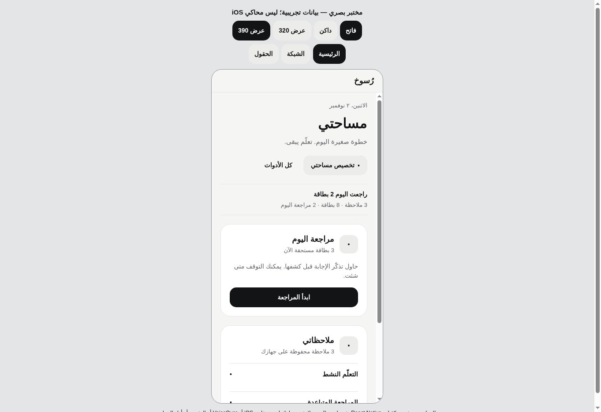
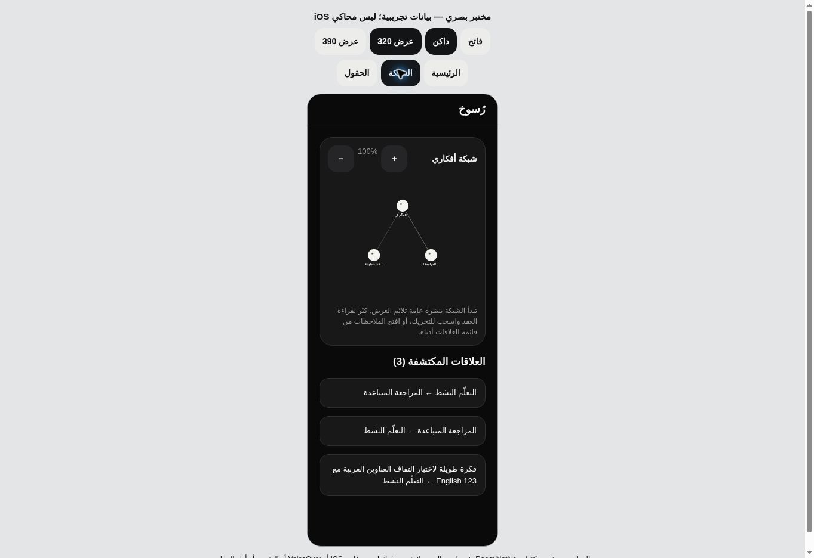

# رُسوخ 0.3 — تجربة طالب أوضح وحفظ أكثر أمانًا

تاريخ التنفيذ: 2 نوفمبر 2026 (الرياض).
الأساس: `c37672383777b94883f16f1ac7642932e077d553` من فرع `work/expo-custom-workspace-20261102`.
فرع هذا التحديث: `work/expo-student-experience-20261102`، دون استبدال تطبيق SwiftUI أو دمج إلى main.

## التغييرات

- رئيسية عربية بتسلسل أوضح للتاريخ، تقدم اليوم، المراجعة، وآخر الملاحظات؛ التخصيص والإخفاء والترتيب محفوظة.
- تباين أفضل للنص الثانوي، أزرار تلتف نصوصها، عناوين وصول، شريط تنقل بلا تعتيم النص كله، واحترام تقليل الحركة.
- التعامل مع اتجاه الصف العربي عند تفعيل RTL في Expo SDK58 دون إجبار إعادة تشغيل اللغة.
- الملاحظات تستخدم FlatList بدل تركيب كل عناصرها دفعة واحدة. لا ندّعي قياس تحسن الذاكرة أو الإطارات على هاتف.
- مسودة ملاحظة واحدة محلية، تُحفظ بعد 700ms من توقف الكتابة، ومحاولة حفظ عند مغادرة التطبيق. استعادة، تجاهل بتأكيد، وشارة نجاح فقط عندما يطابق النص النسخة المحفوظة. الإغلاق القسري قبل اكتمال الكتابة قد يفقد أحدث حروف غير محفوظة.
- قفل الحقول أثناء الحفظ، وتأكيد مغادرة البطاقة غير المحفوظة، وحماية محرر البطاقة من لوحة المفاتيح.
- فصل نجاح عملية الكتابة عن فشل قراءة العرض: إعادة تحميل البيانات لا تكرر الحفظ.
- إعادة محاولة فتح التخزين، وحالات مستقلة للمكتبة الفارغة والبحث بلا نتائج.
- الإجابات لا تُسرب من قائمة البطاقات قبل الكشف؛ إدارة البطاقات اختيارية، وكشف الإجابة مرتبط بمعرّف البطاقة.
- توحيد حد النسخ الاحتياطية عند 15MiB من UTF-8 قبل التصدير وبعد قراءة الاستيراد. رفض عناوين مكررة قد تجعل روابط المعرفة ملتبسة. البيانات الكبيرة لا تصدر كملف لا يمكن استعادته؛ التصدير المجزأ لم ينفذ بعد.
- تغيير عنوان ملاحظة يحدّث روابطها الواردة والذاتية في نفس معاملة SQLite مع الملاحظة وبطاقاتها. تُحفظ الأسماء المستعارة والنصوص غير المطابقة؛ الفشل يعيد التغيير كله.
- الشبكة تبدأ بملاءمة مساحة العرض مع التكبير والقائمة النصية.

## مراجعات الفريق

| الدور | ما أضافه |
|---|---|
| الباحث | وثائق Expo/RN/Apple، اتجاه SDK58، الوصول وحالات الواجهة |
| الرافعة | إعادة استخدام المكوّنات الحالية، أدوات النظام، وعدم إضافة إطار UI جديد |
| محامي الشيطان | إعادة إنتاج أخطاء المسودات والتصدير والروابط وفشل تحديث العرض |
| المهندس | دمج الرئيسية، دورة المسودة، المعاملات والحالات غير المتزامنة |
| مختبر الجودة | اختبارات قبل الإصلاح وبعده، مكوّنات وتخزين وعرض متصفح |

استُخدمت مهارة Expo Studio وتعليمات [Superpowers verification-before-completion](https://github.com/obra/superpowers/blob/2ce8aa15d05bd57213e6f746f953aafb7ded7a8b/skills/verification-before-completion/SKILL.md) التي قرئت عبر omgskills؛ تطابق بصمتها ليس تدقيقًا أمنيًا لكل مستودعها. لم تُثبّت حزمة مهارات عشوائية أو أدوات مدفوعة.

## التوافق وحفظ البيانات

قاعدة البيانات `rusukh-v1.db` وتنسيق النسخة الاحتياطية version1 ثابتان. المسودة في meta تحت `noteDraft.v1` منفصلة عن الملاحظات المنشورة. تفضيلات الواجهة والمسودة لا تدخل نسخة محتوى الدراسة الحالية. لا تغييرات في اعتماديات تشغيل التطبيق مقارنة بـ0.2؛ حزمتا react-dom وreact-native-web تستخدمان فقط للمختبر البصري المنفصل.

## أدلة التحقق

توجد المخرجات في `evidence/v03/`. ملفات before توثق الفشل المتوقع قبل الإصلاح وليست نتائج النسخة النهائية. اختبار SQLite ينفذ SQL على Node SQLite مع محاكاة واجهة Expo، واختبارات المكوّنات تستخدم jest-expo وواجهات نظام محاكاة؛ لا تعادل اختبار آيفون.

المختبر `visual-preview/` يستورد المكوّنات الإنتاجية نفسها، وبياناته اصطناعية في الذاكرة. فُحص المظهر الفاتح بعرض390 والداكن بعرض320، وإخفاء أداة وترتيبها والكثافة، وكتابة عربية مختلطة بـEnglish، وظهور علاقة جديدة وتكبير الشبكة. أيقونات SF Symbols على الويب بديلة، والصور ليست محاكي iOS.

نتائج الفحص النهائي في Codespaces:

| الفحص | النتيجة | الدليل |
|---|---|---|
| منطق المجال وSQLite | 46/46 ناجح | [core-tests.txt](evidence/v03/core-tests.txt) |
| مكوّنات ودورة المسودات | 40/40 ناجح، 6 مجموعات | [ui-tests.txt](evidence/v03/ui-tests.txt) |
| TypeScript | exit 0 | [typecheck.txt](evidence/v03/typecheck.txt) |
| توافق حزم Expo | exit 0 | [expo-compatibility.txt](evidence/v03/expo-compatibility.txt) |
| Expo Doctor | 20/20 ناجح | [expo-doctor.txt](evidence/v03/expo-doctor.txt) |
| تصدير iOS | Hermes، 804 وحدات، نحو 2MB، exit 0 | [ios-export.txt](evidence/v03/ios-export.txt) |

[نتائج الأوامر الآلية](evidence/v03/verification.json) تسجل زمن التنفيذ وإصدار Node. تصدير Hermes لا يثبت تشغيل التطبيق على iOS.

الفحص البصري كشف قصّ الشبكة على عرض320؛ بعد الإصلاح ظهرت العقد الثلاث والعلاقات، واختُبر التكبير120% والرجوع للملاءمة100%.

فحص `npm audit --omit=dev` أظهر 12 تحذيرًا متوسطًا في شجرة اعتماديات Expo وأدواتها، صفر مرتفع وصفر حرج وقت الفحص. أصل التنبيه في `glob` (AbortSignal traversal) و`minimatch` (denial of service). اقتراح npm الآلي يرجع Expo إلى51 ويكسر توافق58، لذلك لم نطبّقه. الاعتماديات التشغيلية لم تُغيّر في هذه النسخة؛ التحذيرات باقية وتحتاج ترقية متوافقة والتحقق قبل اعتبار النسخة إنتاجية. [التقرير الكامل](evidence/v03/runtime-audit.json).

## حدود النسخة

لا محرك ذكاء اصطناعي محلي في نسخة Expo Go، ولا توليد أسئلة بالذكاء الاصطناعي. استخراج س/ج يقرأ أسئلة مكتوبة صراحة. لا قراءة PDF أو جلب YouTube تلقائيًا. استيراد TXT/MD/SRT/VTT وتصدير Markdown موجودان. الجدولة مبسطة وليست FSRS. لم يُختبر VoiceOver أو لوحة مفاتيح iOS أو البطارية أو الحرارة أو Neural Engine على هاتف في هذا التحديث. لا تثبيت لتطبيق مستقل جديد على هاتف المستخدم ولا ادعاء اكتمال المشروع الإنتاجي.

Mac/Xcode لم يُشغّلا في هذا التحديث الخاص بواجهة Expo؛ تصدير JavaScript/Hermes لـiOS مختلف عن بناء وتوقيع تطبيق SwiftUI. يظل مسار التطبيق الأصلي في المستودع محفوظًا. أولوية المرحلة التالية: تجربة0.3 على الهاتف، ثم إثبات محرك محلي واحد بمصدر مستند وإسناد وصلاحيات وإلغاء في بناء أصلي موقع.

## التشغيل والميزانية

خادم Expo مؤقت ويتوقف رابطه عند توقف Codespace أو العملية. فُحصت صفحة ميزانيات GitHub: Codespaces وActions مضبوطتان على$0 مع منع الاستخدام المدفوع؛ لم تُغيّر إعدادات الفوترة. لم يبدأ بناء EAS مدفوع أو خدمة نموذج سحابية.

## مصادر القرارات

- https://docs.expo.dev/guides/localization/
- https://reactnative.dev/docs/accessibilityinfo
- https://reactnative.dev/docs/scrollview
- https://developer.apple.com/design/tips/
- https://www.w3.org/WAI/WCAG22/Understanding/contrast-minimum.html
- https://docs.expo.dev/versions/v58.0.0/sdk/sqlite/
- https://docs.expo.dev/faq/

## رابط التجربة وملف التصدير

[فتح 0.3 في Expo Go](exp://c-svrv-3wychf-mvzej8uvaluwv510.on.expo.app) — تحقق HTTP 200 للملف والحزمة في 2026-11-02T15:19:24.979Z. الرابط مؤقت ويحتاج Expo Go المتوافق مع SDK58.

[حزمة Hermes المصدرة](evidence/v03/ios-hermes-0.3.zip) مع [بصمات SHA-256](SHA256SUMS_0.3.txt). هذا الملف ناتج تصدير JavaScript/Hermes، وليس IPA ولا تطبيقًا مستقلًا قابلًا للتثبيت.

حُفظت التغييرات في فرع مستقل. Workflow بناء SwiftUI يدوي (workflow_dispatch)، ولم يُشغّل في هذا التحديث؛ فحوص Expo المذكورة نُفذت فعليًا في Codespaces.
