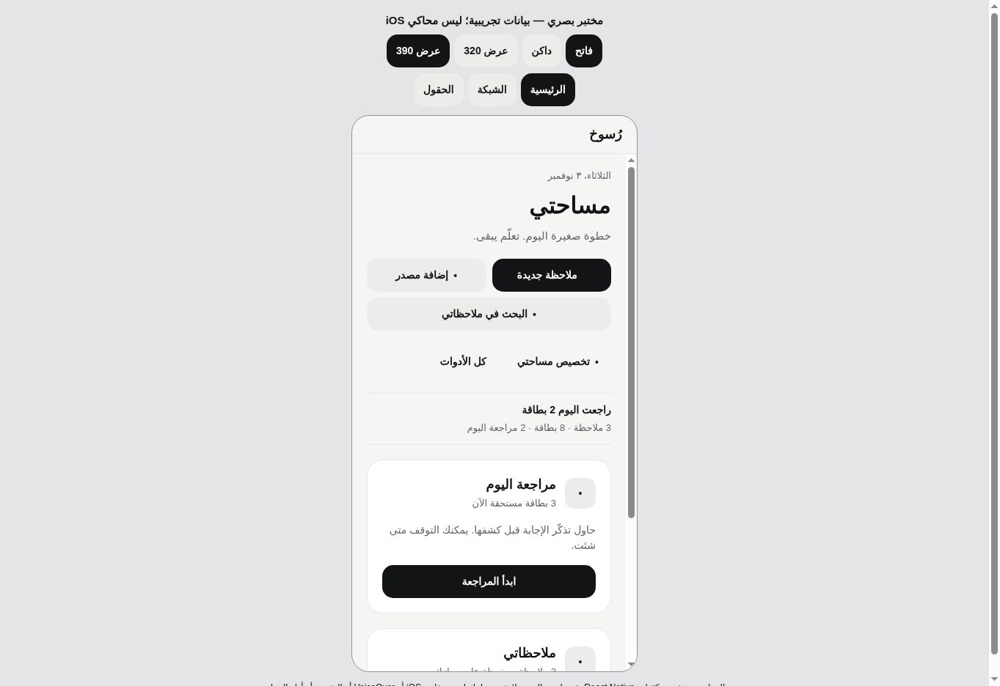
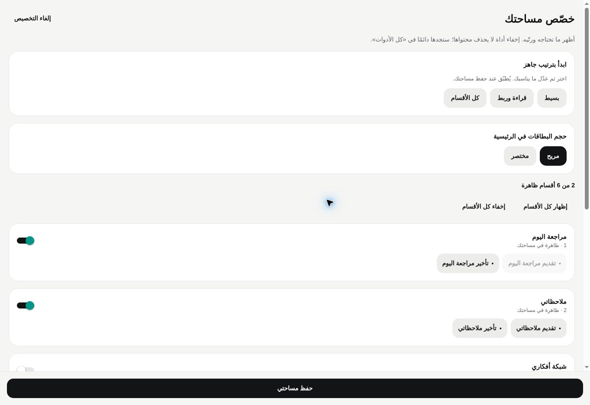
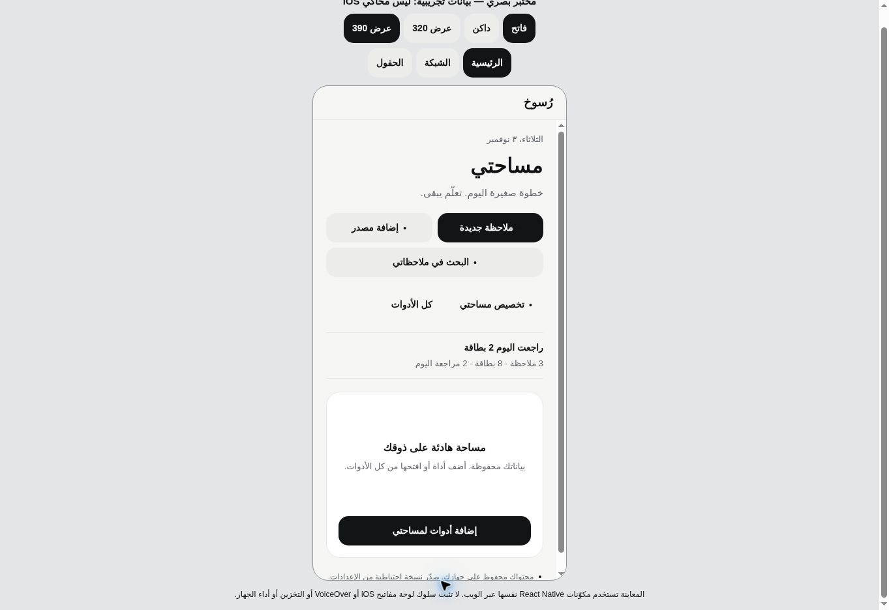
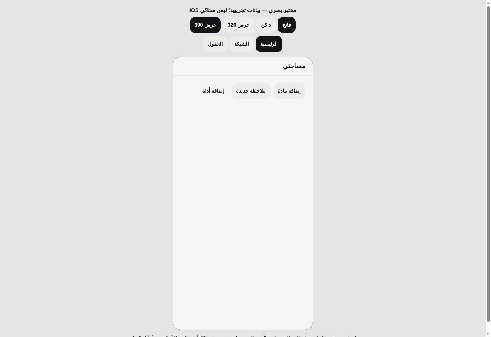

# رُسوخ — تدقيق التجربة والإصدار

**16 أخطاء** بين إعادة إنتاج وفحص مصدر، **14 فجوات** متطلب أو جهاز، **17 مخاطر** تصميم أو إصدار. لا يصح وصف المجموع كله بأنه عيوب مثبتة.

- لا اختبار iPhone مثبت هنا، ولا تثبيت SwiftUI مستقل.
- صور WEB harness واختبارات الموائمات لا تثبت جودة الجهاز أو الذكاء المحلي.
- الوثائق والمجتمع تدعم الحلول؛ الكود والاختبار يثبتان نتائج المشروع.

الحالة: 29 أصلحت واختبرت ضمن النطاق المسجل، 0 تعديلات تنتظر التحقق، 18 مفتوحة.

[التقرير التفاعلي](audit.html) · [البيانات المنظمة](audit.json) · [التصميم المستهدف](TARGET_EXPERIENCE.md)

## كيف يفترض أن يعمل

- أول فتح: مكتبة ومساحة بلا بيانات أو أقسام مفروضة، مع مدخل إنشاء واضح.
- الفتح التالي: استعادة المحتوى والتخطيط والمسودة؛ لا مسح عند كل تشغيل.
- أضف مادة ← افحص النص ← اختر ناتج الدراسة ← راجع النتيجة ← ابدأ ← استأنف.
- إخفاء قسم يغيّر الواجهة فقط؛ استرجاعه لا يحذف المحتوى ولا يكرره.
- النماذج تُعرض بقدراتها الفعلية؛ الإدارة التلقائية والتشغيل دون اتصال يحتاجان تنفيذًا ودليل جهاز.
- الرحلة الموحدة تصميم مستهدف؛ الإصلاحات الجزئية لا تعني اكتمالها.

## حدود الأدلة

- التدقيق يصف Expo 0.5.0 عند الالتزام 2486ae13f2ecb7d2eddb7a29c36caf358d9dd3c0. أرقام الأسطر تخص المصدر وقت المراجعة، وقد تتحرك بعد الإصلاح.
- ملفات SwiftUI المفحوصة نسخة قراءة منفصلة عند 93f5adb1c2ee43195e0ceda35d39a9992c11e320؛ لا تنسب إليها إصلاحات Expo أو اختبارات JavaScript.
- الالتزام المحلي المصطنع 2372410 ليس التزام إصدار على GitHub. حالة الإصلاح مستقلة عن لقطة اكتشاف المشكلة وعن رفعها أو اعتمادها للإصدار.
- الاختبار المعاد إنتاجه قد يستخدم Node SQLite أو مكونات حقيقية مع موائمات أصلية محاكية. لا يعني تشغيلًا على iPhone. التقرير لا يثبت تثبيت SwiftUI المستقل.
- مراجع المجتمع والوثائق تساند اقتراح الحل. دليل عيب رُسوخ هو مصدره أو اختبار محدد عليه؛ وجود نصيحة خارجية ليس دليل عيب.
- هذه حصيلة تدقيق محدد وليست حصرًا لكل عيوب المنتج أو إعلان اكتماله. لا يستهدف التقرير عددًا معينًا من القرارات.
- R008: نجاح الاختبارات والصور وHTTP 200 لا يثبت Files/iCloud أو VoiceOver أو استدلال النموذج والذاكرة والبطارية والحرارة على الهاتف.

| التصنيف | الحالات |
|---|---:|
| خطأ أعيد إنتاجه | 8 |
| خطأ مثبت بالمصدر | 8 |
| متطلب ناقص | 10 |
| خطر تصميم | 13 |
| خطر إصدار | 4 |
| فجوة تحقق جهاز | 4 |

P1 مرتفعة، P2 متوسطة، P3 منخفضة. لا P0. العدد حصيلة نطاق التدقيق وليس هدفًا.

## الحالات

- **D001 · P1 — قاعدة جديدة تُملأ بملاحظات وبطاقات تجريبية رغم طلب بداية فارغة**
  متطلب ناقص · البيانات والاسترجاع · أصلح واختبر ضمن النطاق المسجل

<details>
<summary>الدليل والتعديل ومعيار القبول</summary>

**المصدر:** [expo-preview/src/storage.ts:53](https://github.com/scrv-1/rusukh-native-ios/blob/2486ae13f2ecb7d2eddb7a29c36caf358d9dd3c0/expo-preview/src/storage.ts#L53-L75)

**الدليل:** غياب meta.seeded يشغّل INSERT لملاحظتين وبطاقتين في معاملة؛ لا يوجد اختيار اختياري للمستخدم.
docs/research/devils-audit-20261103/data-evidence/storage-probes.log: openStorage() الحقيقي أعاد notes=2,cards=2,reviews=0؛ العنوانان التعلّم النشط والمراجعة المتباعدة.

**السيناريو:** شغّل التطبيق على تثبيت جديد بقاعدة SQLite فارغة.

**الأثر:** تظهر بيانات لم ينشئها المستخدم وتدخل العدادات والمراجعة والبحث؛ هذا يخالف المطلوب الصريح: مساحة فارغة مع أدوات جاهزة. ليست مشكلة تلف SQLite.

**التعديل:** افصل إنشاء الجداول عن أمثلة المحتوى. أبقِ المكتبة الجديدة فارغة، واجعل تجربة الأمثلة إجراءً اختياريًا صريحًا قابلًا للإزالة دون مساس ببيانات قديمة.

**القبول:** openStorage على قاعدة جديدة ثم إعادة الفتح يعيدان صفر ملاحظات وبطاقات ومراجعات. التثبيت الذي يحتوي بيانات مسبقة لا تُحذف بياناته. أدوات الإضافة والاستيراد تبقى متاحة.

**التحقق:** {
  "status": "reproduced",
  "method": "تشغيل مصدر TypeScript الحقيقي بعد تحويله في الذاكرة فوق Node SQLite؛ ليس iPhone.",
  "command": "node docs/research/devils-audit-20261103/data-evidence/storage-probes.cjs",
  "artifacts": [
    "docs/research/devils-audit-20261103/data-evidence/storage-probes.cjs",
    "docs/research/devils-audit-20261103/data-evidence/storage-probes.log"
  ]
}

**حالة الإصلاح المسجلة:**

```json
{
  "id": "D001",
  "status": "fixed-verified",
  "verification": "نجح التحقق على Codespaces/Linux Node 24.22.2: 111 اختبار نواة و 208 واجهة و 28 AI ؛ TypeScript والتوافق و Expo Doctor 20/20 وتصدير iOS 909 وحدات. السجلات والبصمات في evidence/v051. ليس اختبار iPhone.",
  "evidence": "fix-evidence/first-launch-green.log"
}
```

</details>

- **D003 · P1 — استعادة النسخة تمحو المسودة المحفوظة دون ذكرها في التأكيد أو تضمينها في نقطة الرجوع**
  خطأ أعيد إنتاجه · البيانات والاسترجاع · أصلح واختبر ضمن النطاق المسجل

<details>
<summary>الدليل والتعديل ومعيار القبول</summary>

**المصدر:** [expo-preview/App.tsx:365](https://github.com/scrv-1/rusukh-native-ios/blob/2486ae13f2ecb7d2eddb7a29c36caf358d9dd3c0/expo-preview/App.tsx#L365-L371)

**الدليل:** finishStudyRestore يستدعي draft.clear بعد استعادة SQL؛ يُستخدم في استيراد JSON والمجلد ونقاط الرجوع.
تنبيه App.tsx:408–411 يذكر استبدال عدد الملاحظات ونقطة الرجوع فقط؛ تنبيه نقطة الرجوع :386–390 لا يذكر حذف المسودة أيضًا.
src/storage.ts:165–168 يجمع notes/cards/reviews فقط؛ noteDraft.v1 ليست داخل النقطة. PortableBackupPanel.tsx:98 يستبعد المسودة من التصدير.
docs/research/devils-audit-20261103/data-evidence/draft-audit.ui.test.jsx أثبت أن مسودة جديدة unpublished محفوظة في meta تصبح null بعد التأكيد، وأن نص التأكيد لا يحتوي «مسود».

**السيناريو:** احفظ مسودة غير منشورة وأغلق المحرر، ثم من الإعدادات استورد نسخة دراسة ووافق على استبدال الملاحظات المعروضة.

**الأثر:** تختفي كتابة المستخدم التي ليست ضمن أي ملاحظة منشورة. العودة إلى نقطة الرجوع تعيد الدراسة فقط ولا تستعيد تلك الكتابة. موافقة استبدال الدراسة لا تكشف هذه الخسارة المنفصلة.

**التعديل:** احفظ المسودة السابقة في خانة استرجاع مستقلة قبل الاستعادة، أو امنع الاستعادة حتى يختار المستخدم حفظها/تصديرها/تجاهلها صراحة. عند الاحتفاظ بها بعد تبدل المكتبة لا تربطها تلقائيًا بمعرّف قد يشير إلى ملاحظة مختلفة.

**القبول:** مع مسودة محفوظة ثم استيراد JSON أو مجلد أو نقطة رجوع: تظهر المسودة بعد العملية كمسودة قابلة للاستعادة أو يسبق حذفها قرار صريح يذكرها. إلغاء التأكيد لا يغيرها، وفشل SQL يبقيها كما هي.

**التحقق:** {
  "status": "reproduced",
  "method": "واجهة App/useNoteDraft الحقيقية مع موائم تخزين وهمي؛ تحقق مصدر مستقل من استبعاد المسودة من نقطة SQL.",
  "command": "./node_modules/.bin/jest --config docs/research/devils-audit-20261103/data-evidence/jest.config.cjs --runInBand",
  "artifacts": [
    "docs/research/devils-audit-20261103/data-evidence/draft-audit.ui.test.jsx",
    "docs/research/devils-audit-20261103/data-evidence/ui-probes.log"
  ]
}

**حالة الإصلاح المسجلة:**

```json
{
  "id": "D003",
  "status": "fixed-verified",
  "verification": "نجح التحقق على Codespaces/Linux Node 24.22.2: 111 اختبار نواة و 208 واجهة و 28 AI ؛ TypeScript والتوافق و Expo Doctor 20/20 وتصدير iOS 909 وحدات. السجلات والبصمات في evidence/v051. ليس اختبار iPhone.",
  "evidence": "fix-evidence/restore-draft-summary.json"
}
```

</details>

- **N001 · P1 — المساحة الفارغة المطلوبة غير ممثلة في أول تشغيل ولا في إخفاء جميع الأقسام**
  متطلب ناقص · التنقل والتخصيص · أصلح واختبر ضمن النطاق المسجل

<details>
<summary>الدليل والتعديل ومعيار القبول</summary>

**المصدر:** [expo-preview/src/workspace.ts:18](https://github.com/scrv-1/rusukh-native-ios/blob/2486ae13f2ecb7d2eddb7a29c36caf358d9dd3c0/expo-preview/src/workspace.ts#L18-L20)

**الدليل:** defaultWorkspace يفعّل review وnotes تلقائيًا، وreadWorkspace(null) يعيده (31–33). StudyHome.tsx:39–67 يرسم العنوان والتوجيه وإجراءات الإنشاء والبحث وإحصاءات الدراسة وبطاقة فارغة خارج shown.map؛ لذلك إخفاء كل modules لا يزيل لوحة الدراسة المفروضة. الاختبار tests/workspace.test.cjs:6–8 يثبت التوقع القديم review+notes. هذه النتيجة تخص تركيب الواجهة فقط؛ زرع محتوى الدراسة في storage.ts تدقيق مستقل لدى الفريق.

**السيناريو:** يفتح مستخدم جديد يريد صفحة يركبها بنفسه التطبيق، ثم يحاول إخفاء جميع الأقسام ليبدأ من مساحة فارغة.

**الأثر:** الافتراض السابق عن لوحة دراسة جاهزة يطغى على اختيار المستخدم الصريح، وإخفاء الأقسام لا يحقق الوعد بالفراغ. يتحمل المستخدم إعدادًا عكسيًا قبل أن يبدأ.

**التعديل:** اجعل إعداد المساحة الجديدة بلا أقسام مثبّتة. افصل شريط أدوات صغيرًا دائمًا عن مساحة المستخدم؛ لا تضع الإحصاءات والشعارات وبطاقة الفراغ كأقسام إجبارية. اجعل الإحصاءات وأي إجراء مركّب أقسامًا يضيفها المستخدم. احتفظ بترتيبات المستخدمين المحفوظة؛ لا تصفّرها بلا طلب.

**القبول:** مع workspace غير موجود: صفر أقسام دراسة مثبتة وصفر إحصاءات أو بطاقات مفروضة داخل مساحة المحتوى، ومدخل أدوات واضح. بعد إخفاء الجميع يتحقق الشرط نفسه. تظهر الأقسام فقط بعد إضافتها. يبقى تخطيط مستخدم سابق محفوظًا دون تغيير غير مطلوب.

**التحقق:** مثبت بتتبع الكود وإعادة تنفيذ دالة workspace الحالية عبر TypeScript في الذاكرة: firstRunEnabled=['review','notes']. لم نفترض أن قاعدة بيانات الدراسة فارغة. المصادر التالية تدعم فصل القدرة المتاحة عن القسم المعروض، ولا تثبت عيب رسوخ.

**حالة الإصلاح المسجلة:**

```json
{
  "id": "N001",
  "status": "fixed-verified",
  "verification": "نجح التحقق على Codespaces/Linux Node 24.22.2: 111 اختبار نواة و 208 واجهة و 28 AI ؛ TypeScript والتوافق و Expo Doctor 20/20 وتصدير iOS 909 وحدات. السجلات والبصمات في evidence/v051. ليس اختبار iPhone.",
  "evidence": "fix-evidence/n001-summary.json"
}
```

**مراجع تساند الحل، وليست إثباتًا لعيبنا:**

- <https://obsidian.md/help/plugins>
- <https://support.apple.com/guide/iphone/add-edit-and-remove-widgets-iphb8f1bf206/ios>

</details>

- **S001 · P1 — تصحيح جواب الملاحظة لا يصل إلى البطاقة ولا توجد وسيلة لتحريرها مع حفظ تاريخها**
  خطأ أعيد إنتاجه · الدراسة والبطاقات · أصلح واختبر ضمن النطاق المسجل

<details>
<summary>الدليل والتعديل ومعيار القبول</summary>

**المصدر:** [expo-preview/App.tsx:266](https://github.com/scrv-1/rusukh-native-ios/blob/2486ae13f2ecb7d2eddb7a29c36caf358d9dd3c0/expo-preview/App.tsx#L266-L281)

**الدليل:** commitNote(true) يبني existing من نص السؤال ويستبعد كل سؤال موجود قبل فحص تغير الجواب (267–274). saveNoteAndCards لا يغير إلا البطاقات الممررة إليه (storage.ts:124–125)، ومحرر البطاقة ينشئ دائمًا id جديدًا ويمنع السؤال الموجود (App.tsx:313–320). إدارة البطاقات تعرض الحذف فقط (550–555). اختبار الواجهة S001 صحح النص ثم التقط saveNoteAndCards(noteUpdated,[]) ووجد الجواب القديم بعد ذلك.

**السيناريو:** أنشئ بطاقة من «س: كم عدد الأقمار؟ / ج: جواب قديم»، راجعها عدة مرات، ثم صحح الجواب داخل الملاحظة واضغط «حفظ واستخراج بطاقات س/ج». الملاحظة تحفظ التصحيح لكن البطاقة والاختبار يستمران بالجواب القديم، ويظهر تنبيه عدم العثور على أسئلة جديدة.

**الأثر:** يستمر المتعلم في ترسيخ معلومة يعلم أنها خاطئة. الحل المتاح عبر الحذف وإعادة الإنشاء يمحو تاريخ البطاقة وجدولها؛ فتح الملاحظة الأصلية وحده لا يكمل عملية التصحيح.

**التعديل:** إضافة تحرير بطاقة موجودة باستخدام card.id، وفحص اختلاف جواب سؤال معروف عند إعادة الاستخراج مع معاينة تحديث صريحة. الحفاظ على المراجعات والجدولة افتراضيًا، مع قرار مستقل لإعادة التعلم إذا تغير المعنى. لا تحاول مطابقة تغيّر السؤال بالحدس ولا تنشئ نسخة ثانية بصمت.

**القبول:** بطاقة ذات مراجعات محفوظة: تصحيح الجواب واعتماد التحديث يغير answer في نفس id، ولا يزيد عدد البطاقات، ويحفظ سجلها. إعادة الاستخراج بلا تغييرات عملية خاملة. تغيير السؤال يعرض ربط التعديل ببطاقة قائمة بدل مضاعفتها تلقائيًا.

**التحقق:** مثبت باختبار مكون App الحقيقي مع mock لتسجيل عمليات التخزين: study-evidence/study-flow.ui.test.jsx، اختبار S001. تم تتبع كتابة SQLite لكن لم تُنفذ واجهة على iPhone. جُمعت فجوة التحرير وتقادم الجواب في سبب واحد.

**حالة الإصلاح المسجلة:**

```json
{
  "id": "S001",
  "status": "fixed-verified",
  "scope_ar": "تعديل البطاقة بنفس id مع حفظ الجدولة والسجل؛ عند تغير جواب مستخرج يطلب اعتماد تحديث صريح بدل تجاهله.",
  "verification": "31 اختبار Node SQLite للبيانات تشمل updateCard ، واختبار App لتحرير البطاقة دون إنشاء جديدة؛ مراجعة مستقلة لحماية المسودات.",
  "evidence": "../flow-20261103/data/data-result.json",
  "limits_ar": "لا تخمين لهوية سؤال تغير معناه، ولا إعادة جدولة تلقائية عند تحرير النص.",
  "release_gate_ar": "تحقق الإصدار0.5.2 على Codespaces/Linux Node24.22.2:137 نواة و332 واجهة و32 عقدAI =501 ناجحة؛ TypeScript وتوافقExpo وDoctor20/20 وتصدير915 وحدة.116 بصمة تطابق ملفات العمل. أدلة evidence/v052؛ ليس اختبارiPhone.",
  "device_verified": false,
  "release_verification_ar": "تحقق الإصدار0.5.2 على Codespaces/Linux Node24.22.2:137 نواة و332 واجهة و32 عقدAI =501 ناجحة؛ TypeScript وتوافقExpo وDoctor20/20 وتصدير915 وحدة.116 بصمة تطابق ملفات العمل. أدلة evidence/v052؛ ليس اختبارiPhone."
}
```

**مراجع تساند الحل، وليست إثباتًا لعيبنا:**

- <https://forums.ankiweb.net/t/can-i-disable-leeches-altogether/4767>
- <https://docs.ankiweb.net/manual/leeches>
- <https://super-memory.com/articles/20rules.htm>

</details>

- **S002 · P1 — تحويل إجابات البطاقات إلى مشتتات قد ينتج سؤال اختيار متعدد له أكثر من جواب صحيح**
  خطر تصميم · الدراسة والبطاقات · أصلح واختبر ضمن النطاق المسجل

<details>
<summary>الدليل والتعديل ومعيار القبول</summary>

**المصدر:** [expo-preview/src/core.ts:176](https://github.com/scrv-1/rusukh-native-ios/blob/2486ae13f2ecb7d2eddb7a29c36caf358d9dd3c0/expo-preview/src/core.ts#L176-L188)

**الدليل:** makeQuiz يجمع أجوبة جميع البطاقات ثم يختار منها مشتتات دون وجود خيارات معتمدة أو مجموعة إجابات صحيحة في StudyCard. App.tsx:691–704 يعتبر المطابقة النصية مع answer وحدها صحيحة. إثبات S002: السؤال «اذكر عددًا أوليًا» يعرض ['3','2']؛ answer='2'، وبالتالي يُرفض 3 رغم صحته.

**السيناريو:** بطاقة تسأل «اذكر عددًا أوليًا» وجوابها 2، وأخرى تسأل «ما أصغر عدد أولي فردي؟» وجوابها 3. الاختبار التلقائي يضع الجوابين ضمن سؤال البطاقة الأولى ويصحح أحدهما فقط.

**الأثر:** يمكن أن يتلقى المتعلم تصحيحًا خاطئًا ويثق به. المثال يثبت خطرًا محددًا للأسئلة المفتوحة أو الأجوبة المتكافئة؛ لا يثبت أن كل اختبار مولد غير صالح.

**التعديل:** لا تجعل جمع أجوبة المكتبة افتراضيًا دليلًا على مشتتات خاطئة. استخدم أسئلة متعددة الخيارات مؤلفة/مراجعة بخياراتها أو حوّل البطاقة غير المعتمدة إلى استرجاع ثم تقييم ذاتي. إن استُخدمت مسودة خيارات فاعرضها للمراجعة وحدد نطاق المصدر، ولا تدّع أن التطبيع النصي يتحقق من المعنى.

**القبول:** المثال 2/3 لا يظهر كتقييم آلي أحادي الجواب. سؤال اختيار معتمد يحتوي جوابًا صحيحًا واحدًا يبقى قابلًا للتصحيح. الأسئلة ذات جوابين صحيحين إما تدعم قبولهما صراحة أو تعود إلى استرجاع ذاتي.

**التحقق:** إعادة إنتاج حتمية على makeQuiz الفعلي في study-evidence/logic-reproductions.test.cjs، S002؛ صحة العددين الأوليين حقيقة مباشرة. ضعف صلاحية التوليد مصنف خطر تصميم، وليس ادعاءً بفشل كل المكتبة أو أداء المتعلم.

**حالة الإصلاح المسجلة:**

```json
{
  "id": "S002",
  "status": "fixed-verified",
  "scope_ar": "استبدال الاختيار المتعدد من أجوبة عشوائية بتدريب استرجاع ثم كشف الإجابة وتقييم الطالب لنفسه.",
  "verification": "74 اختبار منطق و YouTube و 7 اختبارات StudyQuiz ، وفق سجل الدور.",
  "evidence": "../flow-20261103/study/summary.json",
  "limits_ar": "ليس تصحيحًا دلاليًا أو درجة اختبار موضوعية؛ لا يغير جدولة المراجعة.",
  "release_gate_ar": "تحقق الإصدار0.5.2 على Codespaces/Linux Node24.22.2:137 نواة و332 واجهة و32 عقدAI =501 ناجحة؛ TypeScript وتوافقExpo وDoctor20/20 وتصدير915 وحدة.116 بصمة تطابق ملفات العمل. أدلة evidence/v052؛ ليس اختبارiPhone.",
  "device_verified": false,
  "release_verification_ar": "تحقق الإصدار0.5.2 على Codespaces/Linux Node24.22.2:137 نواة و332 واجهة و32 عقدAI =501 ناجحة؛ TypeScript وتوافقExpo وDoctor20/20 وتصدير915 وحدة.116 بصمة تطابق ملفات العمل. أدلة evidence/v052؛ ليس اختبارiPhone."
}
```

**مراجع تساند الحل، وليست إثباتًا لعيبنا:**

- <https://super-memory.com/articles/20rules.htm>
- <https://andymatuschak.org/prompts/>

</details>

- **A001 · P1 — اختيار مسار تجهيز لا يحقق إدارة النماذج الجاهزة**
  متطلب ناقص · الذكاء المحلي · مفتوح

<details>
<summary>الدليل والتعديل ومعيار القبول</summary>

**المصدر:** [expo-preview/src/AIWorkspace.tsx:50](https://github.com/scrv-1/rusukh-native-ios/blob/2486ae13f2ecb7d2eddb7a29c36caf358d9dd3c0/expo-preview/src/AIWorkspace.tsx#L50-L62)

**الدليل:** يوجد زران يبدلان modelSetup فقط. التنزيل Linking.openURL خارجي. contracts.ts:6–13 يعرّف نموذجًا مرجعيًا واحدًا؛ engine-entry.mjs:69–76 يعطل تخزين النماذج، وLocalAILab.tsx:63–64 يعطل التخزين المؤقت ويستخدم incognito.

**السيناريو:** طالب جديد يحتاج فتح المتصفح، تنزيل 639 MB، معرفة موضع الملف ثم اختياره يدويًا داخل المختبر. لا قائمة نماذج مثبتة أو اختيار بين نماذج موثقة.

**الأثر:** أهم مطلب للمستخدم ما زال غير منفذ؛ تغيير النصوص خفف الشرح ولم يُلغِ الإعداد اليدوي.

**التعديل:** مدير نماذج أصلي بمصدر مثبت وحالة تنزيل/تحقق/جاهز، وإلغاء واسترداد ومساحة متاحة؛ اربطه بمحرك يدعم قراءة الملف المحلي. لا تفعّل OPFS افتراضيًا داخل الأصل الحالي دون إثبات.

**القبول:** من تثبيت نظيف: يختار المستخدم نموذجًا من داخل التطبيق، يرى حجم التنزيل ويتحكم فيه، ثم يعيد فتح التطبيق بلا شبكة ويشغله دون إعادة اختيار ملف. لا تظهر جاهز قبل تحقق الملف ونجاح التحميل.

**التحقق:** مثبت من تدفق المصدر فقط. لم نجرّب مديرًا بديلًا أو نفترض عمل التخزين في WKWebView.

**حالة الإصلاح المسجلة:**

```json
{
  "status": "open"
}
```

**مراجع تساند الحل، وليست إثباتًا لعيبنا:**

- <https://github.com/ngxson/wllama/blob/master/README-dev.md>
- <https://docs.expo.dev/versions/latest/sdk/webview/>

</details>

- **A002 · P1 — تبديل التبويب يفقد النص الملصق ومسودة الذكاء قبل المحرر**
  خطأ مثبت بالمصدر · الذكاء المحلي · أصلح واختبر ضمن النطاق المسجل

<details>
<summary>الدليل والتعديل ومعيار القبول</summary>

**المصدر:** [expo-preview/src/AIWorkspace.tsx:15](https://github.com/scrv-1/rusukh-native-ios/blob/2486ae13f2ecb7d2eddb7a29c36caf358d9dd3c0/expo-preview/src/AIWorkspace.tsx#L15-L25)

**الدليل:** sourceText وresult حالات محلية فقط. App.tsx:623–628 يزيل فرع AIWorkspace عند تغيير tab ويغيّر مفتاح ScrollView. حفظ useNoteDraft في App.tsx:121–135 يخص محرر الملاحظة، لا شاشة الذكاء.

**السيناريو:** يلصق الطالب مصدرًا غير محفوظ أو يحصل على نتيجة، ثم يفتح ملاحظاته للتحقق من معلومة ويرجع إلى المساعد.

**الأثر:** يفقد عمله دون تحذير أو نقطة استرجاع، ويحتاج إعادة اللصق أو إعادة الاستدلال.

**التعديل:** احفظ مسودة جلسة الذكاء منفصلة عن اعتماد البطاقات، وارفع حالتها خارج التبويب مع استرجاع محلي. لا تحفظ نتائج جديدة كحقائق معتمدة تلقائيًا.

**القبول:** اختبار تبديل AI→Notes→AI يحفظ النص والعنوان والمسودة، واختبار إعادة تشغيل يسترجع مسودة غير معتمدة. فشل الحفظ ظاهر ولا يمسح النص.

**التحقق:** استنتاج حتمي من ملكية الحالة وإزالة المكون؛ لم ينفذ اختبار واجهة جديد في هذا التدقيق.

**حالة الإصلاح المسجلة:**

```json
{
  "id": "A002",
  "status": "fixed-verified",
  "scope_ar": "مصدر ونتيجة المساعد في جلسة فوق التبويبات، مع تخزين متحقق ومنع الكتابة فوق خانة فشلت قراءتها.",
  "verification": "38 اختبار Jest للمساعد والجسر و 32 عقود/runtime محاكى وفق الدور؛ إزالة/تركيب الشاشة ثم استعادة الحاضن.",
  "evidence": "../flow-20261103/ai/verification.json",
  "limits_ar": "لا حفظ لملف النموذج أو worker ، ولا استدلال جهاز في هذه الأدلة.",
  "release_gate_ar": "تحقق الإصدار0.5.2 على Codespaces/Linux Node24.22.2:137 نواة و332 واجهة و32 عقدAI =501 ناجحة؛ TypeScript وتوافقExpo وDoctor20/20 وتصدير915 وحدة.116 بصمة تطابق ملفات العمل. أدلة evidence/v052؛ ليس اختبارiPhone.",
  "device_verified": false,
  "release_verification_ar": "تحقق الإصدار0.5.2 على Codespaces/Linux Node24.22.2:137 نواة و332 واجهة و32 عقدAI =501 ناجحة؛ TypeScript وتوافقExpo وDoctor20/20 وتصدير915 وحدة.116 بصمة تطابق ملفات العمل. أدلة evidence/v052؛ ليس اختبارiPhone."
}
```

**مراجع تساند الحل، وليست إثباتًا لعيبنا:**

- <https://react.dev/learn/preserving-and-resetting-state>

</details>

- **A003 · P1 — الحالة inactive تمسح مسودة وصلت بالفعل إلى واجهة الدراسة**
  خطأ مثبت بالمصدر · الذكاء المحلي · أصلح واختبر ضمن النطاق المسجل

<details>
<summary>الدليل والتعديل ومعيار القبول</summary>

**المصدر:** [expo-preview/src/ai/LocalAILab.tsx:46](https://github.com/scrv-1/rusukh-native-ios/blob/2486ae13f2ecb7d2eddb7a29c36caf358d9dd3c0/expo-preview/src/ai/LocalAILab.tsx#L46-L53)

**الدليل:** كل state غير active يرسل unload ثم onStatus(cancelled). AIWorkspace.tsx:85 يستدعي setResult(null) لكل cancelled، حتى إذا كانت المسودة وصلت سابقًا عبر onResult. unload يمسح draft وresult في engine-entry.mjs:88–92.

**السيناريو:** بعد ظهور مسودة المراجعة في رُسوخ، يفتح المستخدم مركز الإشعارات أو ينتقل مؤقتًا لتطبيق آخر ثم يعود. توثيق React Native يذكر Notification Center ضمن inactive على iOS.

**الأثر:** إيقاف الحساب يزيل أيضًا نص النتيجة الذي لا يحتاج بقاء المحرك؛ إعادة اختيار النموذج والاستدلال تصبح مطلوبة بلا سبب دراسي.

**التعديل:** افصل إيقاف المحرك عن دورة حياة مسودة الدراسة. احتفظ بالنتيجة المعاد التحقق منها محليًا عند المقاطعة، مع إبطال الرسائل المتأخرة وعدم استئناف الحساب في الخلفية تلقائيًا.

**القبول:** بعد نتيجة صالحة، inactive ثم active لا يمسحان المصدر أو المسودة؛ generation قد توقف، والنتائج المتأخرة تُرفض. اختبر مركز الإشعارات وFiles والمكالمة على آيفون.

**التحقق:** سلسلة callbacks مثبتة في المصدر. أحداث منتقي Files الفعلية على آيفون لم تُرصد؛ ليست ادعاء تعطل مثبت لذلك المنتقي.

**حالة الإصلاح المسجلة:**

```json
{
  "id": "A003",
  "status": "fixed-verified",
  "scope_ar": "الخطأ والإلغاء وإيقاف المحرك لا تمحو نتيجة مكتملة وصلت إلى الحاضن؛ draft متحقق يرسل قبل الاعتماد في الدراسة.",
  "verification": "اختبارات انتقالات الحالة والجسر والحدث التلقائي ضمن 38 Jest و 32 runtime/contracts.",
  "evidence": "../flow-20261103/ai/verification.json",
  "limits_ar": "نتيجة لم تصل للحاضن قبل إبطال الطلب لا يمكن الادعاء باسترجاعها.",
  "release_gate_ar": "تحقق الإصدار0.5.2 على Codespaces/Linux Node24.22.2:137 نواة و332 واجهة و32 عقدAI =501 ناجحة؛ TypeScript وتوافقExpo وDoctor20/20 وتصدير915 وحدة.116 بصمة تطابق ملفات العمل. أدلة evidence/v052؛ ليس اختبارiPhone.",
  "device_verified": false,
  "release_verification_ar": "تحقق الإصدار0.5.2 على Codespaces/Linux Node24.22.2:137 نواة و332 واجهة و32 عقدAI =501 ناجحة؛ TypeScript وتوافقExpo وDoctor20/20 وتصدير915 وحدة.116 بصمة تطابق ملفات العمل. أدلة evidence/v052؛ ليس اختبارiPhone."
}
```

**مراجع تساند الحل، وليست إثباتًا لعيبنا:**

- <https://reactnative.dev/docs/appstate>

</details>

- **A004 · P1 — تغيير مصدر الدراسة يجبر المستخدم على إعادة تحميل النموذج**
  متطلب ناقص · الذكاء المحلي · أصلح واختبر ضمن النطاق المسجل

<details>
<summary>الدليل والتعديل ومعيار القبول</summary>

**المصدر:** [expo-preview/src/AIWorkspace.tsx:64](https://github.com/scrv-1/rusukh-native-ios/blob/2486ae13f2ecb7d2eddb7a29c36caf358d9dd3c0/expo-preview/src/AIWorkspace.tsx#L64-L86)

**الدليل:** جميع حقول اختيار المصدر مخفية عند running=true. المتاح للخروج هو setRunning(false)، فيزال Engine. إعادة فتحه تنشئ WebView جديدًا بلا النموذج. الجسر نفسه يقبل source جديدًا أثناء ready في engine-entry.mjs:186–197 لكن الواجهة لا تتيح ذلك.

**السيناريو:** يريد الطالب إنشاء سؤال من المقطع الثاني أو ملاحظة أخرى بعد انتهائه من الأول.

**الأثر:** كل مقطع يتطلب إغلاق المحرك وإعادة اختيار GGUF وتحميله، ثم المرور بمراجعة WebView ومراجعة رُسوخ ومحرر الملاحظة قبل إنشاء البطاقات.

**التعديل:** أبقِ اختيار المصدر متاحًا عندما يكون المحرك غير مشغول، مع حماية المسودة السابقة. أضف إجراء استخدام هذا المصدر من الملاحظة، ثم اعتماد بطاقات محددة بعد مراجعة واضحة دون تكرار شاشة التأكيد.

**القبول:** يعالج المستخدم مقطعين متتاليين بتحميل نموذج واحد، ويُلغى العمل القديم عند تغيير المصدر أثناء الانشغال، ولا تضيع مسودة سابقة دون اختيار. لا تُحفظ بطاقات قبل الاعتماد.

**التحقق:** مثبت من شروط العرض ومن وجود مسار تحديث المصدر غير المستخدم. لم نقس زمن تحميل الجهاز.

**حالة الإصلاح المسجلة:**

```json
{
  "id": "A004",
  "status": "fixed-verified",
  "scope_ar": "اختيار المصدر يبقى متاحًا مع نموذج جاهز في الشاشة؛ تحديث المصدر يستعمل instance نفسه ويمنع callbacks السابقة.",
  "verification": "runtime StubWllama والتحقق من بقاء instance واحد، وتعطيل تغيير المصدر أثناء التحميل والتوليد.",
  "evidence": "../flow-20261103/ai/verification.json",
  "limits_ar": "إعادة استعمال داخل الشاشة فقط؛ مغادرتها أو تفريغ المحرك يتطلب اختيار الملف مجددًا، بلا إثبات أداء هاتف.",
  "release_gate_ar": "تحقق الإصدار0.5.2 على Codespaces/Linux Node24.22.2:137 نواة و332 واجهة و32 عقدAI =501 ناجحة؛ TypeScript وتوافقExpo وDoctor20/20 وتصدير915 وحدة.116 بصمة تطابق ملفات العمل. أدلة evidence/v052؛ ليس اختبارiPhone.",
  "device_verified": false,
  "release_verification_ar": "تحقق الإصدار0.5.2 على Codespaces/Linux Node24.22.2:137 نواة و332 واجهة و32 عقدAI =501 ناجحة؛ TypeScript وتوافقExpo وDoctor20/20 وتصدير915 وحدة.116 بصمة تطابق ملفات العمل. أدلة evidence/v052؛ ليس اختبارiPhone."
}
```

</details>

- **A010 · P1 — لا دليل تشغيل للنسخة الحالية على آيفون ولا ميزانية ذاكرة مثبتة**
  فجوة تحقق جهاز · الذكاء المحلي · مفتوح

<details>
<summary>الدليل والتعديل ومعيار القبول</summary>

**المصدر:** [expo-preview/src/ai/engine-manifest.json:6](https://github.com/scrv-1/rusukh-native-ios/blob/2486ae13f2ecb7d2eddb7a29c36caf358d9dd3c0/expo-preview/src/ai/engine-manifest.json#L6-L11)

**الدليل:** المورد الحالي HTML=21853775 بايت وWASM=16005007، والنموذج المرجعي639446688 بايت. engine-entry.mjs:133 يثبت CPU بخيط واحد وn_ctx=2048. سجل evidence/v04/actual-ai-browser.json يصرح Chrome Linux وبصمات HTML أقدم. verification.json للإصدار0.5.0 يحتوي اختبارات وتصديرًا، لا قياسات جهاز.

**السيناريو:** آيفون المستخدم يفتح المختبر ثم يختار النموذج ويولد دون اتصال، مع مقاطعة أو نقص ذاكرة.

**الأثر:** لا يمكن الجزم بإتمام أهم رحلة AI أو اختيار نموذج مناسب للجهاز أو سلامة البطارية والحرارة، مهما نجحت اختبارات المحاكاة.

**التعديل:** بوابة قبول جهاز تسجل موديل الآيفون/iOS/Expo والذاكرة ووقت التحميل وأول رمز والتوليد والمقاطعات والاستئناف دون شبكة. اجعل توصية النموذج تابعة لهذه النتائج.

**القبول:** سجل مستقل قابل لإعادة الاختبار للـSHA الحالي على آيفون حقيقي، يشمل قتل WebView ونقص المساحة ومصدرًا محفوظًا محليًا. لا تستخدم حجم GGUF كبديل لاستهلاك الذاكرة.

**التحقق:** مقارنة سجلات ومستندات المصدر فقط؛ لا توجد قياسات جهاز جديدة في هذه المهمة.

**حالة الإصلاح المسجلة:**

```json
{
  "status": "open"
}
```

**مراجع تساند الحل، وليست إثباتًا لعيبنا:**

- <https://docs.expo.dev/versions/latest/sdk/webview/>
- <https://github.com/react-native-webview/react-native-webview/blob/master/docs/Reference.md>

</details>

- **A011 · P1 — اختبارات العقود لا تقيس منفعة الأسئلة العربية أو صحة الاستنتاج**
  متطلب ناقص · الذكاء المحلي · مفتوح

<details>
<summary>الدليل والتعديل ومعيار القبول</summary>

**المصدر:** [expo-preview/src/ai/contracts.ts:42](https://github.com/scrv-1/rusukh-native-ios/blob/2486ae13f2ecb7d2eddb7a29c36caf358d9dd3c0/expo-preview/src/ai/contracts.ts#L42-L53)

**الدليل:** التحقق يختبر حقولًا وحدودًا وحروفًا عربية وشاهدًا substring. evidence/v04/actual-ai-browser.json:16–20 يقر بحالتين عربيتين فقط ونتائج إخفاق سابقة؛ لا مجموعة تقييم واسعة للنسخة الحالية. بطاقة Qwen الرسمية تعلن تعدد اللغات ولا تثبت إعداد رُسوخ.

**السيناريو:** إجابة عربية خاطئة أو غير مسندة تُرفق بجملة صحيحة من النص؛ القواعد الشكلية قد تقبلها.

**الأثر:** يبقى الطالب مضطرًا للتحقق من المنطق بنفسه دون معيار معلن لجودة التوليد، ولا نعرف أين يوفر المساعد وقتًا فعليًا.

**التعديل:** مجموعة تقييم عربية بشرية تشمل مواد مختلفة ونفيًا وأرقامًا ونصوصًا بلا جواب وحقن تعليمات؛ قياس صحة الإجابة ودعم الشاهد والفائدة والتكرار والرفض لكل نموذج وإعداد.

**القبول:** تقرير نتائج مفصول بحسب الفئة، مع الأمثلة الفاشلة وحد قبول معلن قبل توصية نموذج. لا يُحسب استخراج شاهد حرفي نجاحًا دلاليًا وحده.

**التحقق:** فجوة تقييم مثبتة بحدود الاختبارات والسجلات المقروءة؛ لم يُستنتج أداء جديد من بطاقة النموذج.

**حالة الإصلاح المسجلة:**

```json
{
  "status": "open"
}
```

**مراجع تساند الحل، وليست إثباتًا لعيبنا:**

- <https://huggingface.co/Qwen/Qwen3-0.6B-GGUF/blob/23749fefcc72300e3a2ad315e1317431b06b590a/README.md>

</details>

- **D002 · P2 — حفظ محتوى مسموح قد يجعل المكتبة أكبر من كل مسارات النسخ والاستعادة**
  خطأ أعيد إنتاجه · البيانات والاسترجاع · مفتوح

<details>
<summary>الدليل والتعديل ومعيار القبول</summary>

**المصدر:** [expo-preview/src/core.ts:18](https://github.com/scrv-1/rusukh-native-ios/blob/2486ae13f2ecb7d2eddb7a29c36caf358d9dd3c0/expo-preview/src/core.ts#L18-L23)

**الدليل:** App.tsx:259–260 يقبل حتى مليون حرف لكل ملاحظة، وsaveNoteAndCards لا يفرض حدًا إجماليًا للمكتبة. serializeBackup يرفض ما فوق 15 MiB، وexportPortableFolder يستعمله أيضًا (src/backup/portable.ts:119).
src/storage.ts:163–170 يستعمل serializeBackup لنقطة الرجوع، ولذلك استعادة نسخة صغيرة تتعطل عندما تكون المكتبة الحالية أكبر من الحد.
docs/research/devils-audit-20261103/data-evidence/storage-probes.log: حُفظت 9 ملاحظات × 999990 حرف عربي؛ JSON UTF-8 حجمه 18001085 بايت أمام حد15728640. فشل التصدير والاستبدال، وبقيت الملاحظات التسع.

**السيناريو:** أضف عدة ملاحظات طويلة مسموحة كل على حدة، ثم حاول تصدير JSON أو مجلد شامل أو استعادة نسخة أصغر.

**الأثر:** يستطيع المستخدم الوصول إلى مكتبة سليمة محفوظة لكن لا يملك التطبيق طريقًا كاملًا لنقلها أو نسخها احتياطيًا أو استبدالها. تصدير Markdown منفرد لا ينقل البطاقات وسجل المراجعة. لم يثبت الاختبار حذفًا أو مشكلة ذاكرة iPhone.

**التعديل:** اجعل صيغة النسخ ونقاط الرجوع قادرة على تمثيل البيانات التي يسمح المنتج بحفظها، مثل تقسيم البيانات أو تدفقها، مع فحص قبل الكتابة. إذا بقي حد إجمالي فليكن ظاهرًا وقابلًا للإدارة قبل تجاوزه مع طريق إخراج لا يتطلب حذف محتوى.

**القبول:** مكتبة السيناريو ذات18001085 بايت تُصدر وتُستعاد كاملة مع أعداد وحقول مطابقة، أو يسبق تجاوز الحد تحذير قابل للتصرف وإخراج كامل. فشل أي عملية لا يغير بيانات المصدر.

**التحقق:** {
  "status": "reproduced",
  "method": "حفظ ومعاينة واستعادة فوق Node SQLite الحقيقي؛ قياس UTF-8 للملف لا ذاكرة الجهاز.",
  "command": "node docs/research/devils-audit-20261103/data-evidence/storage-probes.cjs",
  "artifacts": [
    "docs/research/devils-audit-20261103/data-evidence/storage-probes.cjs",
    "docs/research/devils-audit-20261103/data-evidence/storage-probes.log"
  ]
}

**حالة الإصلاح المسجلة:**

```json
{
  "id": "D002",
  "status": "open",
  "partial_progress_ar": "أضيف إنقاذ مستقل بصيغة SQLite حتى 512MiB يشمل الدراسة و meta والمسودات والتفضيلات ونقاط الرجوع، مع تحقق integrity/foreign keys وبقاء المصدر مفتوحًا. مثال المكتبة 9 ملاحظات أكبر من JSON أعطى نسخة SQLite قابلة للفحص.",
  "remaining_ar": "حد JSON15MiB باقٍ، ولا استعادة SQLite داخل التطبيق، ولا وسائط داخل ملف الإنقاذ؛ لذلك لا دورة نسخ/استعادة داخل المنتج ولا إغلاق لـ D002.",
  "verification": "31 اختبار بيانات مستهدفًا تشمل الإنقاذ؛ Node SQLite حقيقي وموائم Expo ، لا Files/iCloud على iPhone.",
  "evidence": "../flow-20261103/data/data-result.json",
  "device_verified": false
}
```

</details>

- **D004 · P2 — فشل بيانات الصورة الوصفية يترك صورة غير قابلة للاستعادة من المكتبة بعد فقد نسخة cache**
  خطأ أعيد إنتاجه · البيانات والاسترجاع · أصلح واختبر ضمن النطاق المسجل

<details>
<summary>الدليل والتعديل ومعيار القبول</summary>

**المصدر:** [expo-preview/src/media/library.ts:54](https://github.com/scrv-1/rusukh-native-ios/blob/2486ae13f2ecb7d2eddb7a29c36caf358d9dd3c0/expo-preview/src/media/library.ts#L54-L71)

**الدليل:** يُنسخ payload إلى documents قبل نشر ملف JSON. إعادة المحاولة تشترط وجود source أولًا (:54–55) حتى إن كان target المكتمل موجودًا.
loadMediaLibrary(true) يستعيد تسجيلات Audio/ExpoAudio فقط (:83–95) ويكتشف المكتبة عبر *.json فقط (:98–105). لا يُظهر payload الصورة اليتيم ولا تحذيرًا بشأنه.
pendingPhoto موجود في useState فقط (MediaCapturePanel.tsx:53,119–121)، فيفقد عند إعادة تركيب الشاشة.
docs/research/devils-audit-20261103/data-evidence/media-audit.ui.test.jsx: فشل كتابة metadata، بقي photo-1.jpg؛ بعد فقد source cache عاد recovery items=[] وwarnings=[]، وفشلت retry رغم بقاء payload.

**السيناريو:** تلتقط صورة؛ ينجح نسخ الصورة ثم تفشل كتابة metadata بسبب امتلاء التخزين أو انقطاع. تُعاد الشاشة/التطبيق وتختفي نسخة cache الأصلية.

**الأثر:** بايتات الصورة باقية داخل التطبيق لكنها غير متاحة من المكتبة أو المشاركة أو النسخة الشاملة، ولا يوجد تحذير يوجه المستخدم لاستعادتها. ليس ادعاءً بأن save أعلن نجاحًا؛ الخطأ الأول يظهر، لكن طريق إعادة المحاولة لا يستمر بعد إعادة الفتح.

**التعديل:** اكتب سجل نية متينًا قبل النسخ أو أصلح metadata من payload متحقق منه عند الفتح. احتفظ بمعلومات الصورة المعلقة خارج React، واجعل retry تستخدم النسخة الداخلية المكتملة عند غياب cache. أبلغ عن الملفات اليتيمة بدل تجاهلها.

**القبول:** احقن فشلًا بعد نسخ jpg وقبل نشر JSON، أزل مصدر cache وأعد الفتح؛ تظهر الصورة مرة واحدة أو عملية استعادة واضحة تعيدها مع إمكانية المشاركة. لا يحذف فشل الإصلاح payload الأصلي.

**التحقق:** {
  "status": "reproduced",
  "method": "دوال library الحقيقية مع filesystem adapter في الذاكرة؛ ليس إثبات أعطال تخزين iOS.",
  "command": "./node_modules/.bin/jest --config docs/research/devils-audit-20261103/data-evidence/jest.config.cjs --runInBand",
  "artifacts": [
    "docs/research/devils-audit-20261103/data-evidence/media-audit.ui.test.jsx",
    "docs/research/devils-audit-20261103/data-evidence/ui-probes.log"
  ]
}

**حالة الإصلاح المسجلة:**

```json
{
  "id": "D004",
  "status": "fixed-verified",
  "scope_ar": "حفظ الوسائط عبر staging والتحقق من الحجم؛ استرجاع metadata معلقة صالحة وإظهار اليتيم القابل للاستعادة مع تحذير.",
  "verification": "77 اختبار وسائط وتذكير مستهدفًا، وانحسار النسخ المحمول؛ includes أخطاء النسخ الجزئي والبيانات الوصفية.",
  "evidence": "../flow-20261103/media/result.json",
  "limits_ar": "موائم filesystem محاكى؛ لا ضمان تحمل كل انقطاع طاقة، والملف القديم بلا metadata لا يثبت اكتماله من الاسم وحده.",
  "release_gate_ar": "تحقق الإصدار0.5.2 على Codespaces/Linux Node24.22.2:137 نواة و332 واجهة و32 عقدAI =501 ناجحة؛ TypeScript وتوافقExpo وDoctor20/20 وتصدير915 وحدة.116 بصمة تطابق ملفات العمل. أدلة evidence/v052؛ ليس اختبارiPhone.",
  "device_verified": false,
  "release_verification_ar": "تحقق الإصدار0.5.2 على Codespaces/Linux Node24.22.2:137 نواة و332 واجهة و32 عقدAI =501 ناجحة؛ TypeScript وتوافقExpo وDoctor20/20 وتصدير915 وحدة.116 بصمة تطابق ملفات العمل. أدلة evidence/v052؛ ليس اختبارiPhone."
}
```

</details>

- **D006 · P2 — سلامة المسارات الأصلية للملفات والتسجيل وتسليم الإشعار لم تُثبت على iPhone في الأدلة المفحوصة**
  فجوة تحقق جهاز · البيانات والاسترجاع · مفتوح

<details>
<summary>الدليل والتعديل ومعيار القبول</summary>

**المصدر:** [expo-preview/src/backup/PORTABLE_BACKUP.md:39](https://github.com/scrv-1/rusukh-native-ios/blob/2486ae13f2ecb7d2eddb7a29c36caf358d9dd3c0/expo-preview/src/backup/PORTABLE_BACKUP.md#L39-L43)

**الدليل:** PORTABLE_BACKUP.md:41–43 يصرح بأن الملفات وSHA-256 اختُبرت بموائم memory filesystem وأن Files/iCloud ونفاد المساحة على الجهاز لم تُختبر.
src/reminders/README.md:20,24–32 يميز native mocks عن تسليم الإشعار ويترك اختبار الهاتف مطلوبًا.
tests/media-native.ui.test.jsx:1–15 يستبدل AudioModule وRecorder وfilesystem بمزيّفات؛ اختبارات الجلسة تتحقق من الترتيب لا من صلاحية الملف الصوتي بعد مكالمة أو تعليق النظام.

**السيناريو:** تصدير مجلد إلى Files/iCloud ثم إعادة فتحه، أو خروج/مكالمة أثناء تسجيل، أو انتظار تذكير والهاتف مقفل.

**الأثر:** لا يمكن تحويل نجاح اختبارات المنطق إلى ضمان بأن الملفات قابلة للاستعادة أو التسجيل صالح أو الإشعار وصل في بيئة الهاتف. هذه فجوة دليل، وليست عطلًا أصليًا مثبتًا.

**التعديل:** نفذ مصفوفة قبول على iPhone وسجل نسخة iOS وExpo Go/البناء والجهاز ومزود الملفات، مع hashes قبل/بعد وملف تسجيل قابل للتشغيل وصور الإشعارات. أبقِ الصياغة التجريبية حتى ذلك.

**القبول:** تصدير ثم إغلاق/إعادة فتح واستعادة على تثبيت فارغ من On My iPhone ومن iCloud مع تطابق المحتوى والوسائط؛ تسجيل ثم background/مكالمة واستعادة وتشغيل؛ تفعيل/تعديل/إلغاء تذكير وفحص وصوله وعدم وصول القديم. احتفظ بالمصدر أثناء التجربة.

**التحقق:** {
  "status": "source-proven-gap",
  "method": "قراءة حدود الاختبارات والتوثيق المحلي؛ لم يتوفر اختبار جهاز في هذا التدقيق.",
  "artifacts": [
    "docs/research/devils-audit-20261103/data-evidence/source-hashes.json"
  ]
}

**حالة الإصلاح المسجلة:**

```json
{
  "status": "open"
}
```

### الدليل المدمج X206

**المصدر:** [expo-preview/src/media/MediaCapturePanel.tsx:94](https://github.com/scrv-1/rusukh-native-ios/blob/2486ae13f2ecb7d2eddb7a29c36caf358d9dd3c0/expo-preview/src/media/MediaCapturePanel.tsx#L94)

**الدليل:** أي AppState غير active يمرر false إلى session.setActive. AudioCaptureSession.ts:151–153 يزيد generation؛ start:71–77 ينتظر إذن الميكروفون ثم يعود idle إذا تغير الجيل، حتى لو منح المستخدم الإذن. توثيق RN يفرق بين inactive وbackground. لا دليل هنا على أن نافذة إذن إصدار iOS المستهدف تصدر inactive فعلًا.

**السيناريو:** على تثبيت جديد يضغط المستخدم «بدء التسجيل»، تظهر نافذة إذن النظام، ثم يوافق. يجب مراقبة أحداث AppState الحقيقية أثناء هذه النافذة.

**الأثر:** إذا صدر inactive أثناء الإذن، يُلغى الطلب دون تسجيل ولا رسالة تشرح وجوب الضغط مرة ثانية. هذه فرضية انتقال نظام قابلة للاختبار، لا عيب native مثبت.

**التعديل:** سجل تسلسل الحالات على جهاز. إذا تحقق السيناريو، ميّز طلب الإذن المتوقع عن مغادرة فعلية أو اشرح بوضوح أن الإذن مُنح وأن ضغطة جديدة لازمة؛ حافظ على التوقف الآمن عند المكالمة والخلفية.

**القبول:** تحقق من تثبيت جديد: السماح والرفض والعودة من الإعدادات والمكالمة وفتح مركز التحكم. لا يبدأ تسجيل خفي، ولا تعلق الواجهة في preparing، ويعرف المستخدم بدقة هل بدأ التسجيل بعد الموافقة.

**التحقق:** مسار الإلغاء مشروط ومثبت من الكود؛ صدور inactive من نافذة الإذن نفسها لم يُتحقق منه على iPhone.

**مراجع تساند الحل، وليست إثباتًا لعيبنا:**

- <https://reactnative.dev/docs/appstate>

</details>

- **D007 · P2 — مكتبة الوسائط لا توفر حذف ملف محفوظ لتصحيح الإدخال أو تحرير المساحة**
  متطلب ناقص · البيانات والاسترجاع · أصلح واختبر ضمن النطاق المسجل

<details>
<summary>الدليل والتعديل ومعيار القبول</summary>

**المصدر:** [expo-preview/src/media/MediaCapturePanel.tsx:168](https://github.com/scrv-1/rusukh-native-ios/blob/2486ae13f2ecb7d2eddb7a29c36caf358d9dd3c0/expo-preview/src/media/MediaCapturePanel.tsx#L168-L179)

**الدليل:** أفعال الوسيط المنشور محصورة بالاستماع وإغلاق المشغل والمشاركة؛ لا يوجد فعل حذف.
src/media/library.ts يصدّر save/load/mediaUri/validation وتتبع التسجيل فقط؛ الحذف الوحيد في :73–74 ينظف مصدر تسجيل مكرر، ولا يحذف عنصرًا من المكتبة.
النسخ الشامل محدود512 MiB و1000 عنصر (src/backup/portable.ts:8–9)، بينما يمكن إضافة وسائط لاحقة بلا إدارة إزالة داخل التطبيق.

**السيناريو:** يحفظ المستخدم صورة خاطئة أو تسجيلًا غير مرغوب أو يريد إزالة ملفات كبيرة بعد تصديرها.

**الأثر:** لا يستطيع تصحيح المكتبة أو تحرير مساحة عنصر بعينه من المنتج؛ مشاركة الملف لا تزيله من التطبيق. قد تتراكم وسائط لا يريدها وتتجاوز حدود النسخة الشاملة. هذا نقص في إدارة محتوى المستخدم، لا حذف تلقائي مثبت.

**التعديل:** أضف حذفًا محددًا لعنصر مع تأكيد واضح وفصل أخطاء حذف payload وmetadata وإمكانية التراجع إن كانت متاحة. أبقِ العناصر الأخرى والنسخ الخارجية دون تغيير.

**القبول:** حذف صورة وتسجيل محددين يزيلهما من العرض وإعادة الفتح فقط بعد نجاح العملية؛ الإلغاء أو فشلfilesystem لا يعلن حذفًا ناجحًا ولا يؤثر في عناصر أخرى، والحذف أثناء التشغيل يعالج المشغل بأمان.

**التحقق:** {
  "status": "source-proven",
  "method": "قراءة أفعال كل عنصر ومجموع exports في مكتبة الوسائط؛ لم يُغيّر المنتج.",
  "artifacts": [
    "docs/research/devils-audit-20261103/data-evidence/source-hashes.json"
  ]
}

**حالة الإصلاح المسجلة:**

```json
{
  "id": "D007",
  "status": "fixed-verified",
  "scope_ar": "نقل وسيط محدد إلى محذوفات قابلة للاستعادة، وحذف نهائي بتأكيد مستقل؛ معالجة فشل payload/metadata وإيقاف الصوت المعلق.",
  "verification": "اختبارات النقل والاستعادة والحذف والفشل الجزئي وإيقاف التشغيل ضمن 77 اختبارًا؛ انحسار النسخ المحمول مسجل.",
  "evidence": "../flow-20261103/media/result.json",
  "limits_ar": "ليس filesystem transaction ذريًا. الحذف النهائي لا يُعكس ولا يحذف نسخًا صدرها الطالب خارج التطبيق. يشمل الدليل المدمج X203.",
  "release_gate_ar": "تحقق الإصدار0.5.2 على Codespaces/Linux Node24.22.2:137 نواة و332 واجهة و32 عقدAI =501 ناجحة؛ TypeScript وتوافقExpo وDoctor20/20 وتصدير915 وحدة.116 بصمة تطابق ملفات العمل. أدلة evidence/v052؛ ليس اختبارiPhone.",
  "device_verified": false,
  "release_verification_ar": "تحقق الإصدار0.5.2 على Codespaces/Linux Node24.22.2:137 نواة و332 واجهة و32 عقدAI =501 ناجحة؛ TypeScript وتوافقExpo وDoctor20/20 وتصدير915 وحدة.116 بصمة تطابق ملفات العمل. أدلة evidence/v052؛ ليس اختبارiPhone."
}
```

### الدليل المدمج X203

**المصدر:** [expo-preview/src/media/MediaCapturePanel.tsx:168](https://github.com/scrv-1/rusukh-native-ios/blob/2486ae13f2ecb7d2eddb7a29c36caf358d9dd3c0/expo-preview/src/media/MediaCapturePanel.tsx#L168-L179)

**الدليل:** إجراءات كل وسيط هي الاستماع والمشاركة فقط. راجعت src/media/library.ts كاملاً: توجد saveCapturedMedia/loadMediaLibrary/mediaUri ولا توجد عملية حذف عنصر محفوظ؛ source.delete في السطر74 ينظف التسجيل الأصلي بعد النسخ ولا يحذف عنصر المكتبة بطلب المستخدم. المكوّن يصرح بأن الملفات داخل بيانات التطبيق.

**السيناريو:** يلتقط المستخدم صورة شخصية أو يسجل حديثًا بالخطأ، ثم يريد إزالة هذا الملف وحده دون حذف التطبيق وكل ملاحظاته.

**الأثر:** احتفاظ غير مرغوب ببيانات حساسة واستهلاك مساحة؛ هذا قصور تحكم وخصوصية، وليس دليل إرسال البيانات لخادم أو اختراق.

**التعديل:** أضف حذفًا واضحًا لكل وسيط بتأكيد يذكر عنوانه، وأوقف تشغيله قبل الحذف، واحذف ملفه وبيان فهرسته مع معالجة فشل جزئي؛ لا تزعم حذف النسخ التي سبق للمستخدم تصديرها.

**القبول:** يمكن حذف صورة وتسجيل محددين مع بقاء بقية البيانات؛ لا يعود العنصر بعد تحديث المكتبة أو تشغيل التطبيق أو التصدير اللاحق؛ إلغاء التأكيد لا يغير الملفات، وفشل الحذف يظهر سببه.

**التحقق:** غياب مسار الحذف ثابت من واجهة المكتبة وواجهتها البرمجية الحالية؛ أولوية الحل استنتاج تصميمي لحماية تحكم المستخدم، لا متطلب صريح جرى افتراض وجوده.

</details>

- **D008 · P2 — مسودة البطاقة اليدوية لا تملك استرجاعًا مماثلًا لمسودة الملاحظة**
  خطر تصميم · البيانات والاسترجاع · أصلح واختبر ضمن النطاق المسجل

<details>
<summary>الدليل والتعديل ومعيار القبول</summary>

**المصدر:** [expo-preview/App.tsx:57](https://github.com/scrv-1/rusukh-native-ios/blob/2486ae13f2ecb7d2eddb7a29c36caf358d9dd3c0/expo-preview/App.tsx#L57-L59)

**الدليل:** cardEditorNoteId/question/answer محفوظة في useState فقط.
الحفظ المؤجل وعند AppState غيرactive في App.tsx:121–135 مقصور على editorOpen وdraftTitle/draftBody، ولا يتناول حقول البطاقة.
closeCard:304–307 يسأل عند الإغلاق الصريح، لكن لا توجد كتابة durable لحقول السؤال والإجابة قبل commitCard:309–321.

**السيناريو:** يكتب المستخدم بطاقة يدوية طويلة، يترك التطبيق دون نشرها ثم ينهي النظام العملية أو يُعاد فتح التطبيق.

**الأثر:** الحقول غير المنشورة غير قابلة للاسترجاع من التخزين الحالي ويضطر المستخدم لإعادتها. هذا خطر ناتج عن عدم الاستمرار؛ لم يُختبر قتل عملية iPhone ولم يدّع المنتج هنا حفظ البطاقة قبل النشر.

**التعديل:** مدد آلية المسودة لتشمل نوع البطاقة ومعرّف الملاحظة والسؤال والإجابة، أو قدم حفظ مسودة صريحًا. تحقق عند الاستعادة من بقاء الملاحظة الأصلية ولا تنشر بطاقة تلقائيًا.

**القبول:** اكتب السؤال والإجابة، احفظ/اترك المسودة وأعد تركيب التطبيق؛ استرجع النصين دون إنشاء بطاقة منشورة. حذف الملاحظة الأصلية يعرض معالجة واضحة، وفشل حفظ المسودة يبقي الحقول قابلة للتصدير أو المحاولة.

**التحقق:** {
  "status": "source-proven-risk",
  "method": "تتبع حالة حقول البطاقة ومواضع persist؛ لا ادعاء اختبار إنهاء العملية على هاتف.",
  "artifacts": [
    "docs/research/devils-audit-20261103/data-evidence/source-hashes.json"
  ]
}

**حالة الإصلاح المسجلة:**

```json
{
  "id": "D008",
  "status": "fixed-verified",
  "scope_ar": "خانة دائمة لمسودة البطاقة مع هوية المصدر؛ استرجاع النص، وحماية التراجع إلى الأصل، والتجاهل المتسلسل، والتحقق من حفظ snapshot الحالي قبل الإغلاق.",
  "verification": "15 حالة مراجعة مستقلة نهائية، ومنها App remount لمحارف التحكم، clear/background/unmount والتراجع أثناء حفظ معلق.",
  "evidence": "../flow-20261103/independent-review.json",
  "limits_ar": "تخزين و AppState محاكيان؛ لا اختبار قتل عملية iPhone أو نقص مساحة فعلية.",
  "release_gate_ar": "تحقق الإصدار0.5.2 على Codespaces/Linux Node24.22.2:137 نواة و332 واجهة و32 عقدAI =501 ناجحة؛ TypeScript وتوافقExpo وDoctor20/20 وتصدير915 وحدة.116 بصمة تطابق ملفات العمل. أدلة evidence/v052؛ ليس اختبارiPhone.",
  "device_verified": false,
  "release_verification_ar": "تحقق الإصدار0.5.2 على Codespaces/Linux Node24.22.2:137 نواة و332 واجهة و32 عقدAI =501 ناجحة؛ TypeScript وتوافقExpo وDoctor20/20 وتصدير915 وحدة.116 بصمة تطابق ملفات العمل. أدلة evidence/v052؛ ليس اختبارiPhone."
}
```

</details>

- **N002 · P2 — اكتشاف الأداة وإضافتها للمساحة مساران منفصلان يعيدان المستخدم للبحث عنها**
  خطر تصميم · التنقل والتخصيص · أصلح واختبر ضمن النطاق المسجل

<details>
<summary>الدليل والتعديل ومعيار القبول</summary>

**المصدر:** [expo-preview/App.tsx:471](https://github.com/scrv-1/rusukh-native-ios/blob/2486ae13f2ecb7d2eddb7a29c36caf358d9dd3c0/expo-preview/App.tsx#L471-L489)

**الدليل:** صفوف toolsScreen تنفذ openModule(module.id) فقط؛ لا تتيح الإضافة أو الإزالة. زر تخصيص مساحتي أسفل الدليل يفتح WorkspaceEditor العام، الذي يعرض القوالب والكثافة ثم قائمة الوحدات ومفتاحًا لكل وحدة (WorkspaceEditor.tsx:20–61) وحفظًا منفصلًا (65–70). الوظيفة موجودة، لذلك لا تصنف غيابًا كليًا للتركيب.

**السيناريو:** يعثر المستخدم في دليل الأدوات على شبكة أفكاري ويريد الاحتفاظ بقسمها. عليه فتح تخصيص عام، وإيجاد الأداة ثانية، وتفعيلها، ثم الحفظ.

**الأثر:** الانتقال من الاكتشاف إلى التركيب يحتاج إعادة تحديد الشيء الذي اختاره المستخدم بالفعل، ويزيد العمل اليدوي في المهمة التي طلب تبسيطها.

**التعديل:** أضف إلى صف الأداة إجراء واضحًا لإضافتها للمساحة أو إزالتها، منفصلًا عن فتحها. احفظ التغيير الصغير فورًا مع تراجع قابل للاستخدام، واحتفظ بالمحرر العام للترتيب الجماعي. الإزالة هنا إزالة القسم من العرض فقط.

**القبول:** من صف الأداة: إضافة واحدة تُظهر الحالة الجديدة وتبقى بعد إعادة التشغيل، وإزالة واحدة تخفي القسم مع خيار تراجع. لا تُستدعى وظائف حذف الملاحظات أو البطاقات. لا يُطلب إعادة العثور على الأداة داخل محرر آخر.

**التحقق:** تتبع مصدر فقط؛ عدد الخطوات ناتج من المعالجات الظاهرة، ولم يُقَس زمن استخدام على جهاز. خطر تصميم مرتبط بطلب تقليل العمل اليدوي، وليس خطأ في تنفيذ التخصيص الموجود. Apple تعرض الإضافة من معرض العنصر؛ هذا مثال لحل وليس معيارًا إلزاميًا.

**حالة الإصلاح المسجلة:**

```json
{
  "id": "N002",
  "status": "fixed-verified",
  "scope_ar": "فتح الأداة وإضافة/إزالة قسمها في دليل الأدوات نفسه، مع تحديث العرض بعد نجاح حفظ التفضيلات فقط.",
  "verification": "55 اختبار واجهة تنقل، تشمل التكامل، و 15 اختبار workspace/source ؛ الأعداد متداخلة ولا تُجمع إلى مجموع جديد.",
  "evidence": "../flow-20261103/navigation/summary.json",
  "limits_ar": "الإضافة إظهار قسم أداة مدمجة، وليست تنزيل إضافة أو نموذج.",
  "release_gate_ar": "تحقق الإصدار0.5.2 على Codespaces/Linux Node24.22.2:137 نواة و332 واجهة و32 عقدAI =501 ناجحة؛ TypeScript وتوافقExpo وDoctor20/20 وتصدير915 وحدة.116 بصمة تطابق ملفات العمل. أدلة evidence/v052؛ ليس اختبارiPhone.",
  "device_verified": false,
  "release_verification_ar": "تحقق الإصدار0.5.2 على Codespaces/Linux Node24.22.2:137 نواة و332 واجهة و32 عقدAI =501 ناجحة؛ TypeScript وتوافقExpo وDoctor20/20 وتصدير915 وحدة.116 بصمة تطابق ملفات العمل. أدلة evidence/v052؛ ليس اختبارiPhone."
}
```

**مراجع تساند الحل، وليست إثباتًا لعيبنا:**

- <https://support.apple.com/guide/iphone/add-edit-and-remove-widgets-iphb8f1bf206/ios>

</details>

- **N003 · P2 — تقديم قسم ظاهر قد لا يغيّر ترتيبه المرئي بسبب الأقسام المخفية**
  خطر تصميم · التنقل والتخصيص · أصلح واختبر ضمن النطاق المسجل

<details>
<summary>الدليل والتعديل ومعيار القبول</summary>

**المصدر:** [expo-preview/src/workspace.ts:55](https://github.com/scrv-1/rusukh-native-ios/blob/2486ae13f2ecb7d2eddb7a29c36caf358d9dd3c0/expo-preview/src/workspace.ts#L55-L61)

**الدليل:** moveModule يبدل عنصرًا مع جاره داخل workspace.modules، بما فيها العناصر المخفية. WorkspaceEditor.tsx:42–58 يعرض أزرار تقديم وتأخير لهذه القائمة، بينما StudyHome.tsx:28 يرشح enabled قبل العرض. مع ظهور notes وai فقط، تقديم ai مرة واحدة ينقله فوق sources المخفي، فتظل الرئيسية notes ثم ai.

**السيناريو:** يخفي المستخدم معظم الأدوات ويظهر ملاحظاتي والمساعد، ثم يقدم المساعد خطوة ليأتي قبل الملاحظات.

**الأثر:** الفعل لا يغير ترتيب الأقسام الذي يراه في مساحته، وقد يحتاج تكرار الضغط عبر أقسام لا يستخدمها. الخطر هو عدم تطابق نموذج الترتيب مع مساحة المستخدم، وليس فشل تبديل عناصر المصفوفة.

**التعديل:** رتّب الأقسام الظاهرة فيما بينها، واعرض الأدوات غير المضافة في قائمة منفصلة. يمكن الإبقاء على أزرار التقديم والتأخير؛ ليس السحب شرطًا للإصلاح.

**القبول:** عندما تكون الأقسام الظاهرة notes ثم ai، يؤدي تقديم ai مرة واحدة إلى ai ثم notes بغض النظر عن عدد الأقسام المخفية بينهما. لا تضيع مواضع أو حالات الأدوات الأخرى، وتبقى البيانات كما هي.

**التحقق:** أعيد تنفيذ المصدر الحالي في الذاكرة: visibleBeforeMove=['notes','ai'] وvisibleAfterSingleMove=['notes','ai']. هذا سلوك مثبت؛ تصنيفه مشكلة تجربة استنتاج معلن لأن المحرر الحالي يعرض ترتيب القائمة الكاملة.

**حالة الإصلاح المسجلة:**

```json
{
  "id": "N003",
  "status": "fixed-verified",
  "scope_ar": "تحريك القسم الظاهر مع أقرب قسم ظاهر، دون أن تبتلع الأقسام المخفية خطوة التحريك.",
  "verification": "اختبارات ترتيب workspace ومحرر الأقسام، ضمن نتائج التنقل المسجلة.",
  "evidence": "../flow-20261103/navigation/summary.json",
  "limits_ar": "لا ادعاء قياس حركة أو لمس على جهاز.",
  "release_gate_ar": "تحقق الإصدار0.5.2 على Codespaces/Linux Node24.22.2:137 نواة و332 واجهة و32 عقدAI =501 ناجحة؛ TypeScript وتوافقExpo وDoctor20/20 وتصدير915 وحدة.116 بصمة تطابق ملفات العمل. أدلة evidence/v052؛ ليس اختبارiPhone.",
  "device_verified": false,
  "release_verification_ar": "تحقق الإصدار0.5.2 على Codespaces/Linux Node24.22.2:137 نواة و332 واجهة و32 عقدAI =501 ناجحة؛ TypeScript وتوافقExpo وDoctor20/20 وتصدير915 وحدة.116 بصمة تطابق ملفات العمل. أدلة evidence/v052؛ ليس اختبارiPhone."
}
```

**مراجع تساند الحل، وليست إثباتًا لعيبنا:**

- <https://support.apple.com/guide/iphone/add-edit-and-remove-widgets-iphb8f1bf206/ios>

</details>

- **N004 · P2 — زر عرض بطاقاتي لا يفتح قائمة البطاقات**
  خطأ مثبت بالمصدر · التنقل والتخصيص · أصلح واختبر ضمن النطاق المسجل

<details>
<summary>الدليل والتعديل ومعيار القبول</summary>

**المصدر:** [expo-preview/src/StudyHome.tsx:98](https://github.com/scrv-1/rusukh-native-ios/blob/2486ae13f2ecb7d2eddb7a29c36caf358d9dd3c0/expo-preview/src/StudyHome.tsx#L98-L99)

**الدليل:** حين cardsCount>0 وdueCount=0 يحمل الزر اسم عرض بطاقاتي وينادي onModule('review'). App.tsx:156–159 يغير tab فقط؛ showCards يبدأ false في السطر61، والقائمة محجوبة بشرط showCards في 550–557. فلا تُعرض البطاقات إلا بضغط إدارة البطاقات لاحقًا.

**السيناريو:** على جلسة جديدة توجد بطاقات مستقبلية ولا بطاقة مستحقة. يضغط المستخدم عرض بطاقاتي من قسم مراجعة اليوم.

**الأثر:** وعد الإجراء محدد لكن نتيجته شاشة مراجعة فارغة وقائمة مغلقة، فيحتاج المستخدم اكتشاف فعل ثانٍ لتحقيق ما طلبه.

**التعديل:** اجعل الإجراء يفتح إدارة البطاقات مباشرة عبر مقصد صريح، أو سمّه فتح المراجعة إذا بقي ينقل للشاشة العامة. الأفضل تنفيذ المقصد المعلن لتقليل النقرات.

**القبول:** بوجود بطاقة مستقبلية وshowCards=false، يؤدي الضغط على عرض بطاقاتي إلى ظهور سؤالها وإجابتها في قائمة الإدارة دون ضغطة إضافية، ولا يسجل مراجعة ولا يغير موعدها.

**التحقق:** مسار الشرط والمعالج وحارس القائمة مثبت من المصدر الحالي. لم يُشغّل اختبار مخصص لهذه الحالة. اختبارات home/workspace الحالية نجحت 21/21، لكنها لا تغطي انتقال عرض بطاقاتي إلى قائمة مرئية؛ نجاحها لا ينفي هذا المسار.

**حالة الإصلاح المسجلة:**

```json
{
  "id": "N004",
  "status": "fixed-verified",
  "scope_ar": "فتح إدارة البطاقات عند عدم وجود بطاقات مستحقة؛ عند وجود مراجعة مستحقة تبقى الإدارة مطوية حتى لا تكشف الأجوبة.",
  "verification": "اختبارا انحسار لمسار App ضمن all_navigation_UI=55 ؛ لا سجل أحمر منفصل لهذين الاختبارين.",
  "evidence": "../flow-20261103/navigation/summary.json",
  "limits_ar": "السلوك مصمم لفرع عرض البطاقات عندما تنتهي المستحقات، وليس كشف الإدارة في كل زيارة.",
  "release_gate_ar": "تحقق الإصدار0.5.2 على Codespaces/Linux Node24.22.2:137 نواة و332 واجهة و32 عقدAI =501 ناجحة؛ TypeScript وتوافقExpo وDoctor20/20 وتصدير915 وحدة.116 بصمة تطابق ملفات العمل. أدلة evidence/v052؛ ليس اختبارiPhone.",
  "device_verified": false,
  "release_verification_ar": "تحقق الإصدار0.5.2 على Codespaces/Linux Node24.22.2:137 نواة و332 واجهة و32 عقدAI =501 ناجحة؛ TypeScript وتوافقExpo وDoctor20/20 وتصدير915 وحدة.116 بصمة تطابق ملفات العمل. أدلة evidence/v052؛ ليس اختبارiPhone."
}
```

**مراجع تساند الحل، وليست إثباتًا لعيبنا:**

- <https://www.nngroup.com/articles/progressive-disclosure/>

</details>

- **N005 · P2 — مغادرة أداة ثم الرجوع تعيد حالة العمل المحلية بدل استئنافها**
  خطر تصميم · التنقل والتخصيص · أصلح واختبر ضمن النطاق المسجل

<details>
<summary>الدليل والتعديل ومعيار القبول</summary>

**المصدر:** [expo-preview/App.tsx:623](https://github.com/scrv-1/rusukh-native-ios/blob/2486ae13f2ecb7d2eddb7a29c36caf358d9dd3c0/expo-preview/App.tsx#L623-L628)

**الدليل:** يُرسم مقصد واحد فقط داخل ScrollView ذي key=tab؛ تغيير tab يعيد إنشاء شاشات الأدوات. KnowledgeGraph.tsx:14–18 يحتفظ بالبحث والصفحة والتكبير وقائمة العرض في useState محلي يبدأ من الصفر. فتح ملاحظة فوق الشبكة لا يزيلها لأن المحرر Modal؛ هذه الحالة مستثناة من النتيجة.

**السيناريو:** يفتح المستخدم الشبكة ويصل إلى صفحة متأخرة أو يكتب بحثًا، ثم يفتح الملاحظات من الشريط ويعود للشبكة عبر الأدوات.

**الأثر:** يضطر لإعادة البحث أو التقليب إلى الصفحة التي كان فيها. هذا يزيد العمل المتكرر حتى لو كانت البيانات نفسها محفوظة.

**التعديل:** احفظ حالة مقصد الأداة أثناء الجلسة خارج الفرع الذي يُزال، أو استخدم مكدس تنقل يحتفظ بها. استعد البحث والصفحة الصحيحة بعد العودة مع ضبط حدود الصفحة عند تغير البيانات.

**القبول:** بعد البحث أو الانتقال إلى الصفحة2 من الشبكة ثم فتح تبويب آخر والعودة، يبقى الاستعلام والصفحة والتكبير. بعد حذف عناصر تجعل الصفحة خارج النطاق تُضبط لأقرب صفحة صالحة. يظل إغلاق ملاحظة فوق الشبكة محافظًا على السياق.

**التحقق:** الـunmount وإعادة قيم useState نتيجة بنيوية للكود؛ لم تُنفذ رحلة جهاز لهذه الحالة. صنفت design-risk لعدم وجود عقد صريح في المنتج يعد بحفظ حالة كل أداة. تقرير Obsidian تاريخي وورد فيه رد بالإصلاح؛ يستعمل لدعم أهمية الاستئناف فقط.

**حالة الإصلاح المسجلة:**

```json
{
  "id": "N005",
  "status": "fixed-verified",
  "scope_ar": "رفع حالة شبكة المعرفة فوق مسار التبويب: البحث والصفحات والتكبير والقائمة والتحريك والملاحظة المختارة تعود عند التنقل.",
  "verification": "15 اختبارًا للمكوّن ومسار App في graph-green وفق تقرير التنقل؛ يشمل unmount/remount وتغير التبويب.",
  "evidence": "../flow-20261103/navigation/summary.json",
  "limits_ar": "جلسة الشبكة في الذاكرة فقط؛ لا استمرار بعد إعادة تشغيل التطبيق، ولا قياس pan أصلي على iPhone.",
  "release_gate_ar": "تحقق الإصدار0.5.2 على Codespaces/Linux Node24.22.2:137 نواة و332 واجهة و32 عقدAI =501 ناجحة؛ TypeScript وتوافقExpo وDoctor20/20 وتصدير915 وحدة.116 بصمة تطابق ملفات العمل. أدلة evidence/v052؛ ليس اختبارiPhone.",
  "device_verified": false,
  "release_verification_ar": "تحقق الإصدار0.5.2 على Codespaces/Linux Node24.22.2:137 نواة و332 واجهة و32 عقدAI =501 ناجحة؛ TypeScript وتوافقExpo وDoctor20/20 وتصدير915 وحدة.116 بصمة تطابق ملفات العمل. أدلة evidence/v052؛ ليس اختبارiPhone."
}
```

**مراجع تساند الحل، وليست إثباتًا لعيبنا:**

- <https://forum.obsidian.md/t/preserve-scroll-position-in-the-file-explorer-for-obsidian-mobile/93965>
- <https://discourse.joplinapp.org/t/mobile-navigation-experience-with-note-links/23810>

</details>

- **N006 · P2 — التقاط نص سريع يتوقف على اختيار عنوان يدوي فريد**
  خطر تصميم · التنقل والتخصيص · أصلح واختبر ضمن النطاق المسجل

<details>
<summary>الدليل والتعديل ومعيار القبول</summary>

**المصدر:** [expo-preview/App.tsx:253](https://github.com/scrv-1/rusukh-native-ios/blob/2486ae13f2ecb7d2eddb7a29c36caf358d9dd3c0/expo-preview/App.tsx#L253-L257)

**الدليل:** commitNote يرفض العنوان الفارغ ثم أي عنوان يطابق normalizeTitle لملاحظة أخرى، حتى عند وجود محتوى. المحرر يعرض حقل العنوان مستقلًا قبل المحتوى (643–645). المسودة تحفظ تلقائيًا، لكن تحويلها إلى ملاحظة قابلة للاسترجاع ما زال مشروطًا بالعنوان. هذا قيد مقصود لصحة الروابط، وليس عطل حفظ مثبتًا.

**السيناريو:** يريد المستخدم تسجيل جملة أثناء القراءة ويكتب المتن ثم يحفظ، أو يستخدم عنوان محاضرة له ملاحظة سابقة.

**الأثر:** يتحول الالتقاط إلى مهمة تسمية وحل تعارض يدوي قبل إكمال الحفظ، بما يخالف اتجاه تقليل العمل اليدوي. لا ندعي أن غياب عنوان تلقائي وحده bug.

**التعديل:** اقترح عنوانًا أوليًا فريدًا من النص أو الوقت عندما لا يكتبه المستخدم، مع إبقاء التعديل اختياريًا. لا تغيّر عنوانًا يدويًا مع كل تعديل للمتن، ولا تكسر قواعد الروابط الحالية عند توليد الاسم.

**القبول:** يمكن حفظ نص قصير بعنوان فارغ دون مطالبة تسمية. إذا تكرر العنوان المولد يضاف تمييز آمن تلقائيًا. يبقى العنوان اليدوي ثابتًا وتظل روابط الملاحظات دقيقة. يمكن للمستخدم تعديل العنوان لاحقًا.

**التحقق:** شرطان مثبتان من المصدر؛ أثرهما على سرعة التقاط المستخدم استنتاج يحتاج اختبارًا. نقاش Joplin يضم آراء متعارضة حول العنوان التلقائي، لذلك لا يوصف الحل بأنه إجماع أو يطبق بتحديث العنوان باستمرار.

**حالة الإصلاح المسجلة:**

```json
{
  "id": "N006",
  "status": "fixed-verified",
  "scope_ar": "عند ترك عنوان ملاحظة جديدة فارغًا يُشتق من متنها، مع تمييز آلي للاسم المولد المتكرر؛ يبقى العنوان اليدوي كما كتبه الطالب.",
  "verification": "اختبار الالتقاط بعنوان تلقائي في study-flow-integration.ui.test.jsx ؛ منطق التمييز وقواعد العنوان مراجع في App.",
  "evidence": "../flow-20261103/REVIEW.md",
  "limits_ar": "لا تغيير تلقائي مستمر لعنوان يدوي؛ عنوان الملف المسمى صراحة قد يظل يحتاج تعديلًا عند تعارضه.",
  "release_gate_ar": "تحقق الإصدار0.5.2 على Codespaces/Linux Node24.22.2:137 نواة و332 واجهة و32 عقدAI =501 ناجحة؛ TypeScript وتوافقExpo وDoctor20/20 وتصدير915 وحدة.116 بصمة تطابق ملفات العمل. أدلة evidence/v052؛ ليس اختبارiPhone.",
  "device_verified": false,
  "release_verification_ar": "تحقق الإصدار0.5.2 على Codespaces/Linux Node24.22.2:137 نواة و332 واجهة و32 عقدAI =501 ناجحة؛ TypeScript وتوافقExpo وDoctor20/20 وتصدير915 وحدة.116 بصمة تطابق ملفات العمل. أدلة evidence/v052؛ ليس اختبارiPhone."
}
```

**مراجع تساند الحل، وليست إثباتًا لعيبنا:**

- <https://discourse.joplinapp.org/t/change-title-when-editing-a-note/37671>
- <https://forum.obsidian.md/t/mobile-add-the-ability-to-select-a-template-when-using-the-open-new-note-shortcut-command/110549>

</details>

- **N007 · P2 — وصول الحفظ والعودة مع لوحة مفاتيح الآيفون لم يتحقق على الجهاز**
  فجوة تحقق جهاز · التنقل والتخصيص · مفتوح

<details>
<summary>الدليل والتعديل ومعيار القبول</summary>

**المصدر:** [expo-preview/App.tsx:637](https://github.com/scrv-1/rusukh-native-ios/blob/2486ae13f2ecb7d2eddb7a29c36caf358d9dd3c0/expo-preview/App.tsx#L637-L659)

**الدليل:** المحرر pageSheet يحتوي KeyboardAvoidingView ثم ScrollView وفي نهايته أزرار الحفظ، وField في ui.tsx:60–70 يستخدم TextInput متعدد الأسطر عند المحتوى. RELEASE_0.5.0.md:47–51 يصرح أن واجهة الآيفون ولوحة المفاتيح وحجم الخط وRTL لم تُختبر. اختبارات Jest تستخدم واجهات أصلية محاكية؛ لا تثبت التمرير أو موضع لوحة المفاتيح الحقيقي.

**السيناريو:** على آيفون صغير وبالعربية، يكتب المستخدم نصًا طويلًا ثم يحاول الحفظ والإغلاق أو العودة، مع لوحة المفاتيح ظاهرة وحجم خط كبير.

**الأثر:** لا توجد أدلة كافية لتأكيد أن المسار المعلن قليل النقرات أو أن الحفظ والرجوع يظلان واضحين. لا نسجل انسداد زر أو فقد مسودة كعطل مؤكد دون إعادة إنتاج.

**التعديل:** نفّذ تسجيل رحلة فعلية على آيفون صغير: إنشاء، كتابة، حفظ، إغلاق آمن، ثم استئناف. إن ظهر احتجاب أو تمرير زائد للحفظ، ثبّت إجراء إنهاء واضحًا في رأس المحرر أو فوق لوحة المفاتيح وفق النتيجة المرصودة.

**القبول:** تسجيل على جهاز iOS فعلي مع لوحة عربية وحجمين للخط يثبت إمكان الوصول للحفظ والإغلاق دون حجب أو تغيير نص غير مقصود. تُسجل اللمسات الفعلية. أي فشل مرصود يحول هذه الفجوة إلى bug مستقل مع خطوات إعادة إنتاج.

**التحقق:** فجوة مثبتة بإقرار الإصدار؛ لا اختبار جهاز في هذا التدقيق. قُرئت وثائق React Native الحالية المتوافقة مع 0.88 عن KeyboardAvoidingView وModal لتحديد ما يحتاج تحققًا، ولم يُستنتج فشل من مجرد استخدامهما.

**حالة الإصلاح المسجلة:**

```json
{
  "status": "open"
}
```

### الدليل المدمج X204

**المصدر:** [expo-preview/App.tsx:623](https://github.com/scrv-1/rusukh-native-ios/blob/2486ae13f2ecb7d2eddb7a29c36caf358d9dd3c0/expo-preview/App.tsx#L623-L625)

**الدليل:** ScrollView الرئيسي الذي يحتوي SourcesWorkbench وAIWorkspace يحدد keyboardShouldPersistTaps فقط؛ لا يحدد automaticallyAdjustKeyboardInsets ولا يحيط به KeyboardAvoidingView. في المقابل محررا الملاحظات والبطاقات يستخدمان KeyboardAvoidingView عند639 و664. توثيق RN يحدد قيمة automaticallyAdjustKeyboardInsets الافتراضية false على iOS.

**السيناريو:** على iPhone صغير، يكتب المستخدم تفريغًا طويلًا أو نص المصدر في أسفل الشاشة ثم يحاول الوصول إلى المعاينة أو فتح المحرك ولوحة المفاتيح ظاهرة.

**الأثر:** احتمال إخفاء السطر الجاري أو زر الإكمال خلف لوحة المفاتيح؛ لم يثبت حدوث الحجب على جهاز في هذا التدقيق.

**التعديل:** تحقق أولًا على الجهاز؛ عند ثبوت الحجب استخدم استراتيجية واحدة لضبط inset أو إزاحة المحتوى مع مراعاة شريط التبويب، وتجنب جمع استراتيجيتين تسببان فراغًا مضاعفًا.

**القبول:** على أصغر iPhone مدعوم ومع أكبر نص إمكانية وصول، تبقى نقطة الإدخال مرئية ويمكن الوصول لزر الإكمال والضغط عليه دون فقد النص، في حقول النص والتفريغ وAI؛ سجل إعدادات الجهاز والنتيجة.

**التحقق:** غياب الضبط ثابت من الكود؛ أثره البصري واللمسي فجوة تحقق native، وليس فشلًا مثبتًا من لقطة أو Jest.

**مراجع تساند الحل، وليست إثباتًا لعيبنا:**

- <https://reactnative.dev/docs/keyboardavoidingview>
- <https://reactnative.dev/docs/modal>
- <https://reactnative.dev/docs/scrollview>

</details>

- **S003 · P2 — نفس حالة البطاقة تؤجل «صعب» أكثر من «جيد» بعد أول تقييم «سهل»**
  خطأ أعيد إنتاجه · الدراسة والبطاقات · أصلح واختبر ضمن النطاق المسجل

<details>
<summary>الدليل والتعديل ومعيار القبول</summary>

**المصدر:** [expo-preview/src/core.ts:141](https://github.com/scrv-1/rusukh-native-ios/blob/2486ae13f2ecb7d2eddb7a29c36caf358d9dd3c0/expo-preview/src/core.ts#L141-L149)

**الدليل:** فرع hard يضاعف intervalDays×1.2 بينما good يعيد الفترة إلى 3 أيام عندما repetitions===1 مهما كانت الفترة الحالية. S003: أول easy ينشئ intervalDays=4 وrepetitions=1؛ التقييم التالي لنفس الحالة يعطي hard=5 أيام وgood=3 أيام.

**السيناريو:** ابدأ بطاقة جديدة، اختر «سهل»، وعندما تستحق بعد أربعة أيام قارن الموعد الناتج عن «صعب» بالموعد الناتج عن «جيد». الأكثر صعوبة يُدفع أبعد من الجواب الأسهل.

**الأثر:** تتناقض استجابة الجدولة مع التدرج الظاهر لدرجات التذكر، وقد يبتعد عنصر أصعب عن المراجعة أكثر من عنصر أسهل. لا توجد بيانات تسمح بحساب أثر ذلك على الاحتفاظ.

**التعديل:** تعريف قواعد متسقة لحالة التعلم والبطاقة المتخرجة أو فرض حدود ترتيب الفترات للحالة نفسها، خصوصًا بعد easy. لا يتطلب هذا تبديل الخوارزمية إلى FSRS. يفضل عرض الموعد التالي المحسوب قرب التقييم لتجعل السياسة قابلة للفهم والفحص.

**القبول:** اختبارات انتقال للحالات التي ينشئها التطبيق نفسه: للمقارنة على نفس card وnow، لا ينتج hard موعدًا بعد good دون سياسة مصرح بها ومبررة. يغطي الاختبار easy→hard وeasy→good وسلاسل hard/good، مع بقاء again قصيرًا.

**التحقق:** مثبت حسابيًا باختبار S003؛ الملف logic-results.txt يسجل prior:4,hard:5,good:3. توصية اتساق الترتيب استنتاج من معاني الدرجات، وليست مقارنة ادعائية مع FSRS ولا إثباتًا سريريًا/تعليميًا.

**حالة الإصلاح المسجلة:**

```json
{
  "id": "S003",
  "status": "fixed-verified",
  "verification": "نجح التحقق على Codespaces/Linux Node 24.22.2: 111 اختبار نواة و 208 واجهة و 28 AI ؛ TypeScript والتوافق و Expo Doctor 20/20 وتصدير iOS 909 وحدات. السجلات والبصمات في evidence/v051. ليس اختبار iPhone.",
  "evidence": "fix-evidence/S003-summary.json"
}
```

**مراجع تساند الحل، وليست إثباتًا لعيبنا:**

- <https://docs.ankiweb.net/manual/studying>
- <https://forums.ankiweb.net/t/have-the-concepts-of-the-again-hard-good-and-easy-buttons-changed/49664>

</details>

- **S004 · P2 — استخراج س/ج يحفظ أول سطر من جواب متعدد الأسطر دون كشف أن بقية الإجابة لم تدخل البطاقة**
  خطر تصميم · الدراسة والبطاقات · أصلح واختبر ضمن النطاق المسجل

<details>
<summary>الدليل والتعديل ومعيار القبول</summary>

**المصدر:** [expo-preview/src/core.ts:115](https://github.com/scrv-1/rusukh-native-ios/blob/2486ae13f2ecb7d2eddb7a29c36caf358d9dd3c0/expo-preview/src/core.ts#L115-L129)

**الدليل:** عند أول سطر ج:، تُنشأ البطاقة ويصفّر question فورًا؛ الأسطر اللاحقة لا تجمع. زر الحفظ يكتب البطاقات مباشرة دون معاينة الأزواج (App.tsx:266–281). S004 يعيد «الشرط الأول.» فقط من إجابة نصها «الشرط الأول.\nوالشرط الثاني أيضًا.».

**السيناريو:** الصق ملاحظات سؤال وجواب يكون الجواب فيها قائمة أو فقرتين. اضغط الحفظ والاستخراج؛ تظهر رسالة إنشاء بطاقة ناجحة، لكن المراجعة اللاحقة لا تتضمن شرطًا لازمًا ورد في السطر التالي.

**الأثر:** نتيجة جزئية صامتة قد تبدو للمتعلم إجابة كاملة. الواجهة الحالية تذكر صيغة الأسطر، لذا لا نصنفها خرقًا لوعد بدعم كل تنسيق؛ الخطر هو عدم إظهار ما استُخرج قبل إدخاله في التعلم.

**التعديل:** معاينة الأسئلة والأجوبة قبل الحفظ، وبيان الأسطر غير الداخلة في الاستخراج. إما دعم كتلة جواب متعددة الأسطر بحدود واضحة، أو رفض الشكل الملتبس مع إجراء تحرير، دون ابتلاع فقرة المصدر أو الشاهد في الجواب.

**القبول:** المثال ذو الشرطين لا ينتج بطاقة تدعي اكتمال جواب من شرط واحد دون موافقة واضحة. يظل استخراج س/ج البسيط يعمل، ولا تُفسر أسطر الشاهد أو النص المرجعي في مسودة AI كجزء من جواب بلا حدود.

**التحقق:** مثبت في S004 واختبار الضابط لصيغة السطر الواحد. المنطق لم يفقد نص الملاحظة الأصلية؛ الفقد واقع في نتيجة البطاقة المشتقة فقط.

**حالة الإصلاح المسجلة:**

```json
{
  "id": "S004",
  "status": "fixed-verified",
  "scope_ar": "محلل مشترك يحتفظ بالإجابة متعددة الأسطر ونطاق المصدر؛ تفريغ YouTube يحتفظ بالمقاطع والتوقيتات المساهمة.",
  "verification": "حالات multiline والاقتباسات والفواصل ومقاطع YouTube ضمن 74 اختبار منطق.",
  "evidence": "../flow-20261103/study/summary.json",
  "limits_ar": "المثال داخل code fence مستبعد عمدًا؛ جودة نص PDF أو التفريغ تبقى بحاجة مراجعة.",
  "release_gate_ar": "تحقق الإصدار0.5.2 على Codespaces/Linux Node24.22.2:137 نواة و332 واجهة و32 عقدAI =501 ناجحة؛ TypeScript وتوافقExpo وDoctor20/20 وتصدير915 وحدة.116 بصمة تطابق ملفات العمل. أدلة evidence/v052؛ ليس اختبارiPhone.",
  "device_verified": false,
  "release_verification_ar": "تحقق الإصدار0.5.2 على Codespaces/Linux Node24.22.2:137 نواة و332 واجهة و32 عقدAI =501 ناجحة؛ TypeScript وتوافقExpo وDoctor20/20 وتصدير915 وحدة.116 بصمة تطابق ملفات العمل. أدلة evidence/v052؛ ليس اختبارiPhone."
}
```

**مراجع تساند الحل، وليست إثباتًا لعيبنا:**

- <https://andymatuschak.org/prompts/>
- <https://docs.ankiweb.net/manual/getting-started>

</details>

- **S006 · P2 — بطاقات مسودة الذكاء الاصطناعي ترتبط بملاحظة الأسئلة الجديدة لا بالمصدر المحفوظ الذي أُخذت منه**
  خطر تصميم · الدراسة والبطاقات · مفتوح

<details>
<summary>الدليل والتعديل ومعيار القبول</summary>

**المصدر:** [expo-preview/src/AIWorkspace.tsx:40](https://github.com/scrv-1/rusukh-native-ios/blob/2486ae13f2ecb7d2eddb7a29c36caf358d9dd3c0/expo-preview/src/AIWorkspace.tsx#L40-L45)

**الدليل:** review() يخرج {title,body} فقط مع «المصدر: عنوان» كنص عادي ونسخة sourceText. App.tsx:496–497 يفتح مسودة editingId:null، ثم يجعل noteId للبطاقات معرف الملاحظة الجديدة (272). لا sourceNoteId ولا wiki link. اختبار S006 مرر ملاحظة محفوظة إلى AIWorkspace ووجد graphEdges([]) بين الأصل والمسودة الناتجة.

**السيناريو:** اختر ملاحظة محفوظة، أنشئ أسئلة واعتمدها، ثم عدّل الملاحظة الأصلية أو عنوانها. «فتح الملاحظة الأصلية» من البطاقة يفتح ملاحظة الأسئلة والاقتباس القديم، ولا توجد إحالة قابلة للتتبع إلى الأصل الحي.

**الأثر:** ينقطع مسار التحقق من المعرفة وتبقى النسخة المقتبسة قديمة دون حالة واضحة. حفظ الاقتباس مفيد للأثر التاريخي؛ المشكلة هي غياب التمييز والرابط إلى المصدر الحالي.

**التعديل:** حمل sourceNoteId ومعلومات المقطع عند اعتماد الأسئلة، مع الاحتفاظ بالنص المقتبس بوصفه لقطة. إتاحة «المصدر الحالي» و«المقطع المستخدم» بوضوح، أو على الأقل إنشاء رابط مستقر للأصل وتحديثه عند التسمية. لا تعدل أجوبة المتعلم تلقائيًا عند تغير المصدر.

**القبول:** بعد إنشاء بطاقة من مصدر محفوظ، يمكن الوصول إلى المصدر نفسه من البطاقة حتى بعد تغيير عنوانه؛ يظهر المقطع الذي استخدم تاريخيًا منفصلًا. تحديث الأصل يتيح كشف قدم المصدر دون استبدال البطاقة بصمت.

**التحقق:** S006 يستخدم المكون الحقيقي ونتيجة نموذج معزولة؛ يختبر تشكيل المسودة فقط ولا يزعم تشغيل النموذج. تعقب noteId وفتح المصدر مثبت من App.tsx، ولا يتطلب قياس توليد أو اتصالًا خارجيًا.

**حالة الإصلاح المسجلة:**

```json
{
  "id": "S006",
  "status": "open",
  "partial_progress_ar": "مرجع المصدر ومعرّفا زمن الإنشاء/التعديل محفوظة في NoteDraft. استخراج البطاقات عند اعتماد مسودة AI لأول مرة يربط الأصل المطابق؛ المصدر المعدل/المستبدل/المحذوف يمنع الاستخراج ويتيح حفظ النص فقط. يشمل التقدم A008 المدمج.",
  "remaining_ar": "فتح ملاحظة الأسئلة بعد حفظها كنص عادي لا يستعيد مرجع المصدر البنيوي؛ مخطط البطاقة لا يحمل إصدار المصدر/النموذج والشاهد كاملًا لكل بطاقة. لا اكتمال منشأ دائم أو هجرة نسخ احتياطي لهذا المخطط.",
  "verification": "أربع حالات App مستقلة للربط والمنع ضمن 15 اختبار مراجعة ناجحًا؛ تخزين محاكى.",
  "evidence": "../flow-20261103/independent-review.json",
  "device_verified": false
}
```

### الدليل المدمج A008

**المصدر:** [expo-preview/src/AIWorkspace.tsx:40](https://github.com/scrv-1/rusukh-native-ios/blob/2486ae13f2ecb7d2eddb7a29c36caf358d9dd3c0/expo-preview/src/AIWorkspace.tsx#L40-L45)

**الدليل:** review() يحول النتيجة إلى title/body نصيين ويضم عنوان المصدر واسم النموذج فقط. App.tsx:264–273 ينشئ ملاحظة جديدة وبطاقات منها. StudyCard في types.ts:11–21 لا يحتفظ بالشاهد أو sourceNoteId أو hash/model revision، وparseQuestionAnswer في core.ts:115–129 يعيد السؤال والجواب فقط.

**السيناريو:** بعد أسابيع يريد الطالب مراجعة سبب جواب بطاقة مولدة أو الرجوع إلى PDF/الملاحظة الأصلية بعد إعادة تسميتها.

**الأثر:** الشاهد يبقى نصًا في الملاحظة المولدة، لكن الارتباط بالمصدر الأصلي ونسخته غير قابلين للتتبع الآلي؛ شبكة المعرفة لا تستفيد منهما.

**التعديل:** احفظ بيانات منشأ محددة لكل مسودة وبطاقة مولدة: معرف المصدر وإصداره أو بصمته ومجال النص والشاهد ومعرف النموذج المثبت. اعرض رجوعًا للمصدر وإشارة تغيره.

**القبول:** تظل البطاقة مرتبطة بمصدرها بعد إعادة التسمية، وتكشف تعديل المصدر؛ تتضمن النسخة الاحتياطية منشأ البطاقة وتستعيده. يُرفض أي معرف أو مجال غير صالح.

**التحقق:** تحليل مخطط البيانات ومسار التحويل فقط؛ لم تُجر هجرة أو إضافة حقول.

**مراجع تساند الحل، وليست إثباتًا لعيبنا:**

- <https://super-memory.com/articles/20rules.htm>
- <https://obsidian.md/help/plugins/backlinks>

</details>

- **S007 · P2 — فتح الاختبار بلا بطاقات ينتهي بتنبيه شرط مسبق بدل مسار داخل الأداة لبناء أول اختبار**
  متطلب ناقص · الدراسة والبطاقات · أصلح واختبر ضمن النطاق المسجل

<details>
<summary>الدليل والتعديل ومعيار القبول</summary>

**المصدر:** [expo-preview/App.tsx:332](https://github.com/scrv-1/rusukh-native-ios/blob/2486ae13f2ecb7d2eddb7a29c36caf358d9dd3c0/expo-preview/App.tsx#L332-L337)

**الدليل:** startQuiz ينفذ makeQuiz(cards,8)، وعند النتيجة الفارغة يعرض Alert فقط ثم return. اختبار S007 أثبت أن شاشة الاختبار لا تُفتح على مجموعة فارغة وأن التنبيه لا يحمل إجراءات لاختيار مصدر أو إنشاء بطاقات. يوجد مسار عام إلى الملاحظات في المراجعة؛ لكنه ليس مسارًا موجهًا داخل الاختبار.

**السيناريو:** في مكتبة فارغة أو تحوي بطاقة واحدة، افتح «اختبار اختيارات». تظهر رسالة أنشئ بطاقتين بإجابتين مختلفتين ثم يعود المستخدم إلى المكان نفسه ليكتشف الخطوات بنفسه.

**الأثر:** لا يحقق الأداة طلب المستخدم الصريح بأن يبدأ فارغًا وتعمل الأدوات عند فتحها مع أتمتة عملية؛ تعطيه قائمة شروط بدل مساعدته على توفيرها. التنبيه صادق ولا يدعي جاهزية غير موجودة.

**التعديل:** افتح حالة إعداد للاختبار تعرض اختيار ملاحظة/إضافة نص، ثم اقتراح أو تأليف سؤال ومراجعته، مع بديل استرجاع لبطاقة واحدة. أظهر التقدم حتى أول جلسة ولا تزرع محتوى تجريبيًا في مكتبة المستخدم.

**القبول:** من صفر ملاحظات يصل المستخدم بعد إدخال محتواه عبر الأداة نفسها إلى تمرين صالح. بطاقة واحدة تسمح بمراجعة استرجاع أو إجراء إنشاء إضافية واضح. لا ينشأ محتوى تلقائي وهمي لمجرد ملء الحالة.

**التحقق:** S007 يثبت نقطة الانقطاع في App؛ وصفها نقص متطلب يستند إلى طلب المستخدم الحالي، وليس إلى ضرورة تقليد Anki. لا يتداخل مع عيب seed الذي يتولاه تدقيق البيانات.

**حالة الإصلاح المسجلة:**

```json
{
  "id": "S007",
  "status": "fixed-verified",
  "scope_ar": "التدريب الفارغ يعرض مسارات إضافة مادة أو كتابة ملاحظة داخل الأداة؛ بطاقة واحدة تكفي لبدء الاسترجاع الذاتي.",
  "verification": "7 اختبارات StudyQuiz تشمل empty state والأفعال، مع حالات المنطق.",
  "evidence": "../flow-20261103/study/summary.json",
  "limits_ar": "لا إنشاء محتوى أو بطاقة تلقائيًا عند فتح الأداة.",
  "release_gate_ar": "تحقق الإصدار0.5.2 على Codespaces/Linux Node24.22.2:137 نواة و332 واجهة و32 عقدAI =501 ناجحة؛ TypeScript وتوافقExpo وDoctor20/20 وتصدير915 وحدة.116 بصمة تطابق ملفات العمل. أدلة evidence/v052؛ ليس اختبارiPhone.",
  "device_verified": false,
  "release_verification_ar": "تحقق الإصدار0.5.2 على Codespaces/Linux Node24.22.2:137 نواة و332 واجهة و32 عقدAI =501 ناجحة؛ TypeScript وتوافقExpo وDoctor20/20 وتصدير915 وحدة.116 بصمة تطابق ملفات العمل. أدلة evidence/v052؛ ليس اختبارiPhone."
}
```

**مراجع تساند الحل، وليست إثباتًا لعيبنا:**

- <https://docs.ankiweb.net/manual/getting-started>

</details>

- **S008 · P2 — نهاية الاختبار تحتفظ بالدرجة فقط وتفقد مسار مراجعة الأخطاء وفتح مصادرها**
  خطر تصميم · الدراسة والبطاقات · أصلح واختبر ضمن النطاق المسجل

<details>
<summary>الدليل والتعديل ومعيار القبول</summary>

**المصدر:** [expo-preview/App.tsx:679](https://github.com/scrv-1/rusukh-native-ios/blob/2486ae13f2ecb7d2eddb7a29c36caf358d9dd3c0/expo-preview/App.tsx#L679-L707)

**الدليل:** الحالة تحتفظ quizSelected للسؤال الجاري وquizScore الإجمالي، وتصفّر الاختيار عند التالي. شاشة النهاية تعرض score/count وإعادة الاختبار والعودة فقط. S008 أجاب «ألف» على سؤالين بجوابين مختلفين، فوجد 1/2 ولم يجد إجراء مراجعة الأخطاء أو مصدر السؤال؛ الجواب الآخر لم يبق في النهاية.

**السيناريو:** أخطأ المتعلم في عدة أسئلة ثم ضغط التالي حتى النتيجة، وأراد فهم ما أخطأ فيه. إعادة الاختبار تسحب عينة جديدة من كامل البطاقات بدل إعادة أسئلته الخاطئة، ولا يستطيع من النتيجة فتح الملاحظات ذات الصلة.

**الأثر:** تنتهي جلسة التعلم برقم دون إجراء تصحيح؛ يعوق ذلك مطلب المستخدم أن تكون الأدوات عملية لا مجرد عرض أعداد. يظهر تصحيح فوري أثناء السؤال بالفعل، وهذا ليس ادعاء بعدم وجود أي تغذية راجعة.

**التعديل:** احتفظ بإجابات الجلسة محليًا داخل حالتها واعرض ملخصًا قابلًا للفتح للأخطاء مع السؤال واختيار المتعلم والجواب والمصدر. أضف «راجع أخطاء هذه الجلسة» يحافظ على المجموعة الحالية؛ لا تغيّر مواعيد المراجعة ما دام النص يَعِد بأنها تدريب إضافي.

**القبول:** بعد جلسة تحتوي خطأين، تعرض النتيجة الخطأين نفسهما ويمكن فتح مصدر كل سؤال والعودة للنتيجة. إعادة أخطاء الجلسة لا تسحب عينة عشوائية جديدة ولا تكتب ReviewEvent من دون قرار منتج واضح.

**التحقق:** S008 في study-flow.ui.test.jsx يثبت السلوك النهائي على مكون App الحقيقي. توصية تلخيص الأخطاء تحسين تصميم مستند إلى سير إصلاح المعرفة، ولا تزعم أثرًا تجريبيًا مقاسًا.

**حالة الإصلاح المسجلة:**

```json
{
  "id": "S008",
  "status": "fixed-verified",
  "scope_ar": "ملخص جلسة يحفظ الإجابات والتقييم الذاتي، وفلتر ما لم يتذكره الطالب، وفتح المصدر الحالي دون بدء جلسة جديدة.",
  "verification": "اختبارات ملخص الجلسة والرجوع للمصدر وعدم إعادة ضبطها مع إعادة عرض الأب.",
  "evidence": "../flow-20261103/study/summary.json",
  "limits_ar": "نتيجة الجلسة باقية أثناء بقاء المكوّن فقط؛ لا سجل دائم للنتائج بعد الإغلاق.",
  "release_gate_ar": "تحقق الإصدار0.5.2 على Codespaces/Linux Node24.22.2:137 نواة و332 واجهة و32 عقدAI =501 ناجحة؛ TypeScript وتوافقExpo وDoctor20/20 وتصدير915 وحدة.116 بصمة تطابق ملفات العمل. أدلة evidence/v052؛ ليس اختبارiPhone.",
  "device_verified": false,
  "release_verification_ar": "تحقق الإصدار0.5.2 على Codespaces/Linux Node24.22.2:137 نواة و332 واجهة و32 عقدAI =501 ناجحة؛ TypeScript وتوافقExpo وDoctor20/20 وتصدير915 وحدة.116 بصمة تطابق ملفات العمل. أدلة evidence/v052؛ ليس اختبارiPhone."
}
```

**مراجع تساند الحل، وليست إثباتًا لعيبنا:**

- <https://docs.ankiweb.net/manual/filtered-decks>
- <https://forums.ankiweb.net/t/can-i-disable-leeches-altogether/4767>
- <https://andymatuschak.org/prompts/>

</details>

- **A005 · P2 — اختيار المصدر يقطع نتائج الملاحظات عند خمسة دون متابعة**
  خطأ مثبت بالمصدر · الذكاء المحلي · أصلح واختبر ضمن النطاق المسجل

<details>
<summary>الدليل والتعديل ومعيار القبول</summary>

**المصدر:** [expo-preview/src/AIWorkspace.tsx:67](https://github.com/scrv-1/rusukh-native-ios/blob/2486ae13f2ecb7d2eddb7a29c36caf358d9dd3c0/expo-preview/src/AIWorkspace.tsx#L67-L68)

**الدليل:** notes.filter(...).slice(0,5) تعرض خمسة فقط دون عدد إجمالي أو صفحات أو زر المزيد أو حالة انعدام نتائج.

**السيناريو:** ست ملاحظات أو أكثر تشترك في عنوان أو كلمة البحث؛ المطلوبة ليست ضمن الخمس الأولى.

**الأثر:** يحتاج المستخدم تخمين بحث أكثر تحديدًا، وقد يستنتج أن ملاحظته لم تُحفظ أو لا تصلح للمساعد.

**التعديل:** اعرض عدد النتائج وقائمة قابلة للتصفح أو صفحات، مع حالة خالية مفهومة وخيار الوصول من الملاحظة مباشرة.

**القبول:** عند وجود 12 نتيجة متطابقة جزئيًا، يمكن الوصول إلى النتيجة الأخيرة واختيارها دون تغيير محتواها أو معرفة عنوان فريد.

**التحقق:** قطع النتائج ثابت في الكود؛ لم يُشغّل اختبار جديد.

**حالة الإصلاح المسجلة:**

```json
{
  "id": "A005",
  "status": "fixed-verified",
  "scope_ar": "صفحات للمصادر المحفوظة من خمس ملاحظات، مع بحث وعدّاد وحالة بلا نتائج؛ الوصول لما بعد أول خمس.",
  "verification": "اختبار الوصول للملاحظة السادسة من 12 دون معرفة عنوانها، ضمن اختبارات المساعد.",
  "evidence": "../flow-20261103/ai/verification.json",
  "limits_ar": "لا ادعاء قياس سرعة بحث مكتبات كبيرة على جهاز.",
  "release_gate_ar": "تحقق الإصدار0.5.2 على Codespaces/Linux Node24.22.2:137 نواة و332 واجهة و32 عقدAI =501 ناجحة؛ TypeScript وتوافقExpo وDoctor20/20 وتصدير915 وحدة.116 بصمة تطابق ملفات العمل. أدلة evidence/v052؛ ليس اختبارiPhone.",
  "device_verified": false,
  "release_verification_ar": "تحقق الإصدار0.5.2 على Codespaces/Linux Node24.22.2:137 نواة و332 واجهة و32 عقدAI =501 ناجحة؛ TypeScript وتوافقExpo وDoctor20/20 وتصدير915 وحدة.116 بصمة تطابق ملفات العمل. أدلة evidence/v052؛ ليس اختبارiPhone."
}
```

</details>

- **A006 · P2 — قيود إضافية للمصدر لا تُكتشف إلا بعد تجهيز النموذج**
  خطأ مثبت بالمصدر · الذكاء المحلي · أصلح واختبر ضمن النطاق المسجل

<details>
<summary>الدليل والتعديل ومعيار القبول</summary>

**المصدر:** [expo-preview/src/AIWorkspace.tsx:29](https://github.com/scrv-1/rusukh-native-ios/blob/2486ae13f2ecb7d2eddb7a29c36caf358d9dd3c0/expo-preview/src/AIWorkspace.tsx#L29-L33)

**الدليل:** start() يتحقق من 30–1600 حرف فقط. contracts.ts:80–85 يرفض جملة أطول من 1000 حرف أو أكثر من 24 جملة، ويُستدعى ذلك داخل generate في engine-entry.mjs:148–149. studyChunks.ts يستخدم حد 1600 وقد ينتج فقرة واحدة تتجاوز 1000.

**السيناريو:** مقطع عربي من 1200 حرف بلا نهاية جملة يجتاز شاشة المصدر، فيختار الطالب النموذج وينتظر تحميله، ثم يُرفض التوليد.

**الأثر:** تُصرف خطوات وذاكرة في مسار معلوم مسبقًا أنه غير قابل للتوليد، ويُلزم الطالب بتقصير النص يدويًا.

**التعديل:** نفّذ التحقق نفسه عند اختيار المقطع وقبل فتح المحرك، وقدم تقسيمًا يحترم قيود الشاهد مع معاينة وحدود واضحة ودون حذف نص.

**القبول:** فقرة 1001–1600 حرف و25 جملة قصيرة تعرض سببًا قابلًا للإصلاح قبل تشغيل WebView؛ كل مقطع مقترح يجتاز عقد المصدر أو يظهر سبب عدم صلاحيته.

**التحقق:** مقارنة مباشرة بين تحققي الواجهة والمحرك؛ لم يُشغّل نموذج أو اختبار جديد.

**حالة الإصلاح المسجلة:**

```json
{
  "id": "A006",
  "status": "fixed-verified",
  "scope_ar": "تطبيق boundSource و studyResponseFormat نفسيهما قبل تركيب المحرك، ليظهر رفض حدود المصدر قبل تحميل النموذج.",
  "verification": "رفض مصدر 1200 حرف بجملة واحدة ومصدر 25 جملة قبل فتح المحرك.",
  "evidence": "../flow-20261103/ai/verification.json",
  "limits_ar": "يبقى حد التوليد 1600 حرف؛ حفظ المصدر الطويل لا يعني توليده كاملًا.",
  "release_gate_ar": "تحقق الإصدار0.5.2 على Codespaces/Linux Node24.22.2:137 نواة و332 واجهة و32 عقدAI =501 ناجحة؛ TypeScript وتوافقExpo وDoctor20/20 وتصدير915 وحدة.116 بصمة تطابق ملفات العمل. أدلة evidence/v052؛ ليس اختبارiPhone.",
  "device_verified": false,
  "release_verification_ar": "تحقق الإصدار0.5.2 على Codespaces/Linux Node24.22.2:137 نواة و332 واجهة و32 عقدAI =501 ناجحة؛ TypeScript وتوافقExpo وDoctor20/20 وتصدير915 وحدة.116 بصمة تطابق ملفات العمل. أدلة evidence/v052؛ ليس اختبارiPhone."
}
```

</details>

- **A007 · P2 — فحص العربية يقبل نصًا إنجليزيًا يحتوي ترقيمًا عربيًا فقط**
  خطأ مثبت بالمصدر · الذكاء المحلي · أصلح واختبر ضمن النطاق المسجل

<details>
<summary>الدليل والتعديل ومعيار القبول</summary>

**المصدر:** [expo-preview/src/ai/contracts.ts:48](https://github.com/scrv-1/rusukh-native-ios/blob/2486ae13f2ecb7d2eddb7a29c36caf358d9dd3c0/expo-preview/src/ai/contracts.ts#L48-L53)

**الدليل:** الشرط /[\u0600-\u06ff]/ يقبل أي محرف في الكتلة، ومنها ؟ و،. سؤال إنجليزي ينتهي بـ؟ وجواب إنجليزي يحتوي ، يمران بهذا الشرط مع شاهد حرفي صالح.

**السيناريو:** يرجع نموذج ملف آخر نتيجة إنجليزية مع ترقيم عربي؛ تظهر كمسودة اجتازت فحص العربية.

**الأثر:** رسالة الفحص توحي بضمان لغوي أوسع مما يفحصه الكود. وجود شاهد صحيح لا يصلح لغة السؤال أو الإجابة.

**التعديل:** تحقق من وجود حروف عربية فعلية بدل كتلة Unicode كاملة، وأضف حالات للنص المختلط. أبقِ نتيجة الفحص محدودة ولا تصفها بتقييم جودة عربية.

**القبول:** يرفض السؤال والجواب الإنجليزيان مع ؟ أو ، فقط، ويقبل عربية فعلية مع أسماء لاتينية عند السياسة المختارة؛ لا تدّعي هذه الاختبارات ضمان الدقة الدلالية.

**التحقق:** مثبت بتغطية النطاق الحرفي في التعبير؛ لم يُشغّل اختبار جديد ضمن المهمة المقيدة بالمصدر.

**حالة الإصلاح المسجلة:**

```json
{
  "id": "A007",
  "status": "fixed-verified",
  "scope_ar": "فحص العربية يتطلب حرفًا عربيًا من فئة Letter بدل قبول مجرد علامة ترقيم أو رقم في كتلة Unicode.",
  "verification": "اختبارات رفض الترقيم والأرقام والتشكيل وحدها وقبول العربية مع CPU ، وتجميع التعبير بـ Hermes محليًا.",
  "evidence": "../flow-20261103/ai/verification.json",
  "limits_ar": "ليس تقييمًا لجودة العربية أو صحة الجواب؛ تجميع Hermes ليس تشغيل iPhone.",
  "release_gate_ar": "تحقق الإصدار0.5.2 على Codespaces/Linux Node24.22.2:137 نواة و332 واجهة و32 عقدAI =501 ناجحة؛ TypeScript وتوافقExpo وDoctor20/20 وتصدير915 وحدة.116 بصمة تطابق ملفات العمل. أدلة evidence/v052؛ ليس اختبارiPhone.",
  "device_verified": false,
  "release_verification_ar": "تحقق الإصدار0.5.2 على Codespaces/Linux Node24.22.2:137 نواة و332 واجهة و32 عقدAI =501 ناجحة؛ TypeScript وتوافقExpo وDoctor20/20 وتصدير915 وحدة.116 بصمة تطابق ملفات العمل. أدلة evidence/v052؛ ليس اختبارiPhone."
}
```

</details>

- **A009 · P2 — بصمة النموذج المرجعي معروفة ولكن الملف المختار لا يُتحقق منها**
  متطلب ناقص · الذكاء المحلي · مفتوح

<details>
<summary>الدليل والتعديل ومعيار القبول</summary>

**المصدر:** [expo-preview/ai-lab/engine-entry.mjs:99](https://github.com/scrv-1/rusukh-native-ios/blob/2486ae13f2ecb7d2eddb7a29c36caf358d9dd3c0/expo-preview/ai-lab/engine-entry.mjs#L99-L108)

**الدليل:** الفحص الحالي هو الحجم وأربعة بايتات GGUF. OFFICIAL_MODEL.sha256 في contracts.ts لا يُستخدم للتحقق من ملف المستخدم. status/capabilities في السطرين136–137 يعلنان integrity=unverified-local-file بصدق.

**السيناريو:** اختيار ملف مختلف أو ناقص يحمل الاسم نفسه أو اختيار تحويل غير موثق مع ترويسة صحيحة.

**الأثر:** الاسم الظاهر لا يربط التشغيل بالنموذج الذي اختبرناه أو برخصته؛ لا توجد حالة مرجعي متحقق يمكن بناء توصية عليها.

**التعديل:** تحقق تدريجي من الحجم والبصمة في تخزين أصلي دون نسخ 639 MB كاملًا إلى جسر JavaScript، وافصل مرجعي متحقق عن ملف مخصص غير متحقق.

**القبول:** المرجع الصحيح فقط يحمل شارة تحقق؛ تغيير بايت أو ملف بالاسم نفسه يرفض المطابقة. قياس ذاكرة التحقق على الجهاز جزء من القبول.

**التحقق:** غياب استخدام بصمة النموذج في مسار التحميل مثبت ببحث المصدر؛ لم ينزل أو يهاجم ملفًا في هذا التدقيق.

**حالة الإصلاح المسجلة:**

```json
{
  "status": "open"
}
```

**مراجع تساند الحل، وليست إثباتًا لعيبنا:**

- <https://huggingface.co/Qwen/Qwen3-0.6B-GGUF/blob/23749fefcc72300e3a2ad315e1317431b06b590a/Qwen3-0.6B-Q8_0.gguf>

</details>

- **A012 · P2 — الانتظار الطويل لا يعرض تقدمًا فعليًا أو زمنًا جاريًا**
  خطر تصميم · الذكاء المحلي · مفتوح

<details>
<summary>الدليل والتعديل ومعيار القبول</summary>

**المصدر:** [expo-preview/ai-lab/engine-entry.mjs:114](https://github.com/scrv-1/rusukh-native-ios/blob/2486ae13f2ecb7d2eddb7a29c36caf358d9dd3c0/expo-preview/ai-lab/engine-entry.mjs#L114-L135)

**الدليل:** تعرض بداية التحميل status ثابتة ثم تنتظر runtime.loadModel أو مهلة180000ms. generate في146–183 ينتظر إجابة كاملة. elapsedMs يرسل عند تغير الحالة، وAIWorkspace85 يتجاهله؛ لا رمز أول أو تقدم جارٍ ظاهر.

**السيناريو:** يبقى المستخدم على جارٍ التحميل أو التوليد مدة طويلة ولا يعرف هل الحساب يتقدم أو تجمد.

**الأثر:** الانتظار يبدو عطلًا وقد يدفع لتكرار المحاولة أو إغلاق الشاشة وفقد الجلسة.

**التعديل:** اعرض المرحلة وزمن الانتظار الجاري، وتقدم التحميل أو الرموز فقط إذا قدم المحرك إشارة فعلية؛ زر الإيقاف ثابت وواضح، دون نسبة مئوية مصطنعة.

**القبول:** توضح واجهة اختبار مؤقتة مرور الوقت وتغير المرحلة وتستجيب للإيقاف؛ لا تعرض100% أو جاهز قبل اكتمال المحرك.

**التحقق:** فحص منطق تحديث الواجهة فقط؛ لا ادعاء سرعة أو تجمد جهاز فعلي.

**حالة الإصلاح المسجلة:**

```json
{
  "status": "open"
}
```

</details>

- **A013 · P2 — المختبر منفصل بصريًا عن سمة التطبيق وتحتاج أدواته اختبار وصول مستقل**
  خطر تصميم · الذكاء المحلي · مفتوح

<details>
<summary>الدليل والتعديل ومعيار القبول</summary>

**المصدر:** [expo-preview/ai-lab/build.mjs:21](https://github.com/scrv-1/rusukh-native-ios/blob/2486ae13f2ecb7d2eddb7a29c36caf358d9dd3c0/expo-preview/ai-lab/build.mjs#L21-L26)

**الدليل:** CSS يثبت خلفية#111 ونصًا فاتحًا وخط16px. LocalAILab.tsx:7 لا يقبلPalette أوfontScale و:59 يفرض minHeight620. App.tsx:623 يضعه داخل ScrollView، بينما WebView تضم منطقة تمرير أخرى وحقولًا وأزرارًا مستقلة.

**السيناريو:** مستخدم السمة الفاتحة أو الخط الكبير أو VoiceOver ينتقل من واجهة React Native إلى مختبر داكن طويل داخل الصفحة.

**الأثر:** الاختلاف البصري مثبت؛ ترتيب التركيز والقراءة والتمرير مع حجم الخط الكبير لم يثبتا على الآيفون، فلا يكفي نجاح وصول المكونات الأصلية.

**التعديل:** مرر السمة وحجم الخط بمدخلات مقيدة أو قدم أدوات التحكم الأساسية أصلية، وحدد منطقة تمرير واحدة ما أمكن. اختبر تبديل التركيز والرجوع منه إلى التطبيق.

**القبول:** السمة الفاتحة لا تنقلب إلى لوحة داكنة إجبارية؛ قياس خط كبير على شاشة ضيقة، وVoiceOver يصل لملف النموذج والحالة والإيقاف والنتيجة بالترتيب، دون مصيدة تركيز.

**التحقق:** السمة والارتفاع ثابتان بالمصدر؛ مشكلات التركيز والتمرير احتمالات تصميم تحتاج جهازًا وليست أعطالًا مثبتة.

**حالة الإصلاح المسجلة:**

```json
{
  "status": "open"
}
```

**مراجع تساند الحل، وليست إثباتًا لعيبنا:**

- <https://github.com/react-native-webview/react-native-webview/blob/master/docs/Reference.md>

</details>

- **R001 · P2 — إلغاء محرر SwiftUI قد يتجاهل تعديلات غير محفوظة دون فرصة تراجع**
  خطر تصميم · الإصدار وSwiftUI · مفتوح

<details>
<summary>الدليل والتعديل ومعيار القبول</summary>

أعيد تصنيف السلوك خطر تصميم P2: الإلغاء المقصود ليس بذاته عطلًا أو تلف بيانات. لم يعاد إنتاجه على جهاز.

**المصدر:** [App/NotesView.swift:194](https://github.com/scrv-1/rusukh-native-ios/blob/93f5adb1c2ee43195e0ceda35d39a9992c11e320/App/NotesView.swift#L194-L204)

**الدليل:** {
  "source_sha": "93f5adb1c2ee43195e0ceda35d39a9992c11e320",
  "code": "ToolbarItem(placement: .cancellationAction) { Button(\"إلغاء\") { dismiss() } }",
  "related_lines": [
    115,
    116,
    117,
    125,
    126,
    128,
    163,
    198,
    220
  ],
  "details_ar": "العنوان والنص والصورة حالات محلية في المحرر. الكتابة إلى LibraryStore لا تقع إلا عند حفظ. زر إلغاء يستدعي dismiss مباشرة، ولا يوجد تحقق dirty أو حماية إغلاق تفاعلي في الملف المفحوص."
}

**السيناريو:** افتح ملاحظة أو PDF، اكتب نصًا أو أضف صورة/تسجيلًا، ثم اضغط إلغاء بدل حفظ.

**الأثر:** زر إلغاء مقصود يتجاهل التعديلات المحلية قبل حفظها؛ الخطر هو غياب الحماية من إلغاء عرضي. لا يثبت هذا تلف البيانات المحفوظة أو انهيار التطبيق. حماية مسودة Expo لا تمتد إلى هذا المحرر الأصلي.

**التعديل:** أضف كشف تغييرات فعليًا وحوار متابعة/حفظ مسودة/تجاهل؛ احمِ الإغلاق التفاعلي عند وجود تغييرات. يجب ألا يحتاج المحرر الفارغ تأكيدًا.

**القبول:** اختبار SwiftUI يحرر نصًا وصورة وصوتًا ثم يلغي؛ النص يبقى عند متابعة التحرير، ولا يختفي إلا بعد تجاهل صريح. اختبر السحب للإغلاق وفشل حفظ المسودة بصورة مستقلة.

**التحقق:** SOURCE: confirmed explicit cancel path; no Swift runtime or device reproduction in this audit

**حالة الإصلاح المسجلة:**

```json
{
  "status": "open"
}
```

</details>

- **R002 · P2 — نتيجة الذكاء الأصلية تبقى تحت سؤال أو ملاحظة جديدة بلا نسبة واضحة**
  خطأ مثبت بالمصدر · الإصدار وSwiftUI · مفتوح

<details>
<summary>الدليل والتعديل ومعيار القبول</summary>

**المصدر:** [App/LocalAIView.swift:40](https://github.com/scrv-1/rusukh-native-ios/blob/93f5adb1c2ee43195e0ceda35d39a9992c11e320/App/LocalAIView.swift#L40-L79)

**الدليل:** {
  "source_sha": "93f5adb1c2ee43195e0ceda35d39a9992c11e320",
  "code": "Picker(\"ملاحظة مرجعية\", selection: $selectedNoteID) ... TextField(... text: $prompt) ... if !appleModel.answer.isEmpty { Text(appleModel.answer) }",
  "related_files": [
    "App/ArabicModelView.swift:47-68",
    "App/ArabicModelView.swift:103-104",
    "App/ArabicModelView.swift:168-170"
  ],
  "details_ar": "السؤال والمرجع قابلان للتغيير بعد انتهاء busy. عرض إجابة Apple لا يحمل السؤال/المصدر الأصلي ولا يبطلها عند تغيرهما. Qwen يحتفظ answer داخل StateObject؛ تمسح عند بدء توليد جديد أو الحذف فقط، لا عند تغير prompt/context."
}

**السيناريو:** ولّد إجابة للملاحظة أ، ثم اختر الملاحظة ب أو حرر السؤال دون تشغيل توليد جديد.

**الأثر:** تبقى الإجابة السابقة بجانب سياق جديد، وقد يفهمها الطالب كإجابة للمصدر الحالي. لا يوجد حفظ تلقائي مثبت هنا؛ الخلل نسبة النتيجة في العرض.

**التعديل:** اربط النتيجة بلقطة السؤال ومعرف/نسخة المصدر واعرضهما، أو امسح/وسم النتيجة قديمة عند تغير المدخلات. حافظ على فصل محركي Apple وQwen.

**القبول:** بعد توليد أ وتغيير السؤال أو المرجع إلى ب، لا تظهر النتيجة دون وسم واضح بأنها تخص أ؛ يمنع وصول نتيجة متأخرة إلى سياق أحدث.

**التحقق:** SOURCE: state/render relationship confirmed; runtime reproduction pending

**حالة الإصلاح المسجلة:**

```json
{
  "status": "open"
}
```

</details>

- **R003 · P2 — الرئيسية الأصلية تعرض الملاحظات دون فتح مباشر وتؤجل بداية العمل**
  متطلب ناقص · الإصدار وSwiftUI · مفتوح

<details>
<summary>الدليل والتعديل ومعيار القبول</summary>

**المصدر:** [App/HomeView.swift:38](https://github.com/scrv-1/rusukh-native-ios/blob/93f5adb1c2ee43195e0ceda35d39a9992c11e320/App/HomeView.swift#L38-L50)

**الدليل:** {
  "source_sha": "93f5adb1c2ee43195e0ceda35d39a9992c11e320",
  "code": "ForEach(library.snapshot.notes.prefix(4)) { note in VStack(...) }",
  "details_ar": "بطاقات آخر الملاحظات VStack فقط دون Button أو NavigationLink. الحالة الفارغة تقول اضغط ملاحظاتي لإضافة أول ملاحظة بدل إجراء إنشاء مباشر."
}

**السيناريو:** المستخدم يضغط ملاحظة حديثة من الرئيسية، أو يبدأ بتطبيق فارغ ويريد إنشاء أول ملاحظة.

**الأثر:** الرئيسية الأصلية تتطلب انتقالًا إضافيًا وبحثًا جديدًا عن الملاحظة؛ تحسين Expo لا يصل إليها. ليست مشكلة تلف بيانات.

**التعديل:** اربط البطاقات بمحرر الملاحظة الموجود، وأضف إجراء إنشاء في الحالة الفارغة مع الحفاظ على المسار والسياق.

**القبول:** من الرئيسية تُفتح الملاحظة المقصودة مباشرة؛ من الحالة الفارغة يبدأ محرر جديد بخطوة واحدة دون بيانات نموذجية إجبارية.

**التحقق:** SOURCE: confirmed missing interaction in reviewed HomeView; user-flow acceptance pending

**حالة الإصلاح المسجلة:**

```json
{
  "status": "open"
}
```

</details>

- **R004 · P2 — بوابة إصدار Expo لا تضمن تطابق مصدر محرك AI مع المورد المشحون**
  خطر إصدار · الإصدار وSwiftUI · أصلح واختبر ضمن النطاق المسجل

<details>
<summary>الدليل والتعديل ومعيار القبول</summary>

**المصدر:** [expo-preview/scripts/verify-release.cjs:22](https://github.com/scrv-1/rusukh-native-ios/blob/2486ae13f2ecb7d2eddb7a29c36caf358d9dd3c0/expo-preview/scripts/verify-release.cjs#L22-L31)

**الدليل:** {
  "code": "ai-contract-tests runs ai-lab/test.mjs and ai-lab/engine-runtime.test.mjs; no ai-lab/build.mjs rebuild/consistency check in checks",
  "related_files": [
    "expo-preview/ai-lab/engine-runtime.test.mjs:10-13",
    "expo-preview/tests/ai-bridge.ui.test.jsx:8",
    "expo-preview/ai-lab/build.mjs:14-36"
  ],
  "details_ar": "اختبارات الأحداث تقرأ engine-entry.mjs، واختبارات الجسر تستبدل engine.generated بنموذج اختبار. verify-release يسجل تجزئة المصدر والمورد لكنه لا يثبت أن المورد مولّد من هذا المصدر. كذلك لا تشمل قائمة تجزئات المصدر ai-lab/build.mjs أو ai-lab/package-lock.json. فحص مستقل في هذا التدقيق وجد تطابق HTML الحالي مع manifest؛ لا ندّعي عيبًا في المورد الحالي."
}

**السيناريو:** يصلح مطور engine-entry أو contracts ثم ينسى إعادة بناء engine.generated؛ اختبارات المنطق تمر وMetro يشحن المورد القديم.

**الأثر:** قد تُنسب حماية جديدة إلى إصدار لا يحتويها فعليًا، رغم نجاح اختبارات المصدر.

**التعديل:** أضف فحصًا حتميًا للمورد: بناء مؤقت من الاعتماديات المثبتة ومقارنة الناتج/manifest قبل التصدير، أو سلسلة بصمات مدخلات موثقة تتحقق منها بوابة الإصدار. ضم build.mjs وملف قفل AI إلى سجل المدخلات.

**القبول:** تغيير متعمد في engine-entry دون إعادة البناء يفشل بوابة الاتساق؛ البناء الصحيح ينجح دون استدلال أو تحميل نموذج.

**التحقق:** SOURCE: release-check coverage confirmed; read-only hash check current HTML=manifest 00f1de9bb4db7f0dcd20ab93b68c031937ec1ea267ce33eb605cdeb7718f288d; no stale-artifact failure injected

**حالة الإصلاح المسجلة:**

```json
{
  "id": "R004",
  "status": "fixed-verified",
  "scope_ar": "فحص اتساق مدخلات بناء AI و manifest و generated و HTML قبل اختبارات بوابة الإصدار؛ إعادة بناء المورد بعد التغيير.",
  "verification": "5 اختبارات build-integrity ناجحة، مع مقارنة 7 مدخلات ورفض تغير المصدر/المولد/البيان الناقص.",
  "evidence": "../flow-20261103/ai/build-integrity-after-rebuild.json",
  "limits_ar": "لا توقيع ضد تعديل متعمد للمصدر وال manifest معًا، ولا تحقق ملف GGUF أو تشغيل WASM على الهاتف.",
  "release_gate_ar": "تحقق الإصدار0.5.2 على Codespaces/Linux Node24.22.2:137 نواة و332 واجهة و32 عقدAI =501 ناجحة؛ TypeScript وتوافقExpo وDoctor20/20 وتصدير915 وحدة.116 بصمة تطابق ملفات العمل. أدلة evidence/v052؛ ليس اختبارiPhone.",
  "device_verified": false,
  "release_verification_ar": "تحقق الإصدار0.5.2 على Codespaces/Linux Node24.22.2:137 نواة و332 واجهة و32 عقدAI =501 ناجحة؛ TypeScript وتوافقExpo وDoctor20/20 وتصدير915 وحدة.116 بصمة تطابق ملفات العمل. أدلة evidence/v052؛ ليس اختبارiPhone."
}
```

</details>

- **R005 · P2 — اختبارات التخزين تتجاوز فتح قاعدة جديدة وترحيلها**
  خطر إصدار · الإصدار وSwiftUI · مفتوح

<details>
<summary>الدليل والتعديل ومعيار القبول</summary>

**المصدر:** [expo-preview/tests/storage.test.cjs:9](https://github.com/scrv-1/rusukh-native-ios/blob/2486ae13f2ecb7d2eddb7a29c36caf358d9dd3c0/expo-preview/tests/storage.test.cjs#L9-L25)

**الدليل:** {
  "code": "expo-sqlite mocked to {}; imported storage functions omit openStorage; schema(raw) manually creates tables",
  "related_files": [
    "expo-preview/tests/safety.ui.test.jsx:14",
    "expo-preview/tests/workspace.ui.test.jsx:14",
    "expo-preview/src/storage.ts:30-78"
  ],
  "details_ar": "اختبارات SQLite تختبر عمليات فوق schema يصنعه الاختبار، واختبارات التطبيق تستبدل openStorage. لا تمر هذه الطبقات بمسار bootstrap الحقيقي؛ لذلك لا تثبت البداية الفارغة ولا عدم زرع بيانات بعد الترقية. عيب الزرع نفسه مُحال لوكيل البيانات ولم يُكرّر هنا."
}

**السيناريو:** تتغير تهيئة قاعدة البيانات أو قاعدة seed بينما تبقى اختبارات CRUD الحالية خضراء.

**الأثر:** قد يختلف أول تشغيل حقيقي عن مسارات الواجهة المختبرة، وتفوت تغييرات تهيئة أو ترحيل مؤثرة.

**التعديل:** اختبر openStorage الحقيقي عبر محول SQLite يطبق execAsync/openDatabaseAsync أيضًا؛ غطِّ قاعدة فارغة وقاعدة قديمة وإعادة الفتح دون زرع أو حذف.

**القبول:** اختبار يبدأ دون ملفات فيثبت صفر ملاحظات وبطاقات؛ آخر يعيد فتح بيانات مستخدم قديم ويحفظها بايتًا/مضمونًا؛ إخفاق تهيئة لا يعلن تحميلًا ناجحًا.

**التحقق:** SOURCE: test bypass confirmed; bootstrap runtime reproduction delegated to data reviewer

**حالة الإصلاح المسجلة:**

```json
{
  "id": "R005",
  "status": "open",
  "partial_progress_ar": "تجاوز openStorage لم يعد شاملًا: خمسة اختبارات bootstrap تشغل SQL الفعلي على Node SQLite ؛ قاعدة فارغة وإعادة فتح، وقاعدة سابقة مع seeded وبدونه، وفشل تهيئة SQL ثم إعادة المحاولة مع مطابقة البيانات. اختُبر سبب فشل التهيئة الأصلي؛ ليست هذه مجرد محاكاة للدالة.",
  "remaining_ar": "أبقي خطر الترحيل التاريخي مفتوحًا: fixtures الحالية تنشئ مخططًا ممثلًا محليًا؛ لم تثبت ملفات قواعد لإصدارات تاريخية فعلية أو كل تحويل مخطط قديم. لا يحتسب كبند إصلاح إضافي مغلق، ولا نعيد الادعاء أن bootstrap لم يختبر.",
  "verification": "خمس حالات bootstrap ضمن 31 اختبار بيانات مستهدف ناجحًا؛ ليس Expo SQLite على الجهاز.",
  "evidence": "../flow-20261103/data/data-result.json",
  "device_verified": false
}
```

</details>

- **R006 · P2 — يمكن إنتاج IPA كملف CI رغم فشل الاختبارات اللاحقة**
  خطر إصدار · الإصدار وSwiftUI · مفتوح

<details>
<summary>الدليل والتعديل ومعيار القبول</summary>

**المصدر:** [.github/workflows/ios-unsigned.yml:136](https://github.com/scrv-1/rusukh-native-ios/blob/2486ae13f2ecb7d2eddb7a29c36caf358d9dd3c0/.github/workflows/ios-unsigned.yml#L136-L143)

**الدليل:** {
  "code": "if: always() && steps.device.outcome == 'success'",
  "related_lines": [
    66,
    78,
    109,
    112,
    128,
    157,
    165
  ],
  "details_ar": "رفع IPA يتوقف على نجاح خطوة بناء الجهاز وحدها. اختبارات UI وتشغيل Swift المحلي تقع بعدها؛ يمكن فشلها ثم يبقى IPA ضمن مخرجات التشغيل. هذا مفيد للتشخيص، لكنه ليس دليل إصدار معتمد."
}

**السيناريو:** ينجح xcodebuild للجهاز ثم يفشل UI test أو اختبار Swift؛ يجد المستخدم IPA في Artifacts ويحسب وجوده نجاحًا كاملاً.

**الأثر:** اختلاط مخرج بناء غير موقع بمخرج اجتاز اعتماد الإصدار، أو نسبة اختبارات Expo إلى حزمة Swift أخرى.

**التعديل:** احتفظ بمخرجات التشخيص مع وسم واضح؛ انشر سجل validation-status وSHA وحالة كل خطوة داخل الحزمة/ملخص التشغيل، أو افصل اسم المخرج المعتمد عن غير المعتمد.

**القبول:** تشغيل ذو فشل UI يعرض IPA موسومًا بوضوح غير معتمد؛ لا يقال اختُبر أو ثُبت لمجرد وجود artifact. لا حاجة لتشغيل Mac CI لإصلاح توصيف الأدلة.

**التحقق:** SOURCE: workflow conditions confirmed; no workflow dispatched

**حالة الإصلاح المسجلة:**

```json
{
  "status": "open"
}
```

</details>

- **X201 · P2 — إعادة تشغيل تسجيل انتهى تعتمد على إشارة مؤقتة**
  خطأ أعيد إنتاجه · الوصول والصوت والمصادر · أصلح واختبر ضمن النطاق المسجل

<details>
<summary>الدليل والتعديل ومعيار القبول</summary>

**المصدر:** [expo-preview/src/media/MediaCapturePanel.tsx:23](https://github.com/scrv-1/rusukh-native-ios/blob/2486ae13f2ecb7d2eddb7a29c36caf358d9dd3c0/expo-preview/src/media/MediaCapturePanel.tsx#L23-L28)

**الدليل:** toggle يستدعي seekTo(0) فقط إذا كانت status.didJustFinish صحيحة. مصدر expo-audio المثبت 58.0.11، ios/AudioPlayer.swift:150–163، يعيد didJustFinish=false في currentStatus؛ updateStatus:185–194 يدمج تحديث النهاية المؤقت؛ إشعار النهاية:475–498 يرسل true؛ المراقب الدوري:503–517 يرسل currentTime دونها. play:119–130 لا يعيد المؤشر. اختبار واجهة مؤقت بحالة currentTime=3,duration=3,didJustFinish=false استدعى play مرة وseekTo صفر مرات وفشل توقع seekTo(0).

**السيناريو:** ينتهي مقطع صوتي، تصل حالة لاحقة بلا إشارة didJustFinish، ثم يضغط المستخدم «تشغيل التسجيل» مرة أخرى.

**الأثر:** يمر الأمر إلى المشغّل وهو عند النهاية؛ لا يضمن الزر إعادة الاستماع ويحتاج المستخدم إلى إغلاق المشغّل وفتحه لتصفير الجلسة.

**التعديل:** تتبع انتهاء المقطع بحالة ثابتة أو افحص currentTime/duration عند الاستئناف، ثم انتظر seekTo(0) قبل play. لا تعِد التصفير عند استئناف مقطع أوقفه المستخدم في المنتصف.

**القبول:** ينجح اختبار الحالة المنتهية حتى بعد didJustFinish=false، وينجح الاستئناف من منتصف المقطع دون seek. على iPhone أعد تشغيل المقطع بعد ثانيتين من نهايته وتحقق سمعيًا من بدايته.

**التحقق:** مُعاد إنتاج فرع JavaScript باختبار Jest مع مشغّل وهمي، ومدعوم بقراءة مصدر iOS المثبت. لم يُسمع تشغيل فعلي على iPhone. إعادة الإنتاج في access-evidence/audio-ended.ui.test.jsx.

**حالة الإصلاح المسجلة:**

```json
{
  "id": "X201",
  "status": "fixed-verified",
  "verification": "نجح التحقق على Codespaces/Linux Node 24.22.2: 111 اختبار نواة و 208 واجهة و 28 AI ؛ TypeScript والتوافق و Expo Doctor 20/20 وتصدير iOS 909 وحدات. السجلات والبصمات في evidence/v051. ليس اختبار iPhone.",
  "evidence": "fix-evidence/x201-x202.json"
}
```

**مراجع تساند الحل، وليست إثباتًا لعيبنا:**

- <https://docs.expo.dev/versions/v58.0.0/sdk/audio/>

</details>

- **X202 · P2 — رسالة تعطل المحرك ضعيفة التباين في الوضع الداكن**
  خطأ مثبت بالمصدر · الوصول والصوت والمصادر · أصلح واختبر ضمن النطاق المسجل

<details>
<summary>الدليل والتعديل ومعيار القبول</summary>

**المصدر:** [expo-preview/src/ai/LocalAILab.tsx:58](https://github.com/scrv-1/rusukh-native-ios/blob/2486ae13f2ecb7d2eddb7a29c36caf358d9dd3c0/expo-preview/src/ai/LocalAILab.tsx#L58)

**الدليل:** نص الخطأ بلون ثابت #b71c1c وحجم 17. AIWorkspace.tsx:82–85 يضعه داخل Panel؛ ui.tsx:16–18 يحدد سطح الوضع الداكن #181819، وPanel:55–57 يستخدمه خلفية. حساب luminance وفق معادلة WCAG يعطي 2.700673557429649:1، أقل حتى من حد النص الكبير 3:1.

**السيناريو:** يفشل WebView أو ينهي iOS عملية المحرك أثناء استخدام الوضع الداكن.

**الأثر:** تضعف قراءة سبب الفشل وتعليمات الاستعادة في اللحظة التي يحتاج فيها المستخدم إلى معرفة ما حدث.

**التعديل:** مرر لوحة الألوان إلى حالة الخطأ واستخدم p.danger أو لونًا متحقق التباين مع خلفية صريحة؛ حافظ على الدور alert.

**القبول:** اختبار لون النص الفعلي والخلفية في الثيمين يحقق 4.5:1 للنص العادي، وتبقى تعليمات الإغلاق وإعادة المحاولة مقروءة مع النص المكبر.

**التحقق:** تحقق ثابت من شجرة المكونات والألوان وحساب عددي؛ ليس اختبار بصر أو VoiceOver على جهاز.

**حالة الإصلاح المسجلة:**

```json
{
  "id": "X202",
  "status": "fixed-verified",
  "verification": "نجح التحقق على Codespaces/Linux Node 24.22.2: 111 اختبار نواة و 208 واجهة و 28 AI ؛ TypeScript والتوافق و Expo Doctor 20/20 وتصدير iOS 909 وحدات. السجلات والبصمات في evidence/v051. ليس اختبار iPhone.",
  "evidence": "fix-evidence/x201-x202.json"
}
```

**مراجع تساند الحل، وليست إثباتًا لعيبنا:**

- <https://www.w3.org/WAI/WCAG22/Understanding/contrast-minimum.html>

</details>

- **M001 · P2 — بلاغان في اعتماديات أدوات البناء يحتاجان معالجة متوافقة بدل إصلاح npm القسري**
  خطر إصدار · الاعتماديات · مفتوح

<details>
<summary>الدليل والتعديل ومعيار القبول</summary>

**المصدر:** [expo-preview/package-lock.json:7379](https://github.com/scrv-1/rusukh-native-ios/blob/2486ae13f2ecb7d2eddb7a29c36caf358d9dd3c0/expo-preview/package-lock.json#L7379-L7393)

**الدليل:** npm audit --omit=dev على Codespaces أعاد 12 عقدة حزم بدرجة moderate، تتبع بلاغَي glob وminimatch، وليس 12 عيبًا مستقلًا. السجل dependencies-audit.json يحدد الحزم والنطاقات. لا high أو critical في نتيجة الفحص. اقتراح fixAvailable يعود بـExpo 51.0.39؛ المشروع يستخدم Expo 58، ولذلك لا يصلح تطبيقه قسرًا كترقية. البلاغان مقروءان مباشرة من GitHub Advisory Database بتاريخ الفحص. لم نثبت مدخلًا يتحكم به طالب يمر إلى هذه الدوال داخل حزمة iPhone.

**السيناريو:** تعتمد أدوات Expo والبناء على إصدارات يذكرها الفحص؛ تشغيل npm audit fix --force بلا فحص قد يرجع SDK إلى إصدار آخر ويفسد توافق Expo Go.

**الأثر:** مخاطرة صيانة وتوفر في سلسلة البناء وفق شروط البلاغين؛ ليست دليل اختراق بيانات الطالب أو ثغرة قابلة للاستغلال داخل واجهة التطبيق.

**التعديل:** تتبّع الاعتماديتين والإصدارات المصححة في تحديث متوافق مع Expo58، وافحص مسارات الاستدعاء ثم ثبّت تغييرًا محدودًا ينجح في typecheck/doctor/export. لا ترجع SDK أو توسع الصلاحيات لإسكات الفحص.

**القبول:** يوثق قرار لكل بلاغ وإصداراته ومسار التعرض، ويُعاد npm audit بعد تحديث متوافق مع نجاح التصدير والاختبارات. إذا كان البلاغ خاصًا بأداة البناء، يُصرّح بالنطاق دون ادعاء سلامة شاملة أو العكس.

**التحقق:** فحص اعتماديات فعلي ومصدر أولي؛ لا اختبار استغلال على التطبيق. أسماء node_modules/glob وnode_modules/minimatch مذكورة في السجل المرفق.

**حالة الإصلاح المسجلة:**

```json
{
  "status": "open"
}
```

**مراجع تساند الحل، وليست إثباتًا لعيبنا:**

- <https://github.com/advisories/GHSA-3g3m-2fjr-6pw4>
- <https://github.com/advisories/GHSA-g3hv-75wg-m249>

</details>

- **D005 · P3 — العودة للتطبيق تستبدل وقت التذكير الجاري تعديله بالقيمة القديمة**
  خطأ أعيد إنتاجه · البيانات والاسترجاع · أصلح واختبر ضمن النطاق المسجل

<details>
<summary>الدليل والتعديل ومعيار القبول</summary>

**المصدر:** [expo-preview/src/reminders/RemindersPanel.tsx:23](https://github.com/scrv-1/rusukh-native-ios/blob/2486ae13f2ecb7d2eddb7a29c36caf358d9dd3c0/expo-preview/src/reminders/RemindersPanel.tsx#L23-L31)

**الدليل:** refresh يكتب setTime(formatReminderTime(current)) دون التحقق من تعديل الحقل. يُستدعى عند كل AppState active.
docs/research/devils-audit-20261103/data-evidence/reminders-audit.ui.test.jsx: أدخل20:30 ثم active؛ الحقل رجع19:00 ولم تُرسل عملية schedule.

**السيناريو:** تكتب وقتًا جديدًا ثم تنتقل لحظيًا إلى تطبيق آخر أو إعدادات الهاتف وتعود قبل الضغط على التفعيل/التحديث.

**الأثر:** يضيع الاختيار المحلي ويحتاج إعادة الكتابة؛ الضغط التالي قد يثبت الموعد القديم الذي عاد إلى الحقل. لا يتغير موعد النظام بمجرد العودة.

**التعديل:** افصل حالة النظام عن قيمة الحقل المحلية، واحفظ dirty/revision للحقل. حدّث وصف الحالة عند العودة مع إبقاء الوقت الجاري تعديله حتى حفظه أو إلغائه.

**القبول:** أدخل20:30 ثم background/active؛ يبقى20:30 ويُحدث وصف إذن النظام. فحص الحالة لا يمحو تعديلًا محليًا دون فعل إعادة تعيين صريح.

**التحقق:** {
  "status": "reproduced",
  "method": "RemindersPanel الحقيقي مع service وAppState محاكيين.",
  "command": "./node_modules/.bin/jest --config docs/research/devils-audit-20261103/data-evidence/jest.config.cjs --runInBand",
  "artifacts": [
    "docs/research/devils-audit-20261103/data-evidence/reminders-audit.ui.test.jsx",
    "docs/research/devils-audit-20261103/data-evidence/ui-probes.log"
  ]
}

**حالة الإصلاح المسجلة:**

```json
{
  "id": "D005",
  "status": "fixed-verified",
  "scope_ar": "حماية وقت التذكير الجاري تعديله من قراءة foreground قديمة، مع اعتماد القيمة بعد نجاح الحفظ فقط.",
  "verification": "اختبارات dirty/revision وفشل الجدولة وحفظ قيمة أحدث ضمن 77 اختبارًا مستهدفًا.",
  "evidence": "../flow-20261103/media/result.json",
  "limits_ar": "تسليم الإشعار الحقيقي على الهاتف لم يُثبت.",
  "release_gate_ar": "تحقق الإصدار0.5.2 على Codespaces/Linux Node24.22.2:137 نواة و332 واجهة و32 عقدAI =501 ناجحة؛ TypeScript وتوافقExpo وDoctor20/20 وتصدير915 وحدة.116 بصمة تطابق ملفات العمل. أدلة evidence/v052؛ ليس اختبارiPhone.",
  "device_verified": false,
  "release_verification_ar": "تحقق الإصدار0.5.2 على Codespaces/Linux Node24.22.2:137 نواة و332 واجهة و32 عقدAI =501 ناجحة؛ TypeScript وتوافقExpo وDoctor20/20 وتصدير915 وحدة.116 بصمة تطابق ملفات العمل. أدلة evidence/v052؛ ليس اختبارiPhone."
}
```

</details>

- **S005 · P3 — يمكن حفظ عنوان ملاحظة لا يمكن تمثيله بصيغة الرابط التي يطلبها التطبيق**
  خطأ أعيد إنتاجه · الدراسة والبطاقات · أصلح واختبر ضمن النطاق المسجل

<details>
<summary>الدليل والتعديل ومعيار القبول</summary>

**المصدر:** [expo-preview/App.tsx:253](https://github.com/scrv-1/rusukh-native-ios/blob/2486ae13f2ecb7d2eddb7a29c36caf358d9dd3c0/expo-preview/App.tsx#L253-L260)

**الدليل:** التحقق من العنوان يفحص الفراغ والتكرار والطول فقط؛ يسمح بـ | أو ]. محلل الروابط يفصل الهدف عند | وينهيه عند ] (core.ts:43–58). S005: عنوان «الجزء | الأول» محفوظ الشكل، لكن [[الجزء | الأول]] يتحول إلى هدف «الجزء»، ولا ينشئ graphEdges علاقة.

**السيناريو:** احفظ ملاحظة بعنوان يحتوي |، ثم انسخ عنوانها كما هو داخل [[...]] في ملاحظة ثانية طبقًا للإرشاد الظاهر. لا تظهر العلاقة، ولا يشرح التطبيق لماذا.

**الأثر:** يفشل الربط في مثال قابل للإدخال بالواجهة، ويصعب اكتشاف الخطأ لأن الملاحظة موجودة والعنوان يبدو مطابقًا. ليست مشكلة في جميع العناوين أو شبكة الروابط العامة.

**التعديل:** توحيد عقد العنوان وهدف الرابط: يفضل مُنتقي روابط يحفظ وجهة مستقرة أو صيغة هروب مدعومة؛ إن لم يتوفر ذلك امنع المحارف غير القابلة للتمثيل برسالة محددة قبل الحفظ. طبق التحقق على الإنشاء والتسمية الجديدة، لا عند وجود روابط قديمة فقط.

**القبول:** كل عنوان يقبله المحرر قابل لإنشاء رابط إليه عبر المسار الذي تعرضه الواجهة. يغطي الاختبار | و] والاسم البديل، مع بقاء روابط العناوين العادية وإعادة التسمية الحالية سليمة.

**التحقق:** S005 يثبت الناتج الفعلي للمحلل والرسم. قبول المحارف مثبت بتتبع commitNote وحقل العنوان؛ لم تُنفذ تجربة لوحة مفاتيح iPhone لأن الخلل مستقل عنها.

**حالة الإصلاح المسجلة:**

```json
{
  "id": "S005",
  "status": "fixed-verified",
  "scope_ar": "رفض عناوين جديدة لا يمكن تمثيلها بأمان في صيغة رابط wiki ، وربط التحقق بمحرر الملاحظة.",
  "verification": "اختبارات wikiLinkTitleError ضمن المنطق وفحص TypeScript ؛ الدمج في App راجع بالمصدر.",
  "evidence": "../flow-20261103/study/summary.json",
  "limits_ar": "لا يعيد تسمية ملاحظات قديمة أو يغيّر محتوى النسخ المستوردة بصمت.",
  "release_gate_ar": "تحقق الإصدار0.5.2 على Codespaces/Linux Node24.22.2:137 نواة و332 واجهة و32 عقدAI =501 ناجحة؛ TypeScript وتوافقExpo وDoctor20/20 وتصدير915 وحدة.116 بصمة تطابق ملفات العمل. أدلة evidence/v052؛ ليس اختبارiPhone.",
  "device_verified": false,
  "release_verification_ar": "تحقق الإصدار0.5.2 على Codespaces/Linux Node24.22.2:137 نواة و332 واجهة و32 عقدAI =501 ناجحة؛ TypeScript وتوافقExpo وDoctor20/20 وتصدير915 وحدة.116 بصمة تطابق ملفات العمل. أدلة evidence/v052؛ ليس اختبارiPhone."
}
```

**مراجع تساند الحل، وليست إثباتًا لعيبنا:**

- <https://obsidian.md/help/links>
- <https://obsidian.md/help/aliases>

</details>

- **R007 · P3 — تخصيص أقسام Expo ليس موجودًا في الرئيسية الأصلية المفحوصة**
  متطلب ناقص · الإصدار وSwiftUI · مفتوح

<details>
<summary>الدليل والتعديل ومعيار القبول</summary>

**المصدر:** [App/RusukhNativeApp.swift:21](https://github.com/scrv-1/rusukh-native-ios/blob/93f5adb1c2ee43195e0ceda35d39a9992c11e320/App/RusukhNativeApp.swift#L21-L31)

**الدليل:** {
  "source_sha": "93f5adb1c2ee43195e0ceda35d39a9992c11e320",
  "code": "TabView { HomeView(); NotesView(); ReviewView(); GraphView(); LocalAIView() }",
  "related_files": [
    "App/HomeView.swift:8-60",
    "App/BackupSettingsView.swift:18-74",
    "expo-preview/src/WorkspaceEditor.tsx",
    "expo-preview/src/workspace.ts"
  ],
  "details_ar": "الرئيسية الأصلية ثابتة ولا تستقبل تفضيلات وحدات؛ الإعدادات المفحوصة لا تعرض محرر أقسام. Expo يملك workspace ومحرره. لا نعمم على ملفات أصلية غير مفحوصة."
}

**السيناريو:** يخصص الطالب Expo ثم ينتقل مستقبلًا إلى SwiftUI ويتوقع الأقسام والترتيب نفسه.

**الأثر:** فجوة تكافؤ في الهدف النهائي وتجربة الانتقال، لا خلل في تبويبات SwiftUI الثابتة بحد ذاتها.

**التعديل:** سجّلها كعمل Native مستقل: تفضيلات عرض محدودة قابلة للاسترجاع، وهجرة/تعيين مدروس من workspace عند الاستيراد؛ لا تنقل قاعدة البيانات أو تخفي التنقل الأساسي.

**القبول:** في Native، الإخفاء والإظهار والترتيب والحفظ والفشل وإعادة التشغيل لا تمس المحتوى؛ تفضيلات Expo إما تُستورد بوضوح أو يُعلن عدم دعمها.

**التحقق:** SOURCE: reviewed RootView/HomeView/SettingsView only; not implemented or device-tested by this audit

**حالة الإصلاح المسجلة:**

```json
{
  "status": "open"
}
```

</details>

- **X205 · P3 — أزرار الاستماع المتعددة لا تذكر التسجيل المقصود لقارئ الشاشة**
  خطر تصميم · الوصول والصوت والمصادر · أصلح واختبر ضمن النطاق المسجل

<details>
<summary>الدليل والتعديل ومعيار القبول</summary>

**المصدر:** [expo-preview/src/media/MediaCapturePanel.tsx:173](https://github.com/scrv-1/rusukh-native-ios/blob/2486ae13f2ecb7d2eddb7a29c36caf358d9dd3c0/expo-preview/src/media/MediaCapturePanel.tsx#L173-L175)

**الدليل:** كل تسجيل غير مفتوح يحمل زر title=استماع بلا accessibilityLabel مخصص. Button في ui.tsx:43 يعين الاسم المسموع إلى title. عنوان التسجيل sibling منفصل، بينما زر المشاركة في السطر175 يضم item.title صراحة.

**السيناريو:** يضم المستخدم تسجيلين أو أكثر ويتنقل مباشرة بين الأزرار باستخدام VoiceOver بدل قراءة كل عناصر البطاقة بالتتابع.

**الأثر:** الأسماء المتكررة وحدها لا تميز وجهة الاستماع؛ قد يحتاج المستخدم الرجوع لقراءة السياق، وقد يفتح التسجيل الخطأ. لم نختبر نطق VoiceOver فعليًا.

**التعديل:** اجعل الاسم المسموع «استماع إلى {عنوان التسجيل}» و«إغلاق مشغّل {العنوان}»، مع إبقاء النص المرئي المختصر إذا لزم.

**القبول:** تثبت شجرة الوصول أسماء مختلفة لثلاثة تسجيلات، ثم يختار مستخدم VoiceOver التسجيل المطلوب بالتنقل بين الأزرار دون التخمين أو فقد عنوان السياق.

**التحقق:** تكرار أسماء عناصر الوصول مثبت من الكود؛ شدة أثره العملي استنتاج تصميمي يحتاج جلسة VoiceOver.

**حالة الإصلاح المسجلة:**

```json
{
  "id": "X205",
  "status": "fixed-verified",
  "scope_ar": "تسميات الاستماع والتشغيل والإيقاف وإغلاق المشغل تتضمن العنوان واسم الملف للتمييز بين التسجيلات.",
  "verification": "اختبارات عناصر الوصول والأفعال المسموعة ضمن اختبارات الوسائط المستهدفة.",
  "evidence": "../flow-20261103/media/result.json",
  "limits_ar": "لم تُجر جلسة VoiceOver على iPhone ؛ تغيير التسميات مثبت في المكوّن فقط.",
  "release_gate_ar": "تحقق الإصدار0.5.2 على Codespaces/Linux Node24.22.2:137 نواة و332 واجهة و32 عقدAI =501 ناجحة؛ TypeScript وتوافقExpo وDoctor20/20 وتصدير915 وحدة.116 بصمة تطابق ملفات العمل. أدلة evidence/v052؛ ليس اختبارiPhone.",
  "device_verified": false,
  "release_verification_ar": "تحقق الإصدار0.5.2 على Codespaces/Linux Node24.22.2:137 نواة و332 واجهة و32 عقدAI =501 ناجحة؛ TypeScript وتوافقExpo وDoctor20/20 وتصدير915 وحدة.116 بصمة تطابق ملفات العمل. أدلة evidence/v052؛ ليس اختبارiPhone."
}
```

**مراجع تساند الحل، وليست إثباتًا لعيبنا:**

- <https://reactnative.dev/docs/accessibility>

</details>

- **X207 · P3 — اتجاه حقل رابط الفيديو مضبوط كالنص العربي ويحتاج تحقق تحرير ثنائي الاتجاه**
  فجوة تحقق جهاز · الوصول والصوت والمصادر · مفتوح

<details>
<summary>الدليل والتعديل ومعيار القبول</summary>

**المصدر:** [expo-preview/src/ui.tsx:60](https://github.com/scrv-1/rusukh-native-ios/blob/2486ae13f2ecb7d2eddb7a29c36caf358d9dd3c0/expo-preview/src/ui.tsx#L60-L70)

**الدليل:** Field يفرض textAlign=right وwritingDirection=rtl على جميع الحقول ولا يتيح ضبط نوع الإدخال أو direction؛ SourcesWorkbench.tsx:146 يستخدمه لرابط YouTube. لا أستنتج من ذلك أن الرابط المحفوظ معكوس؛ قيمة السلسلة يتحقق منها محلل URL منفصل.

**السيناريو:** يحرر المستخدم رابطًا لاتينيًا طويلًا يتضمن ?v= و&t= بلوحة عربية، ويغير حرفًا داخل معرف الفيديو، ثم يلصق رابطًا بجوار عنوان عربي.

**الأثر:** احتمال صعوبة حركة المؤشر وترتيب عرض علامات الترقيم والمقاطع اللاتينية؛ هذا تحقق RTL وظيفي، وليس تفضيلًا لمحاذاة شكلية أو دليل فساد الرابط.

**التعديل:** اختبر التحرير واللصق أولًا. إن ظهر اللبس، اجعل اتجاه حقل URL ونوع لوحة مفاتيحه مناسبين للرابط مع بقاء عنوان الحقل عربيًا واتجاه باقي النصوص RTL.

**القبول:** على إعدادَي النظام العربي والإنجليزي، يبقى رابط https://www.youtube.com/watch?v=dQw4w9WgXcQ&t=90 مطابقًا حرفيًا بعد تعديل جزء منه؛ يتحرك المؤشر بصورة مفهومة، ويفتح الرابط الصحيح، ويقرأ VoiceOver اسم الحقل وقيمته.

**التحقق:** إعداد اتجاه الحقل ثابت؛ سلوك المؤشر والنطق على iOS غير مختبر، ولا يُعد فشلًا مثبتًا من الكود.

**حالة الإصلاح المسجلة:**

```json
{
  "id": "X207",
  "status": "open",
  "partial_progress_ar": "Field يتيح direction ، وحقل رابط YouTube مضبوط LTR في المصدر الحالي.",
  "remaining_ar": "سلوك المؤشر والتعديل واللصق والنطق بلوحة عربية/إنجليزية و VoiceOver على iOS لم يختبر؛ نوع لوحة URL لم يثبت تغييره هنا. تظل فجوة الجهاز مفتوحة.",
  "verification": "قراءة src/ui.tsx و src/SourcesWorkbench.tsx ؛ لا جلسة جهاز مستقلة.",
  "evidence": "../../../src/SourcesWorkbench.tsx",
  "device_verified": false
}
```

**مراجع تساند الحل، وليست إثباتًا لعيبنا:**

- <https://reactnative.dev/docs/accessibility>

</details>

## الدمج والاستبعاد

- A008 داخل S006: منشأ السؤال والمصدر والنموذج جزء من مشكلة التتبع نفسها.
- X203 داخل D007: حذف الوسائط: التحكم في المحتوى والخصوصية ضمن مسار حذف واحد.
- X204 داخل N007: اختبار لوحة المفاتيح يشمل المحرر وحقول المصادر والمحرك.
- X206 داخل D006: إذن الميكروفون الأول جزء من قبول التسجيل الأصلي على الجهاز.
- R008: نقل إلى حدود التحقق؛ بقي سجله كاملًا في audit.json ولم يحتسب مرة أخرى.
- M001: نتيجة اعتماديات واحدة تضم بلاغين؛ عدد عقد الحزم ليس عدد عيوب مستقلة.

## صور المعاينة

WEB harness في المتصفح، لا iPhone. لا تثبت الصور VoiceOver أو الأذونات أو صلاحية التخطيط على الجهاز.









